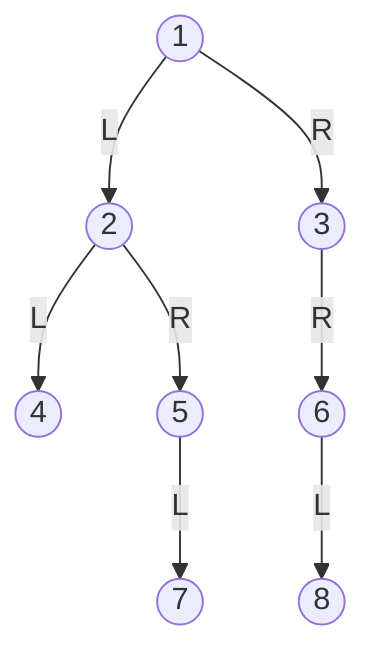
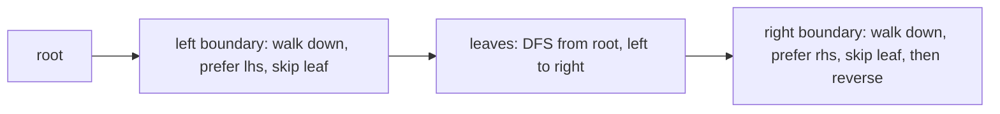
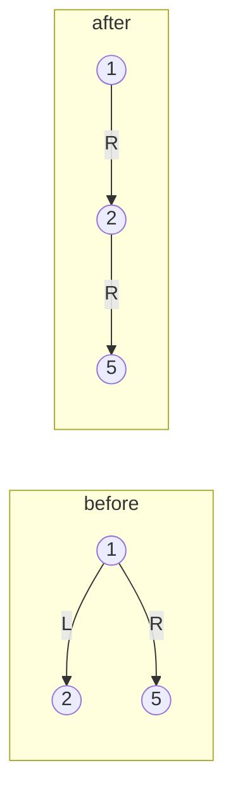

# Binary trees

LeetCode / GFG answers; they keep the judge's signatures. Tree nodes are the judge's `Node` / `TreeNode` with the
children renamed to `lhs` / `rhs` (the judges call them `left` / `right`, so rename when submitting). `n` is the
number of nodes, `h` the height (`h = n` for a path, about `log n` when balanced), and recursion depth equals `h`.
There is no test file for this folder: `python tools/check.py` only compile-checks the snippets.

**Files:** see the groups below · **Needs:** none (the judge supplies `Node` / `TreeNode`) · **Tests:** none

Traversals (pre / in / post / level / vertical order, recursive, iterative, Morris) have their own full README:
[`traversals/`](traversals/README.md).

All views below use one example tree (every value distinct):

| Question on the example | Answer |
|---|---|
| left view / right view | `1 2 4 7` / `1 3 6 8` |
| top view / bottom view | `4 2 1 3 6` / `4 7 5 8 6` |
| boundary | `1 2 4 7 8 6 3` |
| spiral | `1 2 3 6 5 4 7 8` |
| max width / diameter (in nodes) | `3` / `7` (path 7-5-2-1-3-6-8) |
| root-to-leaf paths | `1 2 4`, `1 2 5 7`, `1 3 6 8` |
| LCA(7, 4) / nodes at distance 2 from node 2 | `2` / `3 7` |

## Files by pattern

- **Views (one value per depth or per column):** `left_view.cpp`, `right_view.cpp`, `top_view.cpp`, `bottom_view.cpp`
- **Level based:** `find_spiral.cpp`, `get_max_width.cpp`
- **Whole-tree shape:** `boundary.cpp`, `diameter.cpp`, `is_symmetric.cpp`, `flatten.cpp`
- **Paths and ancestors:** `paths.cpp`, `lca.cpp`, `k_distance_nodes.cpp`
- **Build / encode:** `construct_preorder_inorder.cpp`, `construct_posstorder_inorder.cpp`,
  `serialize_deserialize.cpp`

## Views

### `left_view.cpp`: left view of a binary tree
**Problem:** print the nodes visible when the tree is seen from the left, i.e. the first node of every level
(`vector<int> lhsView(Node*)`). GFG "Left View of Binary Tree" (link not verified).
**Idea:** DFS that visits `lhs` before `rhs` and records `mp[depth]` only the first time a depth is reached; the
map is then read in increasing depth.
**Complexity:** time O(n log h) (n visits, map of at most h depths); extra space O(h) recursion + O(h) map.
**Pitfalls:** an empty tree returns an empty vector. Because the first visit per depth wins, the left-first DFS
order is essential.

### `right_view.cpp`: right view of a binary tree
**Problem:** the last node of every level, seen from the right (`rhsView`). LeetCode 199
(https://leetcode.com/problems/binary-tree-right-side-view/).
**Idea:** the mirror of `left_view.cpp`: DFS visiting `rhs` first, keep the first value reached per depth.
**Complexity:** time O(n log h), extra space O(h) (recursion and map).
**Pitfalls:** empty tree returns empty. A left-only chain still shows up because a deeper level has no right
node, which the depth map handles naturally.

### `top_view.cpp`: top view of a binary tree
**Problem:** the nodes visible from above, one per horizontal distance from the root (`topView`). GFG "Top View of
Binary Tree" (link not verified).
**Idea:** BFS carrying a column `x` (left child `x - 1`, right child `x + 1`); the first node that reaches a column
is the topmost, so `mp[x]` is set only if absent. The map is read in increasing `x`.
**Complexity:** time O(n log n) worst case (map of up to n columns), extra space O(n) (queue plus map).
**Pitfalls:** it pushes `{root, 0}` without a null check, so an empty tree dereferences null. BFS (not DFS) is
needed: a DFS could reach a column first through a deeper node.

### `bottom_view.cpp`: bottom view of a binary tree
**Problem:** the nodes visible from below, one per column (`bottomView`). GFG "Bottom View of Binary Tree" (link
not verified).
**Idea:** same BFS as `top_view.cpp`, but `mp[x]` is overwritten every time, so the last node reaching a column
in BFS order (the deepest, and the rightmost on ties) stays.
**Complexity:** time O(n log n), extra space O(n).
**Pitfalls:** no null check on the root (empty tree crashes). Ties at the same depth and column are resolved to the
right one in BFS order.

## Level based

### `find_spiral.cpp`: level order in spiral (zigzag) form
**Problem:** print the levels alternately, the root first, then level 2 left to right, level 3 right to left, and so
on (`vector<int> findSpiral(Node*)`). GFG "Level order traversal in spiral form" (link not verified; LeetCode 103
is the same idea but returns a list per level and starts left to right).
**Idea:** a normal queue-based BFS where, per level, the children are collected in `v` (left, right when `lev == 1`,
right, left otherwise), appended to the answer, and then pushed to the queue in reverse so that the next level is
processed in the opposite order. `lev` flips each round.
**Complexity:** time O(n), extra space O(w) for the queue and `v`, where w is the widest level.
**Pitfalls:** the root is added before the loop, so level 1 is not reversed; an empty tree returns empty. Because
the queue order is reversed, a level's children are produced in the opposite order from how they sit in the tree,
which is exactly what flips the next level.

### `get_max_width.cpp`: maximum width of a tree
**Problem:** the maximum number of nodes on any single level (`int getMaxWidth(Node*)`). GFG "Maximum Width of Tree"
(link not verified). Not LeetCode 662, which counts null gaps between the leftmost and rightmost node.
**Idea:** DFS with depth, `mp[depth]++`, then take the largest count.
**Complexity:** time O(n log h) because of the map (use a vector indexed by depth for O(n)); extra space O(h).
**Pitfalls:** the empty tree is not handled (it dereferences `root`); the answer starts at 1.

## Whole-tree shape

### `boundary.cpp`: boundary traversal
**Problem:** anticlockwise boundary: root, left boundary (without leaves), all leaves left to right, right boundary
(without leaves) bottom to top (`vector<int> boundary(Node*)`). GFG "Boundary Traversal of binary tree" (link not
verified).
**Idea:** three independent pieces joined together.

On the example: root `1`, left boundary `2` (`4` is a leaf, so it is left to the leaves), leaves `4 7 8`, right
boundary collected top-down as `3 6` and reversed to `6 3`: `1 2 4 7 8 6 3`.
**Complexity:** time O(n) (the leaf DFS visits every node, the two walks are O(h)); extra space O(h).
**Pitfalls:** a single-node tree returns just the root (early return, so the root is not repeated as a leaf). A
boundary walk must stop at a leaf so leaves are not printed twice. Left boundary prefers `lhs` but falls back to
`rhs`, and the right boundary the other way round.

### `diameter.cpp`: diameter of a binary tree
**Problem:** the number of nodes on the longest path between any two nodes (`int diameter(Node*)`). GFG "Diameter of
a Binary Tree" (link not verified; LeetCode 543 counts edges, i.e. this answer minus 1).
**Idea:** postorder; `f` returns the height of a subtree and updates `ans = max(ans, h1 + h2 + 1)` at every node,
because the best path through a node joins its two deepest subtrees.
**Complexity:** time O(n), extra space O(h).
**Pitfalls:** nodes are counted, not edges. `ans` starts at 1, so an empty tree returns 1 instead of 0. The longest
path need not pass through the root (the example's passes through it, a lopsided tree's does not).

### `is_symmetric.cpp`: symmetric tree
**Problem:** is the tree a mirror image of itself around its root (`bool isSymmetric(Node*)`). LeetCode 101
(https://leetcode.com/problems/symmetric-tree/).
**Idea:** compare two nodes at a time: the pair `(l1, r2)` must both exist and carry equal data, and recursion
continues on the mirrored pairs (`l1->lhs` with `r2->rhs`, `l1->rhs` with `r2->lhs`). Started with `f(root, root)`.
**Complexity:** time O(n) (starting from `(root, root)` examines the two halves mirrored, so each node is visited at most
twice), extra space O(h).
**Pitfalls:** structure must match as well as values, which is what the existence checks on `l1/r2` and `r1/l2` do.
An empty tree is symmetric; a single node is too.

### `flatten.cpp`: flatten a binary tree to a linked list
**Problem:** rearrange the tree in place into a right-leaning list in preorder (`void flatten(Node*)`). LeetCode 114
(https://leetcode.com/problems/flatten-binary-tree-to-linked-list/).
**Idea:** the recursive function returns the tail of the flattened subtree. For a node with a left subtree: the
left tail's `rhs` is set to the old right child, the node's `rhs` becomes the old left child, `lhs` becomes null.
The returned tail is the right tail if a right subtree exists, otherwise the left tail.

**Complexity:** time O(n), extra space O(h) recursion.
**Pitfalls:** `root` must not be null (no check). Leaves return themselves as the tail. Recursion depth is `h`, so a
chain of 10^5 nodes needs the large stack the judges give.

## Paths and ancestors

### `paths.cpp`: all root-to-leaf paths
**Problem:** return every root-to-leaf path as a vector of values (`vector<vector<int>> Paths(Node*)`), left paths
first. GFG "Root to leaf paths" (link not verified; LeetCode 257 returns strings).
**Idea:** DFS with a shared `path` vector: push a child before recursing, pop after (backtracking), copy `path` into
the answer at a leaf.
**Complexity:** time O(L * h) where L is the number of leaves (each leaf copies a path of length up to `h`), which
is O(n * h) at worst; extra space O(h) besides the output.
**Pitfalls:** empty tree returns empty. A node with one child is not a leaf, so the path continues.

### `lca.cpp`: lowest common ancestor
**Problem:** lowest common ancestor of the nodes holding values `n1` and `n2` (`Node* lca(Node*, int, int)`).
GFG "Lowest Common Ancestor in a Binary Tree"; LeetCode 236 is the node-pointer version (link not verified).
**Idea:** DFS keeping the current root-to-node path; when a node with value `n1` or `n2` is reached, copy the path.
The LCA is the last node shared by the two copied paths (the shorter path's last node if one is an ancestor of
the other).
**Complexity:** time O(n) (only two paths are copied, each O(h)), extra space O(h).
**Pitfalls:** it asserts `ans.size() <= 2` but then needs both values to exist: a missing value, or `n1 == n2`
(found only once), indexes `ans[1]` out of range. Values must be distinct. Prefer the single-pass recursion
(return the node when found, combine at the node that sees both sides) when the judge allows.

### `k_distance_nodes.cpp`: nodes at distance K from a target
**Problem:** all node values exactly `k` edges away from the node with value `target`, in increasing order
(`vector<int> KDistanceNodes(Node*, int target, int k)`). GFG "Nodes at given distance in binary tree"; LeetCode 863
is the node-pointer version (link not verified).
**Idea:** a tree is a graph if every node knows its parent. One DFS fills `mp[child] = parent` and finds the target
node; a second DFS starts at the target and walks to `lhs`, `rhs` and the parent, never back to the node it came
from, and collects nodes when the depth reaches `k`.
**Complexity:** time O(n + m log m) (m answers sorted), extra space O(n) for the parent map.
**Pitfalls:** if the target is absent, `node` is uninitialised (undefined behaviour). Duplicate values would pick the
last match. `k = 0` returns the target alone.

## Build and encode

### `construct_preorder_inorder.cpp`: build from preorder and inorder
**Problem:** rebuild the tree from its preorder and inorder arrays (`TreeNode* buildTree(vector<int>& preorder,
vector<int>& inorder)`). LeetCode 105
(https://leetcode.com/problems/construct-binary-tree-from-preorder-and-inorder-traversal/).
**Idea:** the first preorder element of a range is the root; its position `ind` in the inorder array splits the
range: the left subtree has `ind - inL` elements. A hash map from value to inorder index gives `ind` in O(1). Ranges
`[preL, preR]` and `[inL, inR]` are passed down, with no array copies.
**Complexity:** time O(n), extra space O(n) for the map plus O(h) recursion.
**Pitfalls:** values must be distinct. An empty input crashes (`f` is called unconditionally with `n - 1 = -1`).
Memory is allocated with `new` and never freed (judge style).

### `construct_posstorder_inorder.cpp`: build from postorder and inorder
**Problem:** rebuild the tree from inorder and postorder (`TreeNode* buildTree(vector<int>& inorder,
vector<int>& postorder)`). LeetCode 106
(https://leetcode.com/problems/construct-binary-tree-from-inorder-and-postorder-traversal/). The file name carries
a typo (`posstorder`); the trigger is the same.
**Idea:** mirror of the previous one: the last postorder element of a range is the root; the left subtree occupies
the first `ind - inL` postorder elements, the right subtree the rest before the root.
**Complexity:** time O(n), extra space O(n) map + O(h) recursion.
**Pitfalls:** distinct values only; empty input crashes the same way.

### `serialize_deserialize.cpp`: serialize and deserialize
**Problem:** turn a tree into a `vector<int>` and back (`vector<int> serialize(Node*)`, `Node* deSerialize(vector<int>&)`).
GFG "Serialize and Deserialize a Binary Tree"; LeetCode 297 uses strings (link not verified).
**Idea:** level-order with `-1` for a null child; every real node contributes both of its children (null or not),
so the array has `2 * (#nodes) + 1` entries. Deserialize walks the same queue: for each queue node take the next two
entries as its left and right children.
**Complexity:** time O(n), extra space O(w) queue (plus the output O(n)).
**Pitfalls:** `-1` is the null sentinel, so a node with value -1 breaks it. An empty tree serializes to `[-1]`, which
`deSerialize` turns into a one-node tree (a bug). It asserts the length is odd. Trailing nulls are kept (not
minimal).
