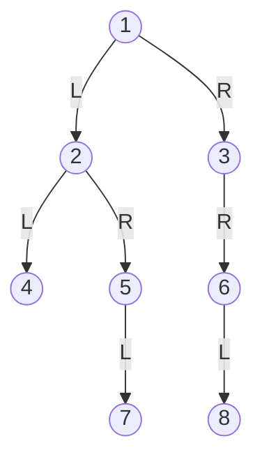
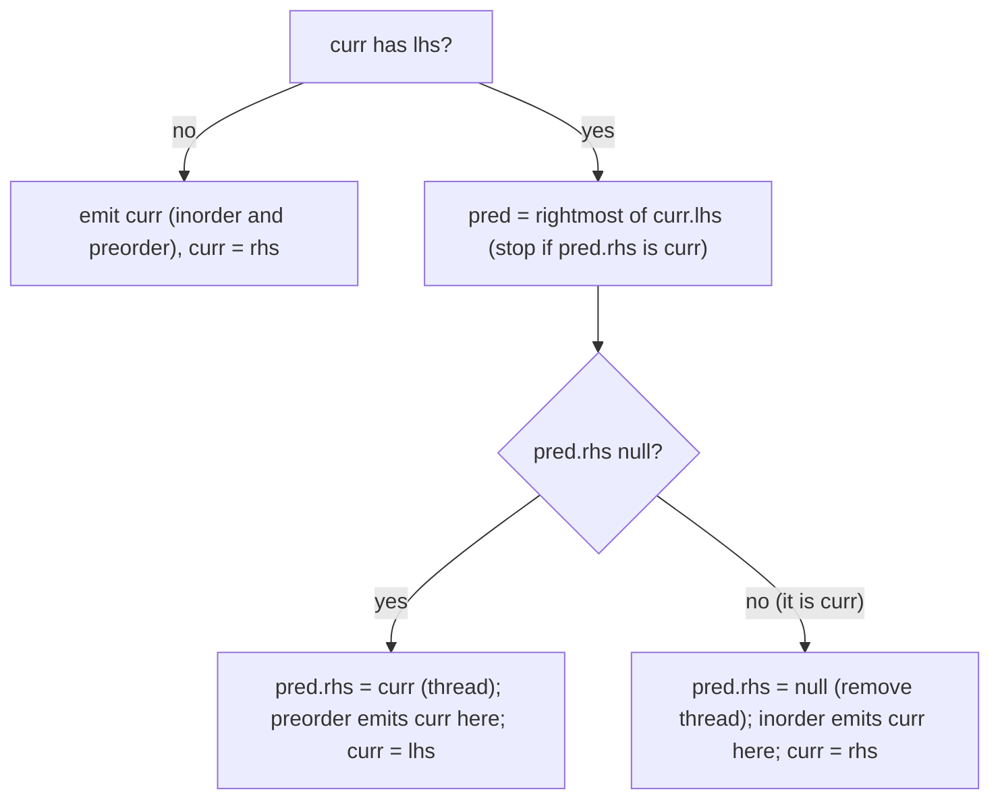

# Binary tree traversals

The standard ways to visit every node of a binary tree once: preorder, inorder, postorder (each recursive, iterative
with an explicit stack, and Morris), plus level order and vertical order. They answer "give me the nodes in this
order" and are the building blocks for the other snippets in [`binary_trees/`](../README.md).

**Files:** `pre_order/pre_order.cpp`, `pre_order/pre_order_iterative.cpp`, `inorder/in_order.cpp`,
`inorder/in_order_iterative.cpp`, `post_order/post_order.cpp`, `post_order/post_order_iterative.cpp`,
`morris/morris_pre_order.cpp`, `morris/morris_in_order.cpp`, `morris/morris_post_order.cpp`, `level_order.cpp`,
`vertical_order.cpp` (aliases `binary_trees_<camelCaseName>`, e.g. `binary_trees_inOrder`) · **Needs:** none (the
judge supplies `Node` with `data`, `lhs`, `rhs`) · **Tests:** none (compile-checked by `tools/check.py` only)

## Problems it solves
- "Print / return the preorder, inorder, postorder or level order of a tree" (LeetCode 144, 94, 145, 102, GFG
  equivalents). Inorder of a BST is sorted; preorder serializes a tree; postorder visits children before the parent
  (deleting, evaluating expression trees).
- Vertical order (LeetCode 314, GFG "Vertical Traversal"): group nodes by horizontal distance from the root.
- When the tree is deep (a path of 10^5 or more nodes) and recursion could overflow the stack, use the iterative
  versions; when even O(h) memory is too much (the classic "O(1) extra space" follow-up), use Morris.
- Not needed when you only need a property of the tree (height, diameter): a plain recursion suffices, and level
  based questions (views, width) are BFS variants, see the parent README.

## API
All take the root and return the values in visiting order. Empty tree: see the pitfalls.
```cpp
vector<int> preOrder(Node* root);           // pre_order.cpp, pre_order_iterative.cpp (same name, pick one)
vector<int> inOrder(Node* root);            // in_order.cpp, in_order_iterative.cpp
vector<int> postOrder(Node* root);          // post_order.cpp, post_order_iterative.cpp
vector<int> morrisPreOrder(Node* root);     // morris_pre_order.cpp
vector<int> morrisInOrder(Node* root);      // morris_in_order.cpp
vector<int> morrisPostOrder(Node* root);    // morris_post_order.cpp
vector<vector<int>> levelOrder(Node* root); // one vector per level
vector<int> verticalOrder(Node* root);      // columns left to right, top to bottom inside a column
```
The recursive and iterative variants of one order share the function name, so paste only one of them.

## Complexity
| Variant | Time | Extra space (besides the output) |
|---|---|---|
| recursive pre / in / post | O(n) | O(h) call stack |
| iterative pre / in / post | O(n) | O(h) explicit stack |
| Morris pre / in / post | O(n) | O(1) |
| `levelOrder` | O(n) | O(w) queue, w = widest level |
| `verticalOrder` | O(n log n) | O(n): `map<int, vector<int>>` keyed by column, plus the queue |

h is the tree height (`n` for a path, about `log n` when balanced). Iterative stacks hold at most one root-to-node
path. Morris is O(n) overall although it walks to the predecessor each time: each tree edge is followed a constant
number of times (down once to create the thread, once more to find it again and remove it). Morris post-order
additionally reverses the answer vector (O(n) time, still no extra structure besides the output).

## How it works
One example tree (every order below is computed on it):



| Order | Result |
|---|---|
| preorder (node, left, right) | `1 2 4 5 7 3 6 8` |
| inorder (left, node, right) | `4 2 7 5 1 3 8 6` |
| postorder (left, right, node) | `4 7 5 2 8 6 3 1` |
| level order | `[1] [2 3] [4 5 6] [7 8]` |
| vertical order (columns -2..2) | `4 2 7 1 5 3 8 6` (columns `[4] [2 7] [1 5] [3 8] [6]`) |

In the vertical order, node `1` is column 0, a left child is `x - 1`, a right child `x + 1`; inside a column nodes
come in BFS order (`2` before `7`, `1` before `5`, `3` before `8`).

**Recursive.** The three orders differ only in where the `push_back` sits relative to the two recursive calls.
They use a self-recursive lambda `f(f, node)`.

**Iterative.**
- Preorder: stack seeded with the root; pop, emit, push `rhs` then `lhs` so that `lhs` is popped first.
- Inorder: go left as far as possible pushing nodes; when stuck, pop, emit, and move to its `rhs`.
- Postorder: one stack. Go left pushing; at a null look at the stack top's `rhs`. If it exists, descend into it. If
  not, pop and emit the top, then keep popping and emitting every ancestor whose `rhs` is the node just emitted (its
  right subtree is done).

**Morris** replaces the stack with temporary threads in the tree: for a node with a left child, find its inorder
predecessor (rightmost node of the left subtree). If that node's `rhs` is null, set it to the current node (the
thread) and go left; if it already points to the current node, the left subtree is finished: remove the thread and
move right.



Preorder emits at the first visit (thread creation), inorder at the second visit (thread removal). Morris
post-order runs the mirrored preorder (node, right, left, threading through `lhs`) and reverses the result, which
gives left, right, node.

## Pitfalls and variants
- When to pick what: recursion is shortest and fine unless depth can reach 10^5 (then raise the stack as the judge
  allows, or go iterative); iterative stack versions are the safe default; Morris only when O(1) extra memory is
  the requirement, because the code is easy to get wrong.
- Morris temporarily modifies the tree (threads `rhs` or, for post-order, `lhs`). It restores every thread when the
  traversal runs to the end, but the tree is not safe for concurrent readers meanwhile, and an exception or early
  exit in the middle would leave threads behind. It also cannot be used on a tree that must stay read-only.
- Empty tree: recursive, `in_order_iterative`, `post_order_iterative`, Morris, `level_order` return an empty result.
  `pre_order_iterative` pushes the root before checking it, so a null root crashes. `vertical_order` pushes
  `{root, 0}` unconditionally and also crashes on a null root.
- Duplicate values are fine for traversals (no lookup by value).
- `levelOrder` returns the levels; the views and spiral in the parent README are variations of this BFS.
- `verticalOrder` is BFS-based, so equal-column nodes come out top to bottom, left to right (the LeetCode 987
  variant sorts equal depth by value, not done here).

## Practice
- LeetCode: 144 Binary Tree Preorder Traversal, 94 Inorder, 145 Postorder, 102 Level Order, 314 Vertical Order
  Traversal (and 987 for the sorted variant).
- Follow-ups: 230 Kth Smallest in a BST via inorder, 173 BST Iterator (stack-based inorder).
