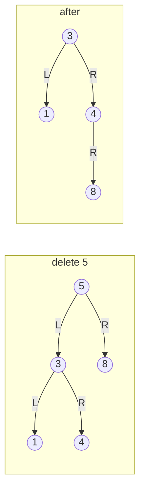

# Binary search trees

LeetCode / GFG answers; they keep the judge's signatures. A BST keeps every key in the left subtree smaller than the
node and every key in the right subtree larger, so a search is a single root-to-leaf walk and an inorder traversal
is sorted. Nodes are the judge's `Node` (`data`, or `key` in `find_pre_suc.cpp`) or `TreeNode` (`val`) with the
children renamed `lhs` / `rhs`; rename them back when submitting. `h` is the tree height (`n` for a degenerate
chain, about `log n` when balanced). No test file here: `python tools/check.py` only compile-checks the snippets.

**Files:** see the groups below · **Needs:** none (the judge supplies the node type) · **Tests:** none

## Files by pattern

- **Point queries (walk down, O(h)):** `search.cpp`, `insert.cpp`, `delete_node.cpp`, `find_ceil.cpp`,
  `find_floor.cpp`, `find_pre_suc.cpp`, `lca.cpp`
- **Inorder is sorted:** `kth_smallest_element.cpp`, `bst_iterator.cpp`, `flatten.cpp`, `merge.cpp`
- **Validate and repair:** `is_bst.cpp`, `correct_bst.cpp`, `largest_bst.cpp`
- **Build:** `bst_from_preorder.cpp`

## Point queries

### `search.cpp`: search in a BST
**Problem:** does the value `x` exist (`bool search(Node*, int)`)? GFG "Search a node in BST" / LeetCode 700 (link
not verified).
**Idea:** compare with the current node and go left or right.
**Complexity:** time O(h), extra space O(1) (iterative).
**Pitfalls:** an empty tree returns false. O(n) on a degenerate chain.

### `insert.cpp`: insert into a BST
**Problem:** insert `x` and return the root (`Node* insert(Node*, int)`). GFG "Insert a node in a BST" / LeetCode 701
(link not verified).
**Idea:** walk down like a search and hang a new leaf where the walk falls off; a key already present is left alone.
**Complexity:** time O(h), extra space O(1).
**Pitfalls:** `root` must not be null (it is dereferenced first). Duplicates are ignored, not stored.

### `delete_node.cpp`: delete a node from a BST
**Problem:** remove the node with key `x` and return the root (`Node* deleteNode(Node*, int)`). LeetCode 450
(https://leetcode.com/problems/delete-node-in-a-bst/).
**Idea:** not the textbook successor swap. The node is removed by promoting its left subtree and hanging its right
subtree under the rightmost node of the left subtree (everything on the right is bigger than everything on the
left, so the BST property holds). A node without a left child is simply replaced by its right child. The root is
handled separately because it has no parent whose pointer can be rewritten; the loop then keeps a parent `temp` and
checks its two children.

**Complexity:** time O(h) (one walk down, plus a walk down the right spine of the left subtree), extra space O(1).
The tree can get taller than the textbook version, up to h(left) + h(right).
**Pitfalls:** an empty tree crashes (the root is read before the loop). A key that is absent returns the root
unchanged. After a deletion the loop keeps descending to the (now replaced) child, which is harmless but wasted.
Deleting the only node returns null. Duplicate keys are not expected.

### `find_ceil.cpp`: ceil in a BST
**Problem:** the smallest key `>= x`, or `-1` if there is none (`int findCeil(Node*, int)`). GFG "Ceil in BST" (link
not verified).
**Idea:** at a node with `data >= x` it is a candidate and a smaller one can only be on the left; otherwise go right.
`ans = min(...)` keeps the best candidate.
**Complexity:** time O(h), extra space O(1).
**Pitfalls:** `INT_MAX` is the "none" sentinel, so a tree whose ceiling is `INT_MAX` itself is reported as `-1`.

### `find_floor.cpp`: floor in a BST
**Problem:** the largest key `<= x`, or `-1` if there is none (`int findFloor(Node*, int)`). GFG "Floor in BST"
(link not verified).
**Idea:** at a node with `data <= x` it is a candidate and a larger one can only be on the right; otherwise go left.
**Complexity:** time O(h), extra space O(1).
**Pitfalls:** BUG in the code: it starts with `ans = -1` and updates with `min(ans, root->data)`, so for
non-negative keys `ans` can never leave `-1`. It must be `max` to return the floor (see the findings list).

### `find_pre_suc.cpp`: inorder predecessor and successor
**Problem:** for key `x`, set `pre` to the largest key `< x` and `suc` to the smallest key `> x` through reference
parameters (`void findPreSuc(Node*, Node*& pre, Node*& suc, int x)`, nodes use `key`). GFG "Predecessor and Successor"
(link not verified).
**Idea:** two independent walks. For the predecessor: when `x > temp->key` the node is a candidate and the answer
may be bigger, go right; else go left. The successor is symmetric.
**Complexity:** time O(h), extra space O(1).
**Pitfalls:** `x` need not be in the tree. `pre` / `suc` are only assigned if a candidate exists, so the caller
must initialise them to null. Both comparisons are strict, so an equal key is never its own predecessor.

### `lca.cpp`: LCA in a BST
**Problem:** the lowest common ancestor of the keys `n1` and `n2` (`Node* LCA(Node*, int, int)`). GFG "LCA in a
BST"; LeetCode 235 (link not verified).
**Idea:** order the keys. While both are on the same side of the current node, go to that side; the first node with
`n1 <= data <= n2` splits them and is the LCA.
**Complexity:** time O(h), extra space O(1).
**Pitfalls:** assumes both keys exist. If the walk runs off the tree the function falls off the end without
returning (undefined behaviour). Unlike the generic tree LCA, no path storage is needed. The trigger is `bst_lca`
(alias `bst_LCA`) because `lca` is already taken by the binary-tree snippet.

## Inorder is sorted

### `kth_smallest_element.cpp`: k-th smallest in a BST
**Problem:** the k-th smallest key, `-1` if `k` is out of range (`int KthSmallestElement(Node*, int k)`). GFG "K-th
smallest element in BST"; LeetCode 230 (link not verified).
**Idea:** inorder recursion that returns the size of the visited subtree and carries `pos`, the number of keys that
must still come before the answer. In the node, `eleL` keys are in the left subtree; if `eleL == pos` the node is
the answer, otherwise the right call continues with `pos - eleL - 1`. A negative `pos` prunes the call.
**Complexity:** time O(h + k) (one descent to the leftmost leaf plus about k nodes), extra space O(h).
**Pitfalls:** `k = 0` or `k > n` returns `-1`. The returned sizes are truncated after pruning, so they are not real
subtree sizes: do not reuse them.

### `bst_iterator.cpp`: BST iterator (inorder, in either direction)
**Problem:** `next()` returns the next smallest key and `hasNext()` tells whether any remain, using O(h) memory
(`BSTIterator(TreeNode*, bool reverse)`). LeetCode 173
(https://leetcode.com/problems/binary-search-tree-iterator/). `reverse = true` yields keys from the largest down,
which is how two-sum on a BST (LeetCode 653) uses a forward and a backward iterator together. Marked `@fragment`
(class that needs the judge's `TreeNode`).
**Idea:** a stack holds the path to the next node: `pushAll` goes left (or right when reversed) from a node and
pushes everything on the way. `next()` pops the top and pushes the left spine of its right child (mirrored when
reversed).
**Complexity:** `next` amortised O(1) (each node is pushed and popped once), worst case O(h); `hasNext` O(1);
space O(h).
**Pitfalls:** `next()` on an exhausted iterator reads an empty stack (undefined behaviour); check `hasNext()`
first. The member variable `reverse` is a flag, not `std::reverse`.

### `flatten.cpp`: flatten a BST to a sorted list
**Problem:** relink the tree in place into a singly linked list in sorted order through `rhs` pointers, returning
`{head, tail}` (the helper `pair<Node*, Node*> f(Node*)`, trigger `bst_flatten`). Used as a building block for
`merge.cpp`.
**Idea:** recursion returns the head and tail of the flattened subtree. Flatten the right subtree and keep it as
`temp->rhs`; flatten the left subtree, clear `temp->lhs`, and link the left tail to `temp`; the head is the left
head (or `temp`) and the tail is the right tail (or `temp`).
**Complexity:** time O(n), extra space O(h) recursion.
**Pitfalls:** `temp` must not be null. The tree is destroyed (it becomes a list). The function is called `f`, so it
collides with any other global `f`; it is copied verbatim into `merge.cpp` instead of being pulled in with
`@needs`.

### `merge.cpp`: merge two BSTs into a sorted array
**Problem:** return all keys of two BSTs in increasing order (`vector<int> merge(Node* root1, Node* root2)`). GFG
"Merge two BST's" (link not verified).
**Idea:** flatten both trees into sorted `rhs` lists (the helper `f` of `flatten.cpp`), merge the two lists like in
merge sort (`calc`), then read the merged list into a vector.
**Complexity:** time O(n + m), extra space O(h1 + h2) for the recursion (the lists reuse the nodes); the result is
O(n + m).
**Pitfalls:** both trees are consumed (relinked as lists). A null root crashes `f`. Equal keys from both trees are
all kept (the `<=` takes the first tree's key first). The snippet carries its own copy of `f` and `calc`, which
duplicates `flatten.cpp`.

## Validate and repair

### `is_bst.cpp`: check if a tree is a BST
**Problem:** is the binary tree a valid BST (`bool isBST(Node*)`)? GFG "Check for BST"; LeetCode 98 (link not
verified).
**Idea:** the recursion returns `{min, max}` of each subtree. Every node requires `max(left) < data < min(right)`;
a violation anywhere clears `ans`.
**Complexity:** time O(n), extra space O(h).
**Pitfalls:** the comparisons are strict, so duplicates make the tree invalid. An empty tree is a BST. Comparing
a node only with its direct children would accept a node 5 whose left child 3 has a right child 7; the min/max
propagation is what rejects it.

### `correct_bst.cpp`: recover a BST with two swapped nodes
**Problem:** two keys of a BST were swapped by mistake; fix it by swapping them back without changing the structure
(`void correctBST(Node*)`). GFG "Fixing Two nodes of a BST"; LeetCode 99 (link not verified).
**Idea:** the inorder sequence of a BST is increasing, so the swap creates one or two descents `prev > cur`.

Adjacent keys swapped give a single descent: swap its two members. Otherwise swap the `prev` of the first descent
with the `cur` of the second (`startP`, `midP`, `endP` in the code).
**Complexity:** time O(n), extra space O(h) recursion (the O(1)-space follow-up needs Morris).
**Pitfalls:** it assumes the tree really has exactly two swapped values; a valid BST leaves `startP` null and
crashes. Empty tree crashes. Only the values are swapped, not the nodes.

### `largest_bst.cpp`: largest BST subtree
**Problem:** the size (number of nodes) of the largest subtree that is a BST (`int largestBst(Node*)`). GFG
"Largest BST"; LeetCode 333 (link not verified).
**Idea:** postorder, returning for each subtree a 4-tuple `arr = {is_bst, min, max, size}` (`arr` is a judge or
caller alias for four ints, not defined in the file). A node is a BST root if both children are BSTs,
`max(left) < data` and `min(right) > data`; then its size is `1 + sizes`, and the best size seen is kept in `ans`.
**Complexity:** time O(n), extra space O(h).
**Pitfalls:** the answer starts at 1, so an empty tree gives 1 (and crashes before that, since the root is
dereferenced). Strict comparisons, so duplicates are not allowed inside a BST.

## Build

### `bst_from_preorder.cpp`: build a BST from preorder
**Problem:** rebuild the BST from its preorder traversal (`TreeNode* bstFromPreorder(vector<int>&)`). LeetCode 1008
(https://leetcode.com/problems/construct-binary-search-tree-from-preorder-traversal/).
**Idea:** keep a global index `i` and an upper bound `ub`. `f(ub)` takes the next value as a node if it is `<= ub`
(otherwise returns null), builds the left subtree with bound `root->val`, and the right subtree with the inherited
`ub`.
**Complexity:** time O(n) (each value is consumed once), extra space O(h).
**Pitfalls:** distinct values are assumed (a value equal to the bound is accepted into the left subtree). The first
bound is `INT_MAX`. Empty input returns null.
