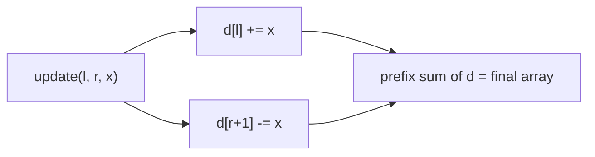

# Difference array (`difference_array`)

Offline range add on an array, then read the whole result once. Each update is O(1); the prefix sums are taken at the end.

**Files:** `difference_array.cpp` (trigger `difference_array`, alias `differenceArray`) · **Needs:** none · **Tests:** `../test_misc_structures.cpp` (`DifferenceArray.RangeAddsMatchBruteForce`)

## Problems it solves
- "Add x to every `a[i]` for `i` in `[l, r]`", many times, and only afterwards ask for the final array.
- Counting how many intervals cover each point; flight bookings, painting, sweep-line style "+1 at `l`, -1 at `r + 1`".
- Not for queries interleaved with updates: use [`fenwick`](../fenwick/README.md) (range add + point query) or a [lazy segment tree](../segment_tree/lazy_sgt/README.md) (range add + range query).

## API
```cpp
difference_array<ll> d(a);        // a is a non-empty vector<ll>
d.update(l, r, x);                // a[l..r] += x, inclusive [l, r]
vector<ll> res = d.resultant();   // the final array
```

## Complexity
| Operation | Time | Memory |
|---|---|---|
| construct | O(n) | 2n + 1 values |
| `update` | O(1) | |
| `resultant` | O(n), recomputed on every call | returns a copy |

`update` touches two cells of the difference array `d_`; `resultant` is one running sum over it.

## How it works
Store `d[i] = a[i] - a[i - 1]`. Adding `x` to `[l, r]` changes only `d[l] += x` and `d[r + 1] -= x`, and the prefix sum of `d` gives the array back.



## Pitfalls and variants
- The constructor reads `a[0]`, so the vector must not be empty.
- Ranges are **inclusive** `[l, r]`; `d_` has `n + 1` cells so `r = n - 1` is fine.
- To start from all zeros pass `vector<ll>(n)`.
- A 2D version (four corner updates + 2D prefix sums) is not in the library.

## Practice
- LeetCode 1109 Corporate Flight Bookings
- Codeforces 295A Greg and Array
- CSES: Range Update Queries (solvable offline)
