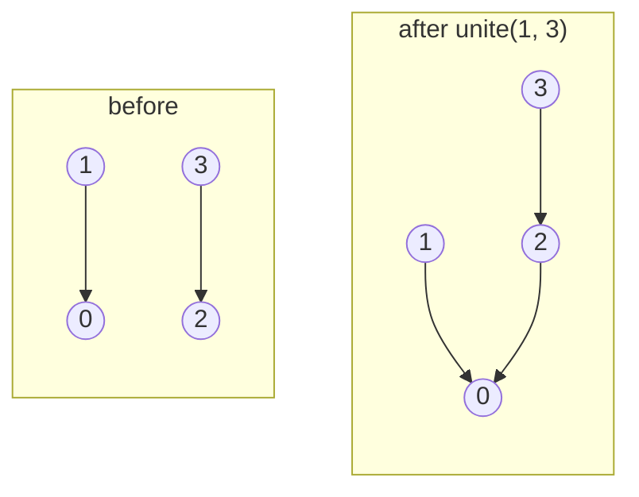

# Disjoint set union (`dsu`, `dsu_rollback`)

Keeps a partition of `0..n-1` under "merge these two sets" and "are these in the same set?".

**Files:** `dsu.cpp` (trigger `dsu`), `dsu_rollback.cpp` (trigger `dsu_rollback`) · **Needs:** none · **Tests:** `test_dsu.cpp`

## Problems it solves
- Connectivity under edge additions, the number of components, the size of a vertex's component.
- Kruskal's MST; detecting a cycle in an undirected graph while reading edges.
- Offline tricks: process queries in reverse to turn deletions into additions; "merge groups" simulations.
- `dsu_rollback` undoes the last union. Use it for divide and conquer over time (offline dynamic connectivity,
  see [`../dynamic_connectivity/`](../dynamic_connectivity/)) or for backtracking searches.

## API
```cpp
dsu d(n);
d.unite(a, b);      // true if a and b were in different sets
d.same(a, b);  d.find(a);  d.size(a);
d.components;       // public field: number of sets

dsu_rollback r(n);
r.unite(a, b);  r.rollback();   // undo the last successful unite (no-op when there is none)
r.same(a, b);  r.size(a);  r.components;
```

## Complexity
| | `unite` / `find` | Memory |
|---|---|---|
| `dsu` (union by size + path compression) | amortized O(α(n)), effectively O(1) | 2n ints |
| `dsu_rollback` (union by rank, no compression) | O(log n); `rollback` O(1) | 3n ints + one record per unite |

Union by size keeps trees shallow, path compression flattens them further; without compression only the O(log n) depth bound remains.

## How it works
Each set is a tree, and `find` walks up to the root. Union by size (or rank) hangs the smaller tree under the
larger one, so depth stays O(log n). Path compression also flattens the path on every `find`. Rollback can't
use path compression, because undoing it would be expensive. So `dsu_rollback` only does union by rank and
pushes the old ranks and sizes on a stack.



## Pitfalls and variants
- `find` in `dsu` is recursive. That is fine with judge stacks, and union by size keeps the depth at O(log n) anyway.
- `rollback` undoes **successful** unites only, which is what divide and conquer over time needs.
- Used by `graph/mst/kruskal.cpp` and by [`../dynamic_connectivity/`](../dynamic_connectivity/README.md) (`dsu_rollback`).
- A weighted / parity DSU (bipartiteness under unions) is not in the library yet.

## Practice
- CSES: Road Construction, Road Reparation (Kruskal)
- Codeforces EDU: Disjoint Sets Union
