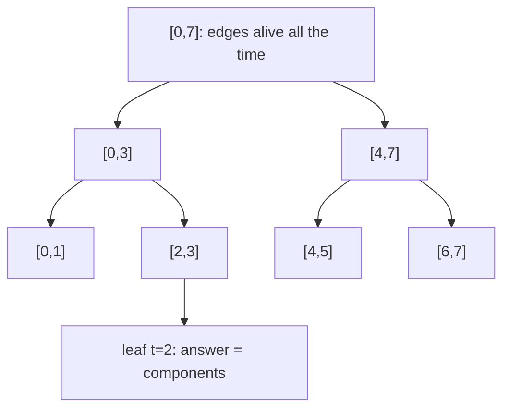

# Offline dynamic connectivity (`dynamic_connectivity`)

Number of connected components after each of `q` time steps, when edges are added and removed over time: a segment tree over time plus a DSU with rollback.

**Files:** `dynamic_connectivity.cpp` (trigger `dynamic_connectivity`; the class is `Dynamic_Connectivity`) · **Needs:** `dsu_rollback` · **Tests:** `test_dynamic_connectivity.cpp` (`DynamicConnectivity.MatchesBruteForce`, `DynamicConnectivity.EdgeCases`)

## Problems it solves
- "Add edge / remove edge / how many components (or are u, v connected) now?", all offline.
- Every edge lives for a known interval of times `[l, r]`; you know the whole sequence in advance.
- Variants: bipartiteness under edge changes (use a parity DSU with rollback), MST under deletions.
- Not for online queries (needs link-cut trees), and not for additions only (a plain [`dsu`](../dsu/README.md) is enough).

## API
```cpp
Dynamic_Connectivity dc(q, n);   // q time steps 0..q-1, n vertices 0..n-1
dc.update(a, b, l, r);           // edge (a, b) is present at times l..r, inclusive; l > r is ignored
dc.dfs();                        // run once after all updates
dc.ans[t];                       // number of components at time t, 0 <= t < q
```
`dc.d` is the underlying `dsu_rollback`. Edit the leaf in `dfs` (`else ans[lo] = d.components;`) to answer something else, such as `d.same(u, v)` for a query attached to time `lo`.

## Complexity
| Operation | Time | Memory |
|---|---|---|
| construct | O(q + n) | 2s vectors, `s` = power of two >= q |
| `update` | O(log q) per edge (the interval splits into O(log q) nodes) | O(m log q) tuples in total |
| `dfs` | O(m log q * log n) | O(log q) recursion |

Each edge is stored in O(log q) tree nodes and united once per node, each `unite` costing O(log n) in `dsu_rollback`.

## How it works
Segment tree over time `[0, s - 1]`. An edge present during `[l, r]` is attached to the O(log q) nodes that exactly cover that interval. A depth-first walk unites the edges of a node on entry, recurses into both children, and rolls the successful unites back on exit. At a leaf, all edges alive at that time have been united.


On entering a node its edges are united; on leaving, the successful unites are rolled back.

## Pitfalls and variants
- Times are `0 .. q - 1`. `ans` has length `s` (a power of two); entries from `q` on are meaningless.
- Edges still alive at the end need `r = q - 1` (any `r >= s - 1` also works).
- Call `dfs()` after all `update` calls.
- Self-loops and duplicate edges are fine: a failed `unite` is simply not rolled back.
- The DSU has no path compression, so `find` is O(log n), not O(alpha(n)).

## Practice
- Codeforces 1140F Extending Set of Points
- Codeforces gym 100551F Connect and Disconnect
- Codeforces 813F Bipartite Checking (parity version)
