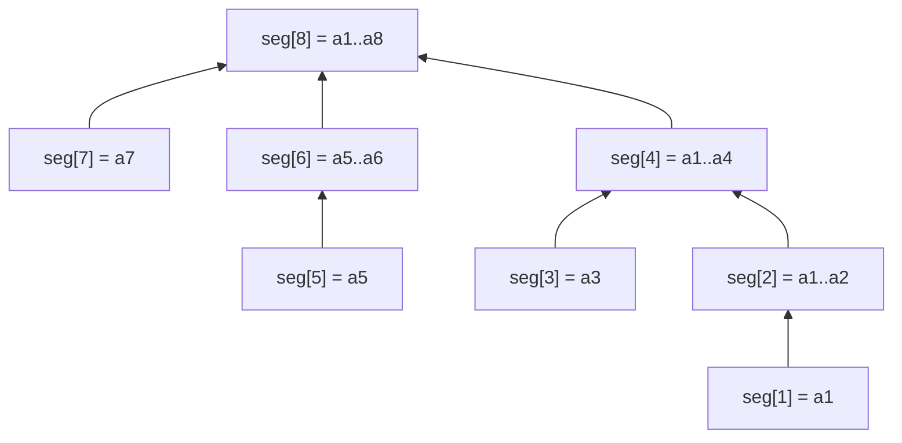

# Fenwick tree (binary indexed tree)

Prefix sums with point updates, in a few lines and with a small constant.

**Files:** `fenwick.cpp` (trigger `fenwick`) · **Needs:** none · **Tests:** `test_fenwick.cpp`

## Problems it solves
- Point add + prefix / range sum, for any invertible associative op (sum, xor).
- Counting inversions, or "how many earlier values are ≤ x" (index by value after coordinate compression).
- Range add + point query: add on the difference array (`add(l, x); add(r + 1, -x);` then `sum(i + 1)`).
- Not for min/max with arbitrary updates (no inverse): use [`seg_tree`](../segment_tree/seg_tree/README.md).

## API
```cpp
fenwick<ll> f(n);   // 0-indexed, all zeros
f.add(i, x);        // a[i] += x
f.sum(i);           // a[0] + ... + a[i - 1]   (half-open [0, i))
f.sum(a, b);        // a[a] + ... + a[b - 1]   (half-open [a, b), unlike the inclusive segment trees)
```

## Complexity
| Operation | Time | Memory |
|---|---|---|
| construct | O(n) | n + 1 values |
| `add` | O(log n) | |
| `sum` | O(log n) | |

Each step of `add` / `sum` moves past one set bit of the index, so at most log n steps.

## How it works
Internally 1-indexed: `seg_[i]` holds the sum of the `i & -i` elements that end at `i`. `add` climbs with
`i += i & -i` and `sum` descends with `i -= i & -i`. Each step moves past one set bit, so both are O(log n).


Arrows show where `add` climbs (1-indexed positions).

## Pitfalls and variants
- Ranges are **half-open**, kept from the original: use `sum(l, r + 1)` for an inclusive `[l, r]`.
- There is no build from a vector: `add` each element (O(n log n), fine in practice).
- A 2D Fenwick and the binary-search descent for the k-th element are not in the library yet.

## Practice
- CSES: Dynamic Range Sum Queries, Salary Queries (with compression)
- SPOJ INVCNT (inversions)
