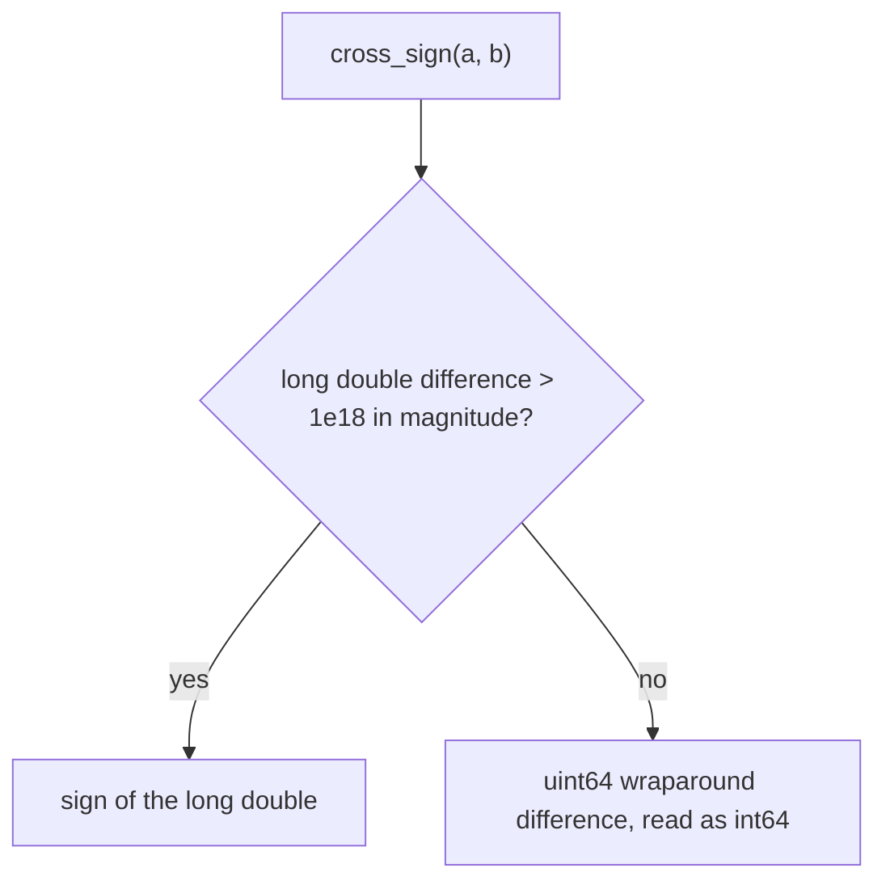

# Exact fractions (`fraction`)

A rational number with 64-bit numerator and denominator: reduces automatically and compares exactly even when the cross products would overflow 64 bits.

**Files:** `fraction.cpp` (trigger `fraction`; credit: nealwu) · **Needs:** none · **Tests:** `test_fraction.cpp` (`Fraction.ArithmeticAndOrderingMatchReference`, `Fraction.PostfixOperatorsCompileUnderDefineInt`)

## Problems it solves
- Exact slopes, ratios and probabilities that must be compared or accumulated without floating-point error: "is a/b < c/d?", sorting by slope.
- Small exact rational arithmetic (sums of 1/k, expected values with small denominators).
- Not for modular answers (use `mint`) or numbers that grow without bound (use a bigint).

## API
```cpp
fraction f(n, d);                       // n/d, default 0/1; the sign moves to the numerator, then reduced
f.numer, f.denom;                       // public int64_t fields
f + g, f - g, f * g, f / g;             // also +=, -=, *=, /=
++f, --f, f++, f--;                     // add or subtract 1
-f, f.inv(), abs(f), f.is_integer();
f == g, f != g, f < g, f > g, f <= g, f >= g;   // exact, via cross_sign
double(f), (long double)(f);            // explicit conversions
cout << f;                              // prints numer/denom
```
Two compile-time switches at the top: `CHECK_OVERFLOW64` (default true: comparisons stay correct for products above 1e18, up to 2x slower) and `AUTO_REDUCE` (default true; if false, call `reduce()` yourself).

## Complexity
| Operation | Time | Memory |
|---|---|---|
| `+ - * /` | O(log(max numer, denom)) for the gcd when `AUTO_REDUCE` | two `int64_t` |
| comparisons | O(1) | |

The reduction is a `__gcd`; a comparison is a couple of multiplications.

## How it works
`cross_sign(a, b)` is the sign of `a.numer * b.denom - b.numer * a.denom`. With `CHECK_OVERFLOW64` it first evaluates the same difference in `long double`; if the magnitude exceeds 1e18 that sign is decisive. Otherwise the exact difference is taken with unsigned wraparound, which is correct because the true value then fits in `int64_t`.



## Pitfalls and variants
- Arithmetic (`+`, `*`, ...) multiplies denominators with no overflow check; only comparisons are protected.
- A zero denominator (`fraction(x, 0)`, `inv()` of 0) hits `__gcd(0, 0) = 0` and divides by zero when `AUTO_REDUCE` is on.
- `operator++` / `--` do not reduce; this is fine only when the fraction is already reduced.
- With `AUTO_REDUCE = false`, comparisons stay exact but you must call `reduce()` before printing.
- Postfix operators take `int32_t` so they compile under `#define int long long`.

## Practice
- No verified problem links yet; typical uses are exact slope comparison in geometry (convex hull, lines) and ratio comparisons.
