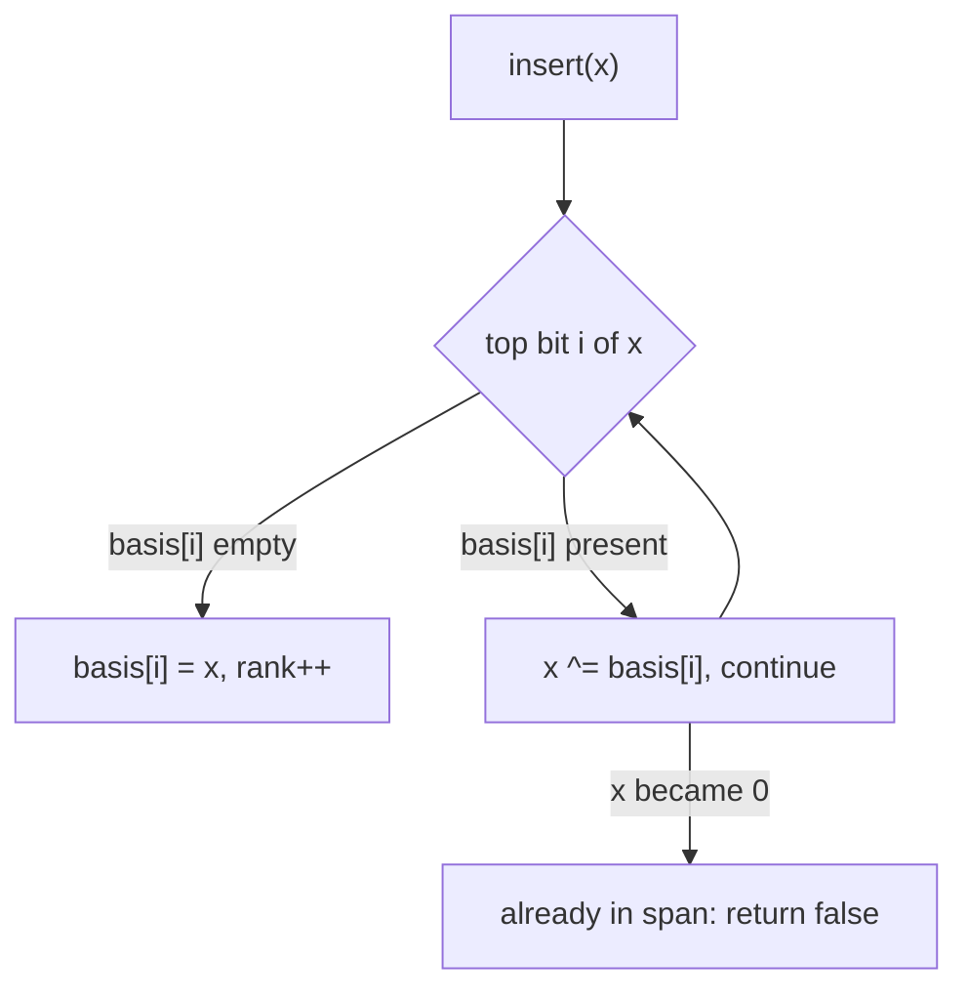

# XOR linear basis (`linear_basis`)

Maintains a basis of the GF(2) span of inserted 60-bit numbers: membership, maximum xor, minimum nonzero xor, and merging two bases.

**Files:** `linear_basis.cpp` (trigger `linear_basis`, alias `LinearBasis`) · **Needs:** none · **Tests:** `../test_misc_structures.cpp` (`LinearBasis.SpanMaxMinAndMergeMatchBruteForce`)

## Problems it solves
- "Maximum xor of a subset of these numbers", "can x be written as the xor of some subset?".
- Cycle space of a graph: xor of a path plus any combination of cycles (insert every cycle xor).
- The number of distinct subset xors is `2^size()`.
- Signals: "xor of a subset", values up to ~1e18 (below 2^60), many queries against a growing set.
- Not for the xor of a *range* of an array with queries: that needs a prefix linear basis (keep the latest index per bit), which is not in the library.

## API
```cpp
linear_basis b;
b.insert(x);         // true if x was independent (rank grew), false if already in the span
b.contains(x);       // is x a xor of inserted values?
b.max_xor(val = 0);  // max of val ^ s over s in the span; with no argument: the maximum in the span
b.min_xor();         // smallest NONZERO element of the span (0 if the basis is empty)
b.size();            // rank; the span has 2^size() elements
b1 + b2;  b1 += b2;  // basis of the union
```

## Complexity
| Operation | Time | Memory |
|---|---|---|
| `insert`, `contains`, `max_xor`, `min_xor` | O(60) | 60 values + a counter |
| merge (`+`, `+=`) | O(60 * 60) | |

Each operation scans the 60 bit positions once; a merge inserts up to 60 vectors.

## How it works
`basis_[i]` is either 0 or a vector whose highest set bit is `i`. `insert` reduces `x` from the top bit down: if bit `i` is set and `basis_[i]` is empty, `x` becomes that vector; otherwise `x ^= basis_[i]`. Reaching 0 means `x` was already in the span. For the maximum, greedily take `res ^ basis_[i]` whenever it is larger, which happens exactly when bit `i` of `res` is clear. The vectors are not fully reduced, which is enough for these queries.



## Pitfalls and variants
- Values must be in `[0, 2^60)`: bits 60 and above are ignored by `insert` and `contains`, which silently gives wrong answers (negative numbers too).
- `min_xor()` is the minimum *nonzero* element of the span, not the minimum of `val ^ s`.
- The k-th smallest element of the span needs a reduced basis; not provided.
- `max_bits = 60` is the knob if you need 63 or 30 bits.

## Practice
- Codeforces 959F Mahmoud and Ehab and yet another xor task
- Codeforces 845G Shortest Path Problem (cycle space)
- Codeforces 724G Xor-matic Number of the Graph
