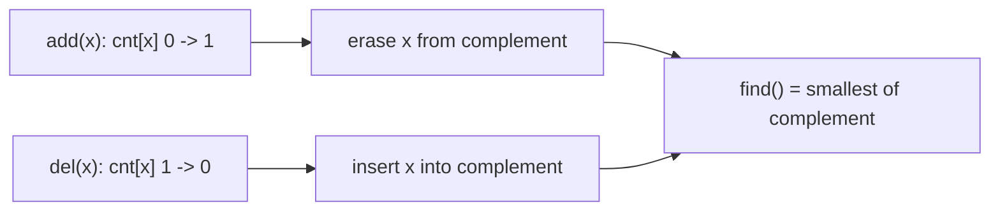

# MEX under insert / delete (`mex`)

A multiset of non-negative integers that reports its MEX (smallest missing value) after every `add` / `del`.

**Files:** `mex_changing_set.cpp` (trigger `mex_changing_set`, alias `Mex_changing_set`; the class is named `mex`) · **Needs:** none · **Tests:** `../test_misc_structures.cpp` (`Mex.AddDeleteMatchesBruteForce`)

## Problems it solves
- Sliding window or dynamic multiset where you need the MEX after each change.
- "Smallest unused id" with release and acquire.
- For a one-shot MEX of a static array use [`calculate_mex`](../../miscellaneous/calculate_mex.cpp) instead.

## API
```cpp
mex m(a);    // build from a vector<int>; capacity n = a.size()
mex m(n);    // empty multiset with capacity n
m.add(x);    // insert one copy of x
m.del(x);    // erase one copy of x (x must be present)
m.find();    // current MEX, at most n
```
Values outside `[0, n)` are ignored by `add` and `del`, so the MEX is capped at `n`.

## Complexity
| Operation | Time | Memory |
|---|---|---|
| construct | O(n log n) | O(n) |
| `add` / `del` | O(log n) | |
| `find` | O(1) | |

`cnt_[x]` counts copies; `complement_` is an ordered `set` of the values in `[0, n]` with count 0, so the MEX is its first element.

## How it works
A value enters `complement_` when its count drops to zero and leaves when it becomes positive. Since `n` is never counted, `complement_` always contains `n`, is never empty, and `*begin()` is the MEX.



## Pitfalls and variants
- `del(x)` for an `x` that is not present drives `cnt_[x]` negative and corrupts the set; delete only what was added.
- Choose `n` at least as large as the largest MEX you can need (for a window of size w, `n = w` is enough).
- The class name `mex` is short and lowercase: it clashes with a variable called `mex`.

## Practice
- LeetCode 2336 Smallest Number in Infinite Set
- Codeforces 817F MEX Queries (range operations; needs a segment tree instead)
