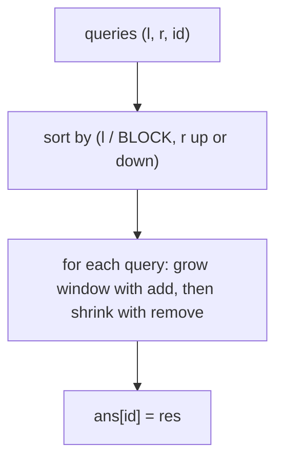

# Mo algorithm (`mo`, `hilbert_order`)

Offline range queries answered by sorting them so that the window `[i, j]` moves only a little between consecutive queries; you provide `add` and `remove` for one element.

**Files:** `mo.cpp` (trigger `mo`; a statement-level template: set `BLOCK`, fill `add` / `remove`), `hilbert_order.cpp` (trigger `hilbert_order`, alias `hilbertorder`) · **Needs:** none · **Tests:** `test_mo.cpp` (`Mo.HilbertOrderIsInjective`; the Mo template itself is untested)

## Problems it solves
- Many (q up to ~2e5) range queries `f(a[l..r])` on a static array that a segment tree cannot merge, but where adding or removing one element is cheap: distinct count, mode, sum of `cnt^2`, inversions in a range.
- Signals: queries given offline, n and q around 1e5 to 2e5, 2 to 4 second limits.
- Not for updates (Mo with updates is not in the library). If `f` merges associatively, use a [`seg_tree`](../segment_tree/seg_tree/README.md).

## API
`mo.cpp` is pasted inside `main`; it reads the input itself and needs `BLOCK` in scope.
```cpp
// before pasting: int BLOCK = ...;   // about n / sqrt(q), or sqrt(n)
// reads q, then q lines "l r" (1-indexed in the input, stored 0-indexed inclusive)
auto add    = [&](int i) -> void { /* include a[i], update res */ };
auto remove = [&](int i) -> void { /* exclude a[i], update res */ };
// the loop sets ans[query index] = res; the template prints ans, one per line
```
Hilbert order, a drop-in replacement for the block comparator:
```cpp
const int logn = 20;                      // 2^logn >= n
ll hilbertorder(int x, int y);            // Hilbert curve index of the point (l, r)
sort(all(query), [&](const auto &x, const auto &y) { return hilbertorder(x[0], x[1]) < hilbertorder(y[0], y[1]); });
```

## Complexity
| Part | Time |
|---|---|
| sorting queries | O(q log q) |
| right pointer | O((N / B) * N) moves over all blocks |
| left pointer | O(Q * B) moves |
| total with B = sqrt(N) | O((N + Q) * sqrt(N) * F), F = cost of `add` / `remove` |

Memory is O(N + Q). These are the bounds from the comment at the top of `mo.cpp`. The Hilbert order gives the same asymptotics with a smaller constant.

## How it works
Queries are sorted by block of `l` (size `BLOCK`), then by `r`, ascending in odd blocks and descending in even blocks (the odd-even trick) so the right pointer sweeps back and forth instead of resetting. The window starts empty (`i = 0, j = -1`) and moves to each query; it grows first (`add`) and then shrinks (`remove`), so counts never go negative.



## Pitfalls and variants
- `BLOCK` is not defined by the template; `n / sqrt(q)` is usually better than `sqrt(n)`.
- The order of the four loops matters: extend (`add(++j)`, `add(--i)`) before contracting.
- `ans` has `q` entries, printed in input order.
- `hilbert_order.cpp` defines globals `logn` and `maxn` (coordinates must be below `maxn`); rename them if they clash.
- Mo on trees, with updates, or with rollback are not in the library.

## Practice
- CSES 1734 Distinct Values Queries (also solvable with a Fenwick tree offline)
- SPOJ DQUERY
- Codeforces 86D Powerful array, 220B Little Elephant and Array
