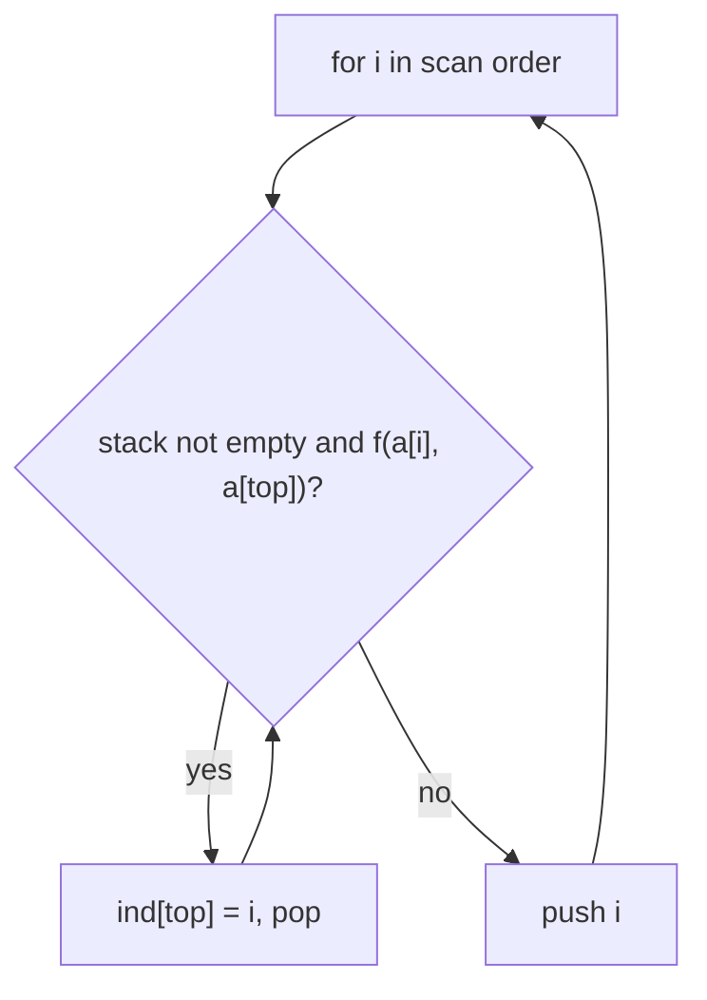

# Monotonic stack (`monotonic_stack`)

For every index, the nearest index to the right (or left) whose value satisfies a comparison: next / previous greater or smaller element in one function.

**Files:** `monotonic_stack.cpp` (trigger `monotonic_stack`) · **Needs:** none · **Tests:** none (the usage lines at the bottom of the file are the examples)

## Problems it solves
- Next / previous greater / smaller element, "days until a warmer day", largest rectangle in a histogram, sum of subarray minimums.
- Counting subarrays where element `i` is the maximum / minimum (use its left and right boundaries).
- Fixed-purpose shorter versions: [`nge`](../../miscellaneous/nge.cpp), [`nse`](../../miscellaneous/nse.cpp).

## API
```cpp
vector<int> monotonic_stack(const vector<int> &a, function<bool(int, int)> f, int one = 0, int fwd = 1);
auto NGE = monotonic_stack(a, [&](const int x, const int y) -> bool { return x > y; }, 0);      // next greater
auto PGE = monotonic_stack(a, [&](const int x, const int y) -> bool { return x > y; }, 0, -1);  // previous greater
auto NSE = monotonic_stack(a, [&](const int x, const int y) -> bool { return x < y; }, 0);      // next smaller
auto PSE = monotonic_stack(a, [&](const int x, const int y) -> bool { return x < y; }, 0, -1);  // previous smaller
```
`ind[i]` is the nearest index `j` (to the right when `fwd = 1`, to the left when `fwd = -1`) with `f(a[j], a[i])` true. If none exists the sentinel is `n` (forward) or `-1` (backward). With `one = 1` the array is 1-indexed (`a[0]` unused) and the sentinels become `n + 1` and `0`.

## Complexity
| Operation | Time | Memory |
|---|---|---|
| one call | O(n) calls to `f` | O(n) for the stack and the answer |

Each index is pushed once and popped at most once.

## How it works
Scan in the chosen direction keeping a stack of indices whose answer is still unknown. When the new element satisfies `f(a[i], a[top])`, `i` is the answer for `top`: pop and record it. Then push `i`. The stack stays monotonic in the compared order.



## Pitfalls and variants
- The comparison is strict: `x > y` skips equal values, so for subarray counts with duplicates use a strict comparison on one side and a non-strict one on the other.
- It takes `function<bool(int, int)>`, which costs an indirect call per comparison; for very tight loops write the loop inline.
- The element type is `int` only (with the boilerplate that is `long long`).
- `one` only changes the index range and the sentinels; pass `one = 1` for a 1-indexed vector with a dummy `a[0]`.

## Practice
- CSES 1645 Nearest Smaller Values
- LeetCode 496 Next Greater Element I, 739 Daily Temperatures, 84 Largest Rectangle in Histogram, 907 Sum of Subarray Minimums
