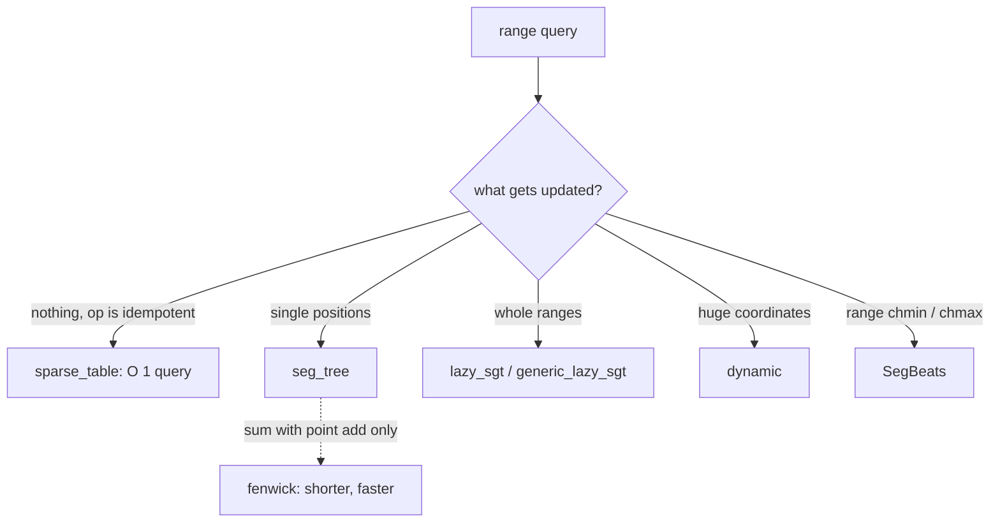

# Segment trees

Range queries with updates over an array. The array trees here are recursive, 0-indexed, sized to a power of two, with inclusive `[l, r]` ranges (exceptions are noted per file).

**Files:** [`seg_tree/`](seg_tree/README.md) · [`lazy_sgt/`](lazy_sgt/README.md) · [`dynamic/`](dynamic/README.md) · `first_element_atleast_x.cpp` (`first_atleast_seg_tree`) · `kth_one_list_removal.cpp` (`kth_one_seg_tree`) · `max_prefix_in_a_to_b.cpp` (`max_prefix_seg_tree`) · `max_sub_array_sum.cpp` (`max_subarray_seg_tree`) · `seg_beats.cpp` (`SegBeats`) · `iterative_query.cpp`, `iterative_update.cpp` · `range_distinct.cpp`, `range_kth_smallest.cpp` · **Needs:** none · **Tests:** `test_segment_tree_apps.cpp` (`SegTreeApps.*`), plus the tests inside each subfolder

## Problems it solves
| Folder / file | Use it for |
|---|---|
| [`seg_tree/`](seg_tree/README.md) | point (or per-position) assign + range merge, any associative merge |
| [`lazy_sgt/`](lazy_sgt/README.md) | range update + range query (`lazy_sgt`: edit hooks; `generic_lazy_sgt`: value / update types) |
| [`dynamic/`](dynamic/README.md) | point add + range sum over a huge index range (sparse nodes) |
| `first_element_atleast_x.cpp` | first index `j >= l` with `a[j] >= x` (max tree + descent), with point assign |
| `kth_one_list_removal.cpp` | k-th remaining element when elements get removed (count tree + descent) |
| `max_prefix_in_a_to_b.cpp` | max prefix sum inside `[a, b]` (node = sum, best prefix) |
| `max_sub_array_sum.cpp` | max subarray sum with point updates (node = sum, prefix, suffix, best) |
| `seg_beats.cpp` | range chmin / chmax / add / assign + range sum / min / max (Segment Tree Beats) |
| `iterative_query.cpp`, `iterative_update.cpp` | `@fragment`: bottom-up member functions to paste into a power-of-two tree |
| `range_distinct.cpp`, `range_kth_smallest.cpp` | whole programs (CSES 1734, yosupo range_kth_smallest) |

Not a segment tree at all: static idempotent queries ([`sparse_table`](../sparse_table/README.md)), prefix sums with add ([`fenwick`](../fenwick/README.md)).

## API
```cpp
first_atleast_seg_tree t(a);   t.update(i, v);  t.query(x, l);     // first j >= l with a[j] >= x, else -1
kth_one_seg_tree t(n);         t.update(i, 0);  t.query(k);        // position of the k-th one (k is 1-indexed)
max_prefix_seg_tree t(a);      t.update(l, r, v);  t.query(l, r);  // pair {sum, best prefix}; update assigns v
max_subarray_seg_tree t(a);    t.update(i, v);  t.query(l, r);     // max subarray sum (empty allowed, so >= 0)
SegBeats sb(a);                sb.range_chmin(l, r, x);  sb.range_chmax(l, r, x);  sb.range_add(l, r, x);
                               sb.range_update(l, r, x);  // assign
                               sb.range_min(l, r);  sb.range_max(l, r);  sb.range_sum(l, r);   // HALF-OPEN [l, r)
```
`SegBeats` ranges are half-open `[l, r)`; all other trees are inclusive. The four application trees have their own class names, so they paste into the same file as `seg_tree`. The two iterative files are member functions for a tree with `s`, `tree`, `merge` / `apply`.

## Complexity
| Structure | Build | Query | Update | Memory |
|---|---|---|---|---|
| `seg_tree`, application trees | O(n) | O(log n) | O(log n) | 2 · (power of two >= n) |
| `lazy_sgt` | O(n) | O(log n) | O(log n) | 2 · (power of two >= n), plus pending updates |
| `dynamic` | O(1) | O(log n) | O(log n) | O(q log n) nodes |
| `SegBeats` | O(n) | O(log n) | O(log n) amortized for chmin / chmax; O(log² n) amortized with add | 2 · (power of two >= n) nodes of 64 bytes |

Every operation follows one or two root-to-leaf paths; the descent files (`first_element_atleast_x`, `kth_one_list_removal`) answer in O(log n) because a failed subtree is rejected by its stored value.

## How it works
Node `i` has children `2i` and `2i + 1` and stores a merge of its range; a query takes whole nodes inside `[l, r]` and splits only at partial ones. Pick the variant by what is updated:



## Pitfalls and variants
- `max_prefix_seg_tree::update(l, r, v)` stores `{v, max(0, v)}` in every covered node without scaling by length, so it is only right for single positions (`l == r`).
- `max_subarray_seg_tree::query` returns the best of at least the empty segment (0), not the best non-empty one.
- `first_atleast_seg_tree` copies the array (`b`) and pads it with `INT_MIN`.
- Values are `int` in the application trees; with the boilerplate that is `long long`.
- `range_distinct.cpp` and `range_kth_smallest.cpp` are complete programs, not snippets to paste into a solution.
- Path queries on trees: `hld_segment_tree` / `hld_lazy_segment_tree` in `trees/hld/`.

## Practice
- CSES: Dynamic Range Sum Queries, Range Update Queries, Hotel Queries (descent), Distinct Values Queries
- Codeforces EDU: Segment Tree, parts 1 and 2
- yosupo: Range Kth Smallest; Range Chmin Chmax Add Range Sum (SegBeats)
