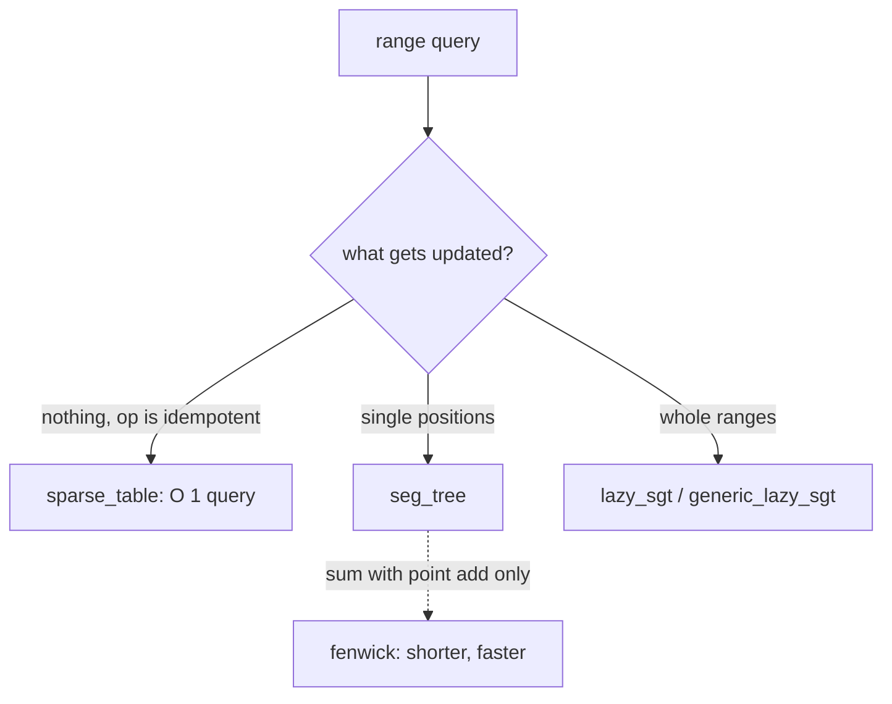

# Segment trees

Range queries with updates over an array. All trees here are recursive, 0-indexed, sized to a power of two,
with inclusive `[l, r]` ranges.

| Folder / file | Use it for |
|---|---|
| [`seg_tree/`](seg_tree/README.md) | point (or per-position) assign + range merge, any associative merge |
| [`lazy_sgt/`](lazy_sgt/README.md) | range update + range query (`lazy_sgt`: edit hooks; `generic_lazy_sgt`: value/update types) |
| `first_element_atleast_x.cpp` (`first_atleast_seg_tree`) | first index with `a[i] >= x` (max tree + descent) |
| `kth_one_list_removal.cpp` (`kth_one_seg_tree`) | k-th remaining element / remove from a list (count tree + descent) |
| `max_prefix_in_a_to_b.cpp` (`max_prefix_seg_tree`) | max prefix sum inside `[a, b]` (node = sum, best prefix) |
| `max_sub_array_sum.cpp` (`max_subarray_seg_tree`) | max subarray sum with updates (node = sum, prefix, suffix, best) |
| `seg_beats.cpp` (`SegBeats`) | range chmin / chmax / add + range sum (Segment Tree Beats) |
| `iterative_query.cpp`, `iterative_update.cpp` | `@fragment`: bottom-up member functions to paste into a power-of-two tree |
| `range_distinct.cpp`, `range_kth_smallest.cpp` | whole programs (CSES 1734, yosupo range_kth_smallest) |

The four application trees have their own class names, so they paste into the same file as `seg_tree`.
`test_segment_tree_apps.cpp` checks each of them against a brute force.

## Choosing

