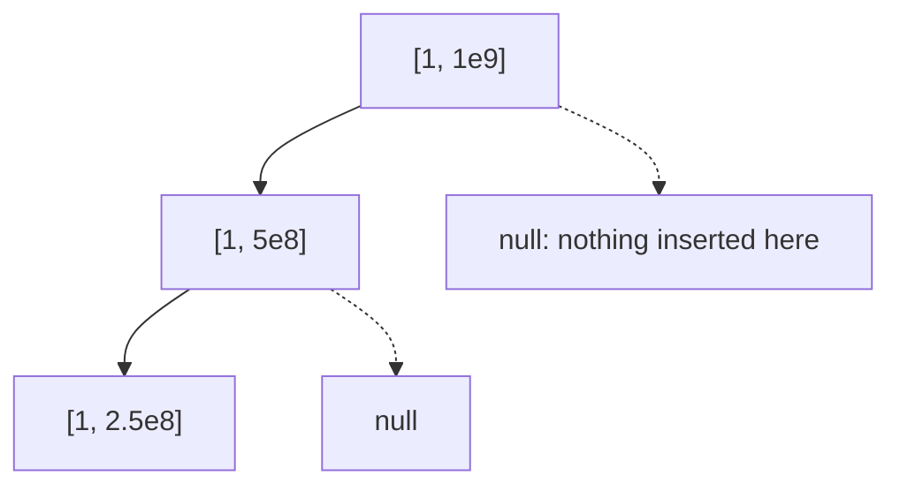

# Dynamic (sparse) segment tree (`dynamic`)

Segment tree over `[1, n]` whose nodes are created only when an update reaches them, so `n` can be 1e9 or 1e18. Default operation: point add, range sum.

**Files:** `dynamic.cpp` (trigger `dynamic`, alias `Dynamic`) · **Needs:** none · **Tests:** `../../test_misc_structures.cpp` (`DynamicSegTree.SparsePointAddRangeSumOneIndexed`)

## Problems it solves
- Point add / range sum (or any merge) over a huge coordinate range where only q positions are ever touched, with no offline compression.
- Online counting without coordinate compression ("how many inserted values lie in `[l, r]`").
- Not for a small `n`: the array-based [`seg_tree`](../seg_tree/README.md) is faster and smaller. Not for range updates: they would need lazy propagation on top.

## API
```cpp
dynamic<ll> st(n);        // indices 1..n, n is a long long (e.g. 1e9)
st.update(i, x);          // a[i] += x   (adds; change the marked lines for assign / other ops)
st.query(l, r);           // sum over inclusive [l, r], 1 <= l <= r <= n (not range-checked)
```
The lines marked `remember to change` (`lhs + rhs`, `node->value += new_value`) are the hooks for another operation. The tree owns its nodes (destructor frees recursively; copying is deleted).

## Complexity
| Operation | Time | Memory |
|---|---|---|
| construct | O(1) | one root node |
| `update` | O(log n) | at most log n new nodes per update |
| `query` | O(log n) | O(log n) stack, creates no nodes |

Every operation walks one or two root-to-leaf paths; a missing child is treated as the identity.

## How it works
A node covers `[lo, hi]` and splits at `mid = lo + (hi - lo) / 2`. A child pointer stays `nullptr` until an update needs it; a query treats a null child as the identity (`T{}`). After recursing, an update recomputes the parent from its existing children.



## Pitfalls and variants
- 1-indexed `[1, n]`, inclusive, unlike the 0-indexed array trees.
- `update` **adds**; to assign, read the old value first or change the marked line.
- Memory is about `q * log n` nodes of `sizeof(T) + 16` bytes: 1e5 updates over 1e9 is ~3e6 nodes.
- Nodes are allocated one by one with `new`; for tight limits use a pool of nodes instead.
- `identity_element_` is `T{}`, so max/min need it changed.

## Practice
- CSES: Dynamic Range Sum Queries, Salary Queries (also work with compression)
- Codeforces EDU: Segment Tree, part 1
