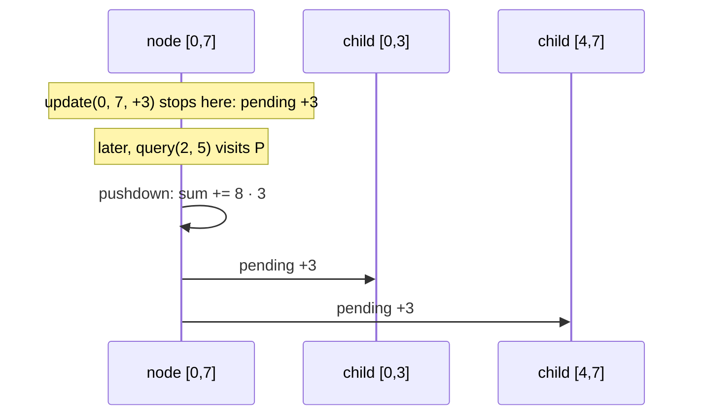

# Lazy segment tree (`lazy_sgt`, `generic_lazy_sgt`)

Segment tree with lazy propagation: range update and range query, both O(log n).

**Files:** `lazy_sgt.cpp` (trigger `lazy_sgt`, alias `LazySGT`), `generic_lazy_sgt.cpp` (alias `generic_LazySGT`)
· **Needs:** none · **Tests:** `test_lazy_segment_tree.cpp`

## Problems it solves
- Range add + range sum (the default), range assign + range min/max, range add + range min, flip a range + count ones.
- Signals: "add x to every a[i] in [l, r]" or "set all of [l, r] to x", mixed with range questions.
- Not needed for point updates (use [`seg_tree`](../seg_tree/README.md)). For range add + point query only,
  use a [`fenwick`](../../fenwick/README.md) on the difference array.

## API
```cpp
lazy_sgt<ll> st(a);           // or lazy_sgt<ll> st(n)
st.update(l, r, x);           // inclusive [l, r]
st.query(l, r);

generic_lazy_sgt<node_value, node_update> st(vals);   // value type T, update type U
st.update(l, r, node_update{5});
st.query(l, r).sum;
```
Hooks to edit in `lazy_sgt` (private members):

| Hook | Meaning | Default (add / sum) |
|---|---|---|
| `merge(lhs, rhs)` | combine two children | `lhs + rhs` |
| `combine(node, lo, hi, upd)` | apply a pending update to a whole node's value | `tree += (hi − lo + 1) * upd` |
| `apply(node, upd)` | compose a new update onto the node's pending one | `updates += upd` |
| `identity_element_`, `identity_update_` | neutral value / no-op update | `T{}` |

`generic_lazy_sgt<T, U>` gets the same roles from operators. `T + T` merges, `T += U` applies, and
`U += U` composes (`a += b` means "a, then b"). `T()` and `U()` are the identities. The value carries what it
needs, such as its segment length, so `lo` and `hi` are not passed.

## Complexity
| Operation | Time | Memory |
|---|---|---|
| build | O(n) | values + pending updates (+ flags) of size 2 · (power of two ≥ n) |
| `update(l, r, x)` | O(log n) | |
| `query(l, r)` | O(log n) | |

## How it works
An update stops at nodes fully inside `[l, r]` and leaves a pending update there. Every visit first pushes a
node's pending update into its own value and onto its children (`pushdown`), so a node's value is correct
whenever it is read.



## Pitfalls and variants
- `combine` must scale by the segment length for sum-like values. Forgetting `(hi − lo + 1)` is the classic bug.
- Composition order matters for updates that don't commute (assign then add differs from add then assign).
  In `generic_lazy_sgt`, `a += b` means "a, then b".
- Range assign: the no-op update must be a value that never occurs, or rely on the `lazy_` flag as `lazy_sgt` does.
- Path updates on trees: `hld_lazy_segment_tree` in `trees/hld/`.

## Practice
- CSES: Range Update Queries, Range Updates and Sums
- Codeforces EDU: Segment Tree, part 2
