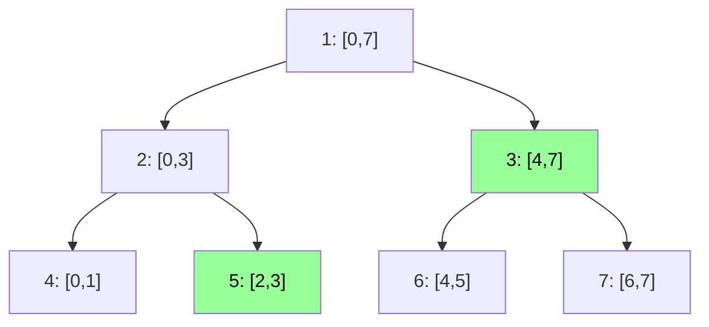

# Segment tree (`seg_tree`)

Recursive segment tree, generic over the value type and the merge: point (or per-position) updates and range
queries for any associative merge.

**Files:** `seg_tree.cpp` (trigger `seg_tree`, alias `SegTree`) · **Needs:** none · **Tests:** `test_segment_tree.cpp`

## Problems it solves
- Range sum / min / max / gcd / xor / matrix product with point updates, `n, q` up to ~2e5 to 1e6.
- Any "combine two halves" quantity: counts, (value, index) pairs for arg-min, hashes.
- Signals: "set a[i] = x" interleaved with "answer f(a[l..r])".
- Not for many range updates (use [`lazy_sgt`](../lazy_sgt/README.md)). For a static idempotent query a
  [sparse table](../../sparse_table/README.md) is O(1); for prefix sums with add, [`fenwick`](../../fenwick/README.md) is lighter.

## API
```cpp
seg_tree st(a, 0LL, [](ll x, ll y) { return x + y; });   // values, identity element, merge (lambda type deduced)
seg_tree st(n, identity, merge);                          // n positions, all identity
st.update(l, r, val);   // calls apply on every position in [l, r] (point update: l == r)
st.query(l, r);         // merge over inclusive [l, r]
```
`apply(node, val)` is the hook to edit: assignment by default (`tree_[node] = val`), `+=` for point add.

## Complexity
| Operation | Time | Memory |
|---|---|---|
| build from a vector | O(n) | 2 · (power of two ≥ n) values |
| `query(l, r)` | O(log n) | O(log n) stack |
| `update(i, i, v)` | O(log n) | |
| `update(l, r, v)` | O(r − l + 1 + log n): every position is visited, not lazy | |

## How it works
Leaves `s_ .. 2s_ − 1` hold the array (`s_` = power of two ≥ n). Node `i` has children `2i` and `2i + 1` and
stores their merge. A query takes whole nodes inside `[l, r]`, the identity outside it, and splits at `mid`
otherwise. At most two partial nodes per level are split, so O(log n) nodes are visited.


`query(2, 7)` = merge(node 5, node 3).

## Pitfalls and variants
- The identity must be neutral for the merge: `0` for sum, `LLONG_MIN` for max (not `0` if values can be negative), `INF` for min.
- The merge must be associative; it need not be commutative (a query keeps the left-to-right order).
- Positions `n .. s_ − 1` hold the identity. Querying past `n − 1` is harmless but meaningless.
- Bottom-up versions: `../iterative_query.cpp` and `../iterative_update.cpp` (fragments to paste into this class).
- Path queries on trees: `hld_segment_tree` in `trees/hld/` wraps the same tree.

## Practice
- CSES: Dynamic Range Sum Queries, Dynamic Range Minimum Queries, Hotel Queries (descent)
- Codeforces EDU: Segment Tree, part 1
