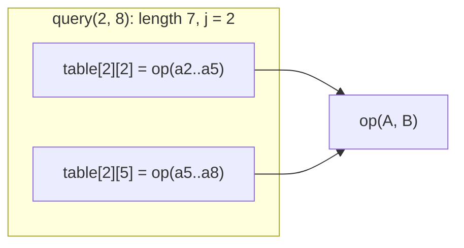

# Sparse table

Static range queries in O(1) for idempotent operations (min, max, gcd, and, or), after an O(n log n) build.

**Files:** `sparse_table.cpp` (generic, alias `SparseTable`), `min_sparse_table.cpp`, `max_sparse_table.cpp`,
`sparse_table_2d.cpp` (rectangles), `sparse_table_2d_square.cpp` (squares) · **Needs:** none
· **Tests:** `test_sparse_table.cpp`, `test_sparse_table_2d.cpp`

## Problems it solves
- Range min / max / gcd on an array that never changes, with many queries (q up to 1e6, or as an inner step).
- RMQ inside other algorithms: LCA via the Euler tour (`trees/lca/lca.cpp` has its own copy specialised to depths),
  suffix-array LCP queries, binary search over "min of a window ≥ x".
- Not for updates (use [`seg_tree`](../segment_tree/seg_tree/README.md)), and not for sums: overlapping halves
  would count elements twice. For static sums use prefix sums.

## API
```cpp
sparse_table st(a, [](ll x, ll y) { return min(x, y); });   // any idempotent op, lambda type deduced
min_sparse_table<ll> mn(a);   max_sparse_table<ll> mx(a);
st.query(l, r);                                              // inclusive [l, r]

sparse_table_2d<ll> g(grid);         g.query(i1, j1, x, y);  // min over the x-by-y rectangle with upper-left (i1, j1)
sparse_table_2d_square<ll> q(grid);  q.query(i1, j1, x);     // min over the x-by-x square with upper-left (i1, j1)
```

## Complexity
| | Build | Query | Memory |
|---|---|---|---|
| 1D | O(n log n) | O(1) | n log n |
| 2D rectangles | O(nm log n log m) | O(1) | nm log n log m |
| 2D squares | O(nm log min(n, m)) | O(1) | nm log min(n, m) |

## How it works
`table_[j][i]` = op over `a[i .. i + 2^j − 1]`, built from two halves of level `j − 1`. A query on `[l, r]`
takes `j = ⌊log2(r − l + 1)⌋` and combines the two blocks of length `2^j` that start at `l` and end at `r`. They
overlap, which is harmless only because the op is idempotent.



## Pitfalls and variants
- Idempotent ops only (`op(x, x) = x`). For sum, product or xor, use a disjoint sparse table or prefix sums.
- `min_sparse_table` / `max_sparse_table` are kept separate on purpose: they inline `min`/`max` without a functor.
- Memory: n = 1e6 with `ll` is about 20 · 8 MB = 160 MB. Use `int` values or a segment tree if that is too much.

## Practice
- CSES: Static Range Minimum Queries
- Codeforces 1549D (gcd of differences + two pointers)
