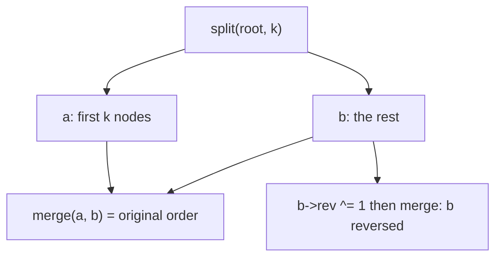

# Implicit treap (`treap`)

A balanced binary tree keyed by position (not by value): split a sequence at index `k`, merge two sequences, reverse a part lazily, read the k-th element.

**Files:** `treap.cpp` (trigger `treap`) · **Needs:** none (uses the boilerplate `rng`) · **Tests:** `test_treap.cpp` (`Treap.SequenceOpsMatchVector`)

## Problems it solves
- A sequence with "cut a segment and move it", "reverse a segment", "insert at a position / erase a position", "k-th element".
- Signals: array operations that are not point updates, n and q around 1e5 to 2e5, and the sequence changes shape (`vector` operations would be O(n)).
- Not for static data or pure range-sum updates: a [segment tree](../segment_tree/README.md) is shorter and faster.

## API
```cpp
treap<ll> t;  treap_node<ll> *root = nullptr;
root = t.merge(root, new treap_node<ll>(x));   // append x
auto [a, b] = t.split(root, k);                // a gets the first k elements, b the rest
root = t.merge(a, b);                          // concatenate (a before b)
b->rev ^= 1;                                   // reverse a whole part lazily (before merging it back)
t.query(root, k);                              // k-th element, 1-indexed
t.print(root, out);                            // append the in-order values to a vector<T>
size(root);                                    // number of nodes (0 for nullptr)
```
`pushdown(node*)` and `update(node*)` are public helpers; `treap_node` has `pri`, `siz`, `rev`, `val`, `lhs`, `rhs`. The caller owns the nodes (they are made with `new` and never freed by the class).

Typical recipe on `[l, r]` (0-indexed, inclusive): `split(root, l)` gives `a` and the rest, `split(rest, r - l + 1)` gives `b` and `c`; reverse `b`, or merge back as `a c b` / `b a c`.

## Complexity
| Operation | Time | Memory |
|---|---|---|
| `split`, `merge` | O(log n) expected | O(log n) recursion |
| `query(root, k)` | O(log n) expected | |
| `print` | O(n) | |
| per node | | `pri` 8 B + `siz`, `rev` 8 B + `val` + two pointers |

Priorities come from `rng()`, so the shape is a random BST and the expected depth is O(log n).

## How it works
Every node has a random priority; the tree is a BST by position (in-order) and a max-heap by priority. `split(t, cnt)` walks down comparing `cnt` with the left subtree size and cuts along the path; `merge(l, r)` keeps the larger priority on top and recurses into the other tree. `siz` is recomputed by `update` on the way back. A set `rev` flag means "swap the children of this subtree"; `pushdown` applies it and passes it on to the children.



## Pitfalls and variants
- `split` and `merge` call `pushdown`; if you touch `lhs` / `rhs` yourself, push first. `query` pushes before reading children, so pending reversals are respected.
- `query(root, k)` has no bounds check: `k` must be in `[1, size(root)]`.
- Set `rev` on a detached part (the roots returned by `split`); reversing does not change sizes.
- The free function `size(treap_node<T>*)` has the same name as `std::size`; call it only with node pointers.
- Only reversal is lazy. For range add / min / sum add fields and extend `pushdown` and `update`.
- Recursion depth is O(log n) expected, so judge stacks are no problem.

## Practice
- CSES 2072 Cut and Paste
- CSES 2073 Substring Reversals
- CSES 2074 Reversals and Sums
