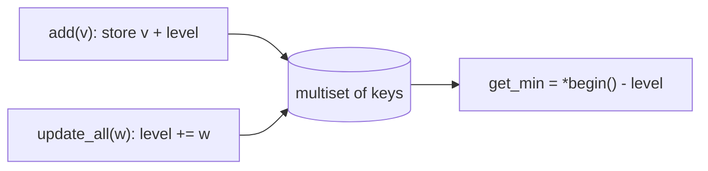

# Venice set (`venice_set`)

A multiset where "subtract w from every element" costs O(1): elements are stored shifted by a global water level.

**Files:** `venice_set.cpp` (trigger `venice_set`, alias `VeniceSet`) · **Needs:** none · **Tests:** `../test_misc_structures.cpp` (`VeniceSet.AddRemoveShiftAllMatchesMultiset`)

## Problems it solves
- A set of values that all decrease (or increase) by the same amount every step, with insertions, deletions of a known value and "what is the smallest now?".
- Simulations such as "every day every pile loses w", where elements die when they reach 0.
- Not for per-element differing updates or non-uniform shifts: use a normal `multiset` or a lazy segment tree.

## API
```cpp
venice_set<ll> s;
s.add(v);          // insert v (current value)
s.remove(v);       // erase one copy of the current value v (must exist)
s.update_all(w);   // every element v -> v - w
s.get_min();       // smallest current value (set must not be empty)
s.size();
```

## Complexity
| Operation | Time | Memory |
|---|---|---|
| `add`, `remove` | O(log n) | O(n) |
| `update_all` | O(1) | |
| `get_min` | O(1) | |

A `multiset` keeps `value + water_level`; `update_all` only moves the level.

## How it works
Stored key = current value + `water_level_`. `update_all(w)` does `water_level_ += w`, so every current value `key - level` drops by `w` without touching the set. `add` and `remove` convert with the current level.



## Pitfalls and variants
- `remove(v)` on a missing value erases `end()` (undefined behaviour); `get_min()` on an empty set likewise.
- Elements that should vanish when they reach 0 must be popped by the caller: `while (s.size() and s.get_min() <= 0) s.remove(s.get_min());`.
- A negative `w` raises every element.

## Practice
- Search "Venice technique" on Codeforces for the original blog and its problem list (no verified problem links yet).
