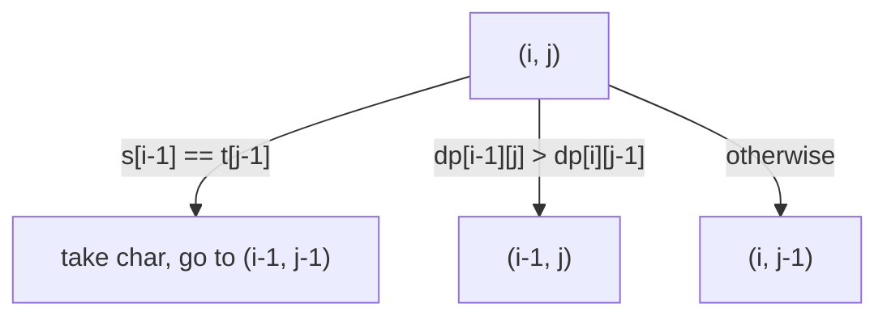

# Longest common subsequence (LCS)

Length of the longest sequence that is a subsequence of both strings, and the sequence itself.

**Files:** `lcs.cpp`, `print_lcs.cpp` · **Needs:** none (`print_lcs` reads the table that `lcs` fills, so paste `lcs.cpp` first) · **Tests:** `../test_dp.cpp` (`Dp.LcsAndPrintLcsMatchBruteForce`)

## Problems it solves
- "Longest common subsequence of two strings / arrays", edit distance with only inserts and deletes (`n + m - 2 * lcs`),
  "minimum deletions to make two strings equal", "shortest common supersequence" (`n + m - lcs`).
- Statement signals: two sequences, order matters, characters may be skipped, n and m up to ~5000 (the table is n·m).
- Not for larger inputs: general LCS needs O(nm). If one side is a permutation (distinct values), reduce to
  [LIS](../lis/README.md) in O(n log n). Contiguous substrings need a different recurrence.

## API
The caller allocates the table; `lcs` fills it, `print_lcs` walks it.
```cpp
vector<vector<int>> dp(n + 1, vector<int>(m + 1));              // zero-initialised
int lcs(string &s, string &t, vector<vector<int>> &dp);         // returns dp[n][m]
void print_lcs(string &s, string &t, vector<vector<int>> &dp); // prints one LCS to cout (no newline)
```
`print_lcs` does not return the string; it writes to `cout` after reversing the collected characters.
Both take non-const `string&`.

## Complexity
| Operation | Time | Memory |
|---|---|---|
| `lcs` | O(nm) | O(nm) table (allocated by the caller) |
| `print_lcs` | O(n + m) | O(n + m) for the answer |

## How it works
`dp[i][j]` = LCS length of the prefixes `s[0..i)` and `t[0..j)`. If `s[i-1] == t[j-1]` it is `1 + dp[i-1][j-1]`,
otherwise `max(dp[i-1][j], dp[i][j-1])`. Row 0 and column 0 stay 0 (the caller's zero-initialisation).
`print_lcs` starts at `(n, m)`: equal characters are taken and the walk goes diagonal; otherwise it moves to the
neighbour with the larger value (`dp[i-1][j] > dp[i][j-1]` goes up, ties go left). The characters come out reversed.



## Pitfalls and variants
- The table must be `(n+1) x (m+1)` and zero-filled before `lcs`; a smaller table is out of bounds.
- Memory: the length alone needs two rows; reconstruction needs the full table (or Hirschberg's algorithm, not in the library).
- Many LCS can exist; `print_lcs` prints one specific choice (ties go left). Counting them needs another DP.
- For arrays instead of strings, change the parameter types; the recurrence is the same.

## Practice
- CSES: [Longest Common Subsequence](https://cses.fi/problemset/task/3403) (needs the reconstruction)
- AtCoder DP contest: [F - LCS](https://atcoder.jp/contests/dp/tasks/dp_f)
- LeetCode: [1143. Longest Common Subsequence](https://leetcode.com/problems/longest-common-subsequence/)
