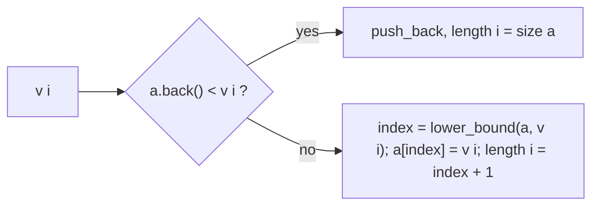

# Longest increasing subsequence (LIS)

Length, one witness sequence, or the number of longest increasing subsequences of an array.

**Files:** `lis.cpp` (trigger `lis`, alias `LIS`), `lis_increasing.cpp`, `lis_non_decreasing.cpp`, `find_number_of_lis.cpp` (alias `findNumberOfLIS`) · **Needs:** none · **Tests:** `../test_dp.cpp` (`Dp.LisVariantsMatchBruteForce`)

## Problems it solves
- "Longest strictly increasing (or non-decreasing) subsequence", "minimum deletions to make the array sorted",
  "minimum number of piles / chains" (Dilworth: the longest non-increasing subsequence equals the number of increasing chains needed).
- Statement signals: subsequence (not subarray), order must be preserved; n up to 2e5 means the O(n log n) files,
  n up to a few thousand allows the O(n²) ones.
- Counting the longest ones (LeetCode 673) needs the O(n²) `find_number_of_lis.cpp`.
- Not for LIS with weights or index constraints: that is a DP over a Fenwick tree / segment tree
  ([`fenwick`](../../data_structure/fenwick/README.md)). Not for a common subsequence of two strings: see [`lcs`](../lcs/README.md).

## API
Plain functions taking the array by reference; they only need the boilerplate (`all`).
```cpp
int LIS(vector<int> &a, int n);                // lis.cpp: length, strictly increasing, O(n^2)
vector<int> lis(int n, vector<int> &v);        // lis_increasing.cpp: one strictly increasing LIS, O(n log n)
vector<int> lis(int n, vector<int> &v);        // lis_non_decreasing.cpp: one non-decreasing LIS, O(n log n)
int findNumberOfLIS(vector<int>& a);           // find_number_of_lis.cpp: number of strictly increasing LIS, O(n^2)
```
`lis_increasing.cpp` and `lis_non_decreasing.cpp` define the **same name** `lis`: paste only one of them per file.
`findNumberOfLIS` reads `a.size()`; for an empty array it returns 0.

## Complexity
| Function | Time | Memory |
|---|---|---|
| `LIS` | O(n²) | O(n) |
| `lis` (both) | O(n log n) | O(n) |
| `findNumberOfLIS` | O(n²) | O(n) |

`LIS` and `findNumberOfLIS` compare every pair `j < i`. `lis` does one binary search per element plus one backward scan.

## How it works
**O(n²):** `dp[i]` = length of the best increasing subsequence ending at `i` = `1 + max dp[j]` over `j < i` with `a[j] < a[i]`.
`findNumberOfLIS` keeps `cnt[i]` next to `dp[i]`: a strictly better `dp[j] + 1` replaces the count (`cnt[i] = cnt[j]`),
an equal one adds (`cnt[i] += cnt[j]`). The answer sums `cnt[i]` over the indices whose `dp[i]` is the maximum.

**O(n log n) (patience sorting):** `a` is the tails array: `a[k]` is the smallest possible last value of an increasing
subsequence of length `k + 1`. It stays sorted. A new value either extends `a` (it is larger than the back) or
overwrites the first tail that is `>=` it (`lower_bound`). `length[i]` records the slot where `v[i]` landed, which is
the length of the best subsequence ending at `i`. To rebuild, scan from the right and take the last index for each
length `len, len-1, ..., 1`; those values form a valid LIS. The array `a` itself is **not** the answer, only its size is.



## Pitfalls and variants
- Strict vs non-decreasing: `lis_increasing` uses `a.back() < x` and `lower_bound`; `lis_non_decreasing` uses `<=` and
  `upper_bound`. Mixing them gives wrong answers on equal elements. Longest strictly decreasing: negate the values.
- `LIS` carries a fix noted in the code (`maxi` starts at 0, so an empty array gives 0).
- An empty input to `lis` returns an empty vector (the reconstruction loop does not run).
- The O(n log n) versions return *a* LIS, not a specific one (not the lexicographically smallest).
- Counting with the fast structure (a BIT of `{length, count}` pairs) is not in the library; use `findNumberOfLIS` for n up to ~5000.
- Under `#define int long long` the `vector<int>` parameters are `vector<long long>`; without it, `int`. Both compile.

## Practice
- CSES: [Increasing Subsequence](https://cses.fi/problemset/task/1145) (n log n), [Towers](https://cses.fi/problemset/task/1073) (same tails array, non-decreasing flavor)
- LeetCode: [300. Longest Increasing Subsequence](https://leetcode.com/problems/longest-increasing-subsequence/), [673. Number of Longest Increasing Subsequence](https://leetcode.com/problems/number-of-longest-increasing-subsequence/)
