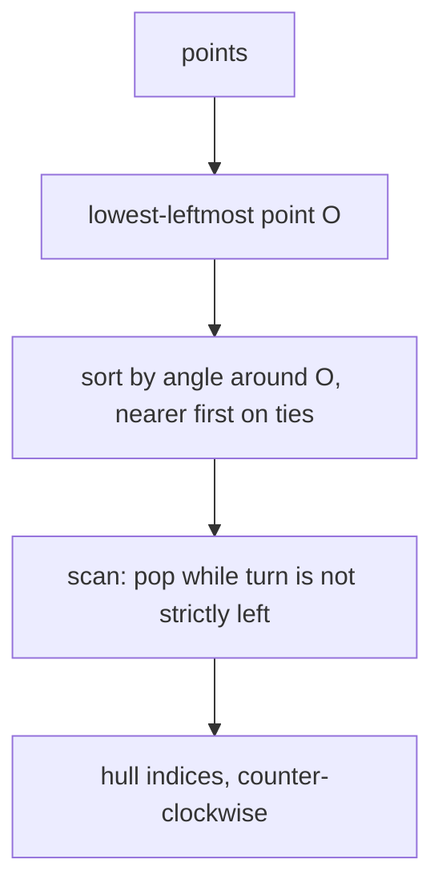

# Point and 2D integer geometry

A 2D integer `point` with vector operations, plus orientation, segment intersection, point-in-polygon, polygon area,
convex hull, tangents from an outside point, and the largest triangle on a point set.

**Files:** `point.cpp` (trigger `point`) · **Needs:** none (uses the boilerplate's `all`) · **Tests:** `test_point.cpp` (`Point.VectorOperations`, `Point.SegmentIntersectionMatchesBruteForce`, `Point.HullAndPolygonQueriesMatchBruteForce`, `Point.TangentsFromOutsidePoint`)

## Problems it solves
- "Do these two segments intersect (touching counts)?", "is the point inside / on the boundary / outside this polygon?",
  "area of a polygon", "convex hull of n points", "tangent lines from a point to a convex polygon",
  "largest triangle formed by the points".
- Statement signals: integer coordinates, n up to ~1e5 for the hull, exact answers (no epsilon), "counter-clockwise".
- Not for real-valued coordinates (everything is `int`, no epsilon handling), not for 3D, and not for circles or
  half-plane intersection (not in the library).

## API
All coordinates are `int` (`long long` under the boilerplate's `#define int long long`). Everything is a free function except the members of `point`.
```cpp
point p(x, y);  point q;                 // default (0, 0)
p + q, p - q, p * k, -p, p == q, p != q  // also +=, -=, *= (scalar k)
p.norm();                                // x*x + y*y (squared length)
p.dist();                                // double length
cin >> p;  cout << p;                    // reads "x y", prints "(x, y)"

int dot(a, b);                           // a.x*b.x + a.y*b.y
int cross(a, b);                         // a.x*b.y - b.x*a.y   (> 0 when b is counter-clockwise from a)
int orientation(a, b, c);                // a->b->c: +1 counter-clockwise, -1 clockwise, 0 collinear
bool onSegment(a, b, c);                 // c lies on segment a-b (endpoints included)
bool intersect(a, b, c, d);              // segments a-b and c-d share a point (touching and collinear overlap count)
int manhattan(a, b);
double distance(a, b, c);                // distance from c to the LINE through a, b (asserts a != b)
int location(p, poly);                   // -1 boundary, 0 outside, 1 inside; poly = vertices in order (any orientation)
int areaSigned2x(poly);                  // twice the signed area: positive for counter-clockwise vertex order
vector<int> hull(pts);                   // indices into pts of the hull vertices, counter-clockwise, starting at the lowest-leftmost
pair<int,int> tangent(p, poly);          // vertex indices of the two tangent points from outside point p
array<int,3> maxTriangleArea2x(pts);     // indices into pts of the max-area triangle (area*2 = |cross|)
```
`tangent` needs a convex polygon in counter-clockwise order (exactly what `hull` returns, taken as points) and `p` strictly outside.
All `const point&` / `const vector<point>&` arguments.

## Complexity
| Function | Time | Memory |
|---|---|---|
| `dot`, `cross`, `orientation`, `onSegment`, `intersect`, `manhattan`, `distance` | O(1) | O(1) |
| `location`, `areaSigned2x` | O(n) | O(1) |
| `hull` | O(n log n) | O(n) |
| `tangent` | O(log n) (four binary searches) | O(1) |
| `maxTriangleArea2x` | O(h²) in the hull size h (plus the hull) | O(h) |

## How it works
**Orientation** is the sign of `cross(b - a, c - a)`; everything else is built on it. `intersect` is the standard test:
the endpoints of each segment lie on opposite sides (or on the line) of the other, with the collinear/touching cases
caught by `onSegment`.
**Point in polygon** (`location`): if `p` is on an edge return -1; otherwise shoot a ray to `(1e9, p.y)` and flip a
parity bit for each edge that straddles `p.y` (half-open `l <= p.y < r`, so vertices are counted once) and crosses the ray.
**Area:** fan triangulation from `a[0]` with cross products, so the sign gives the orientation.
**Hull:** Graham scan. Take the lowest-leftmost point, sort the rest by angle around it (ties: nearer first), then keep a
stack and pop while the last turn is not strictly left (`<= 0`): collinear points on the hull boundary are dropped.
**Tangent:** binary search on the polygon's vertices using orientation tests against `p`; which of the two branches runs
depends on whether `p` is on the left or right of edge `a[n-1] -> a[0]`.
**Max triangle:** on the hull, for each vertex `i` the second vertex `j` advances and the third `k` is a two-pointer that
only moves while the area grows (rotating calipers style).



## Pitfalls and variants
- Overflow: `cross` multiplies two coordinate differences. With `int = long long` coordinates up to ~1e9 are fine for
  `cross` of differences (up to 4e18), but `location` uses a far point `1e9`, so keep `|coordinate| <= 1e9`.
  Without the boilerplate `int` is 32 bit and overflows near |coordinate| ~ 3e4.
- `hull` drops collinear boundary points and duplicates; an all-collinear input gives the two extreme points, a single point gives itself.
  Pass `n = 0` and `min_element` dereferences an empty range: guard it.
- `maxTriangleArea2x` calls `hull` and returns indices into the **original** array. For fewer than 3 hull vertices the
  returned array is uninitialised.
- `location` takes the polygon's vertices in order (convex or not); `tangent` additionally needs convexity and counter-clockwise order, and gives wrong results if `p` is inside or on the polygon.
- `distance` is the distance to the infinite line, not the segment.
- `dist()` goes through `sqrtl` into a `double`; for exact comparisons use `norm()`.
- Names `onSegment`, `areaSigned2x`, `maxTriangleArea2x` keep the original camelCase.

## Practice
- CSES: [Point Location Test](https://cses.fi/problemset/task/2189), [Line Segment Intersection](https://cses.fi/problemset/task/2190), [Polygon Area](https://cses.fi/problemset/task/2191), [Point in Polygon](https://cses.fi/problemset/task/2192), [Convex Hull](https://cses.fi/problemset/task/2195)
