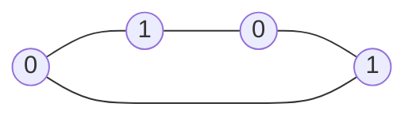

# Bipartite check (`check_bipartite`)

Decides whether the vertices of an undirected graph can be 2-coloured so that every edge joins different colours.

**Files:** `check_bipartite.cpp` (trigger `check_bipartite`) · **Needs:** none · **Tests:** `../test_graph_algos.cpp`
(`Graph.CheckBipartiteMatchesBruteForce`)

## Problems it solves
- "Split the people into two teams so that enemies are on different teams" (CSES Building Teams).
- "Does the graph contain an odd cycle?": it is bipartite exactly when it has none.
- Preparing a matching problem: bipartite graphs allow Hopcroft-Karp or flow ([`max_flow/`](../max_flow/README.md)).
- Statement signals: two groups, alternating colours, "even-length cycles only", chessboard-like grids.
- To get the actual colouring, keep the `color` vector (the function discards it; see pitfalls).

## API
```cpp
bool check_bipartite(int n, vector<int> adj[]);   // vertices are 1..n (1-indexed!), undirected adjacency lists
```

## Complexity
| Operation | Time | Memory |
|---|---|---|
| `check_bipartite` | O(V + E) | O(V) (colours + queue) |

Each vertex is pushed once; each adjacency list is scanned once.

## How it works
BFS from every uncoloured vertex gives it colour 0 and gives each newly discovered neighbour the opposite colour. If an
edge ever connects two vertices of the same colour, then together with the BFS tree paths it closes an odd cycle, so the
graph is not bipartite. Components are handled by restarting the BFS from every uncoloured vertex.


An even cycle alternates colours consistently; adding the edge `1 -- 3` would join two colour-0 vertices and fail.

## Pitfalls and variants
- **1-indexed**: `color` has size `n + 1` and the loop runs over `1..n`. With 0-indexed adjacency lists, pass `n + 1`
  (an isolated vertex 0 is harmless) or adapt the loop.
- A self-loop `v -- v` makes the answer `false`, which is correct.
- The function returns only the yes/no answer. Copy the body and return `color` if you need the two sides.
- Grids: build no graph, colour by `(i + j) % 2` instead when every edge joins adjacent cells.

## Practice
- CSES: Building Teams
- LeetCode 785 (Is Graph Bipartite?), 886 (Possible Bipartition)
- Codeforces 687A (NP-Hard Problem)
