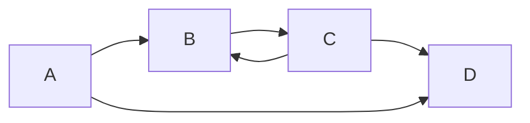

# Cycle detection in a directed graph (`dag_cycle`, `dg_cycle`)

Decides whether a directed graph contains a cycle (equivalently, whether it is not a DAG).

**Files:** `dag_cycle.cpp` (alias `DAG_Cycle`, `@fragment`), `dg_cycle.cpp` · **Needs:** `dag_cycle` needs
`topological_sort_bfs` (pasted automatically), `dg_cycle` none · **Tests:** `../test_graph_algos.cpp`
(`Graph.TopologicalSortAndCycleChecks`, `Graph.EdgeCases`)

## Problems it solves
- "Is it possible to finish all tasks / is the dependency graph valid?" (Course Schedule, build systems).
- Deciding whether a DP over a DAG is allowed, or whether a game on a graph can loop forever.
- Self-loops count as cycles in both versions.
- Not for undirected graphs (a plain DFS with a parent check or a DSU does that). To *print* a cycle use a DFS with
  parent pointers; for negative cycles use [`bellman_ford`](../shortest_path/bellman_ford/README.md).

## API
```cpp
// dag_cycle: needs n, adj[n]; pastes Topological_Sort_Bfs first
vector<int> topo = Topological_Sort_Bfs();
function<bool()> DAG_Cycle = [&]() { return (int)topo.size() != n; };
bool has_cycle = DAG_Cycle();

// dg_cycle: needs a global constant N and adj[N]; call from every unvisited vertex
vector<int> vis1(N, 0), vis2(N, 0);          // vis1 = ever visited, vis2 = on the current DFS path
bool DG_cycle(int v);
for (int v = 0; v < n; v++) if (!vis1[v] and DG_cycle(v)) { /* cycle */ }
```

## Complexity
| Operation | Time | Memory |
|---|---|---|
| `DAG_Cycle` | O(V + E) (the topological sort) | O(V) |
| `DG_cycle` over all vertices | O(V + E) | O(V) plus recursion depth |

## How it works
**Kahn-based.** If the graph has a cycle, no vertex on it ever reaches in-degree 0, so Kahn's algorithm outputs fewer
than `n` vertices.

**DFS-based.** `vis2[v]` is 1 exactly while `v` is on the current recursion stack. Meeting a vertex that is already on
the stack means a back edge, i.e. a cycle. Finished vertices (`vis1` set, `vis2` cleared) are safe cross/forward edges.


DFS from `A` reaches `B`, `C`, then sees the edge `C -> B` while `B` is still on the stack: cycle `B -> C -> B`.

## Pitfalls and variants
- `DG_cycle` takes no `n`; it uses the global `N` for its array sizes (define it, e.g. `const int N = 2e5 + 5;`) and
  `vis1`/`vis2` are globals, so reset them between test cases.
- `DG_cycle(v)` only checks what is reachable from `v`; loop over all vertices (skipping `vis1`).
- `DAG_Cycle` is `@fragment` (it needs `Topological_Sort_Bfs` and its variables); `topo` is already computed
  when it runs, so reuse it as the topological order when the graph is acyclic.
- Pick Kahn-based when you need the topological order anyway; DFS-based when you want recursion state or to extend it to
  recover the cycle.

## Practice
- CSES: Round Trip II (print a directed cycle), Course Schedule
- LeetCode 207 (Course Schedule), 802 (Find Eventual Safe States)
