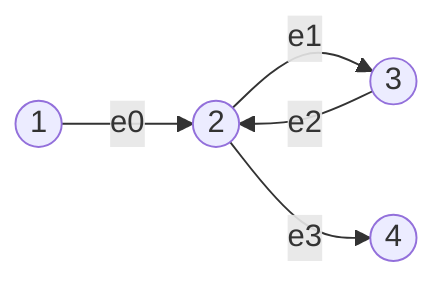

# Eulerian path and circuit (`eulerian_path_directed_graph`, `eulerian_path_undirected_graph`)

A walk that uses every edge exactly once, found with Hierholzer's algorithm.

**Files:** `eulerian_path_directed_graph.cpp` (alias `graphs_eulerian_path_directed_graph`),
`eulerian_path_undirected_graph.cpp` (alias `graphs_eulerian_path_undirected_graph`) · **Needs:** none (`@fragment`:
whole-program bodies that read `cin`, print, and `return 0;`) · **Tests:** `../test_flow_and_io.cpp` (`Euler.PathsMatchBruteForce`)

## Problems it solves
- "Draw the figure without lifting the pen / traverse every road exactly once" (CSES Mail Delivery, Teleporters Path).
- Directed: path from vertex 1 to vertex n using every edge once (CSES Teleporters Path).
- Undirected: circuit that starts and ends at vertex 1 using every edge once (CSES Mail Delivery).
- Reconstructing a sequence from overlapping pieces (de Bruijn graph style problems, "restore the string from its k-mers").
- Visiting every **vertex** once is the Hamiltonian path (NP-hard); this is not it.

## API
Each file is the body of `main` for one fixed problem: it reads the input, prints `IMPOSSIBLE` or the path (1-indexed).
```cpp
// directed (CSES 1693): input "n m" and m lines "u v" (edge u -> v); path must start at 1 and end at n
// undirected (CSES 1691): input "n m" and m lines "u v"; circuit must start and end at 1
vector<pair<int, int>> adj[n];            // {to, edge id}
vector<int> edge_used(m), path;           // path built in post-order, then reversed
function<void(int)> dfs;                  // Hierholzer, starts at vertex 0
```
To change the start/end vertices, edit the degree test and the final `path.back()` / `path.front()` check.

## Complexity
| Operation | Time | Memory |
|---|---|---|
| directed or undirected | O(V + E) | O(V + E) |

Each edge is popped from an adjacency list exactly once; the recursion depth is at most E.

## How it works
**Existence.** Directed: in-degree equals out-degree everywhere, except `out - in = 1` at the start and `in - out = 1` at
the end (or all equal for a circuit), and all edges lie in one connected piece. Undirected: all degrees even (circuit)
or exactly two odd (path between them), plus connectivity of the edges.

**Hierholzer.** From the start, keep following unused edges (`adj[v].pop_back()`); when stuck at `v`, append `v` to
`path`. Stuck always happens first at the end vertex; the sub-circuits found while backtracking are spliced in because
vertices are appended after all their edges are used. Reversing `path` gives the walk. If an edge is left unused
(`adj[i]` non-empty), the edges are not connected and the answer is `IMPOSSIBLE`.


Start at 1; go 1,2,3,2 and get stuck at 4; post-order is `4 2 3 2 1`, reversed `1 2 3 2 4`: it uses all four edges.

## Pitfalls and variants
- Directed degree check: for vertex 0 only `out > in` is allowed, for vertex `n - 1` only `in > out`, others must be equal;
  vertex 1 = vertex n makes the problem a circuit and needs a different check.
- The undirected file accepts two odd vertices in the pre-check only if vertex 1 is one of them, then rejects at the end
  because `path.front() != path.back()`: effectively a circuit-only test, as in CSES 1691. Delete that last check (and
  the vertex-1 requirement) to get an open path.
- `edge_used` is needed in the undirected version (each edge sits in two lists); the directed file keeps it for symmetry.
- Self-loops are fine; multi-edges are fine (separate ids).
- Both use a recursive `function` of depth up to E; rely on the large stack.
- The code contains `return 0;` and reads `cin`: it only works as the body of `main` (or `solve`).

## Practice
- CSES: Mail Delivery, Teleporters Path
- LeetCode 332 (Reconstruct Itinerary), 753 (Cracking the Safe)
- Codeforces 508D (Tanya and Password)
