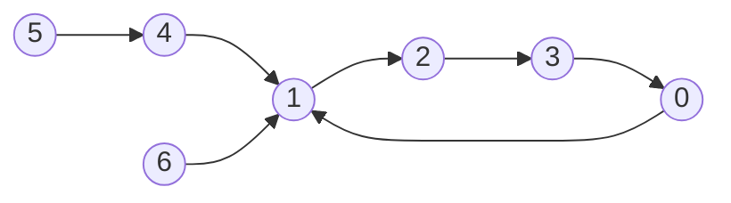

# Functional graph (`functional_graph`)

A graph in which every vertex has exactly one outgoing edge `v -> F[v]`: each component is one cycle with trees hanging
into it. The class finds the cycles and answers "where am I after k steps?" and "how many steps from u to v?".

**Files:** `functional_graph.cpp` (trigger `functional_graph`) · **Needs:** none · **Tests:** `../test_graph_algos.cpp`
(`Graph.FunctionalGraphMatchesBruteForce`)

## Problems it solves
- "Follow the pointer k times" for huge k (CSES Planets Queries I; k up to 1e9 or 1e18).
- "Minimum number of steps from u to v, or -1" (CSES Planets Queries II).
- Cycle length / cycle membership / distance to the cycle for every vertex (CSES Planets Cycles).
- Statement signals: "each planet teleports to exactly one planet", permutations and mappings `i -> a[i]`, repeated function application.
- If k is small, binary lifting works too, see [`trees/lca`](../../trees/lca/README.md); this class needs O(n) memory instead of O(n log n).

## API
```cpp
vector<int> F(n);                        // F[v] = next vertex, 0-indexed; must outlive the object (stored by reference)
functional_graph fg(F);                  // build
fg.go_forward(v, k);                     // vertex reached after exactly k steps from v
fg.min_steps(u, v);                      // smallest k >= 0 with go_forward(u, k) == v, or -1 if unreachable
fg.cycle_length(v);                      // length of the cycle that v leads into
// public fields, all indexed by vertex unless stated
fg.in_cycle[v];                          // 1 if v is on a cycle
fg.which_cycle[v];                       // index into fg.cycles of the cycle v leads into
fg.cycle_root[v];                        // the cycle vertex where v's tree is attached (v itself if on the cycle)
fg.cycle_position[v];                    // position of a cycle vertex inside its cycle (-1 for tree vertices)
fg.depth[v];                             // distance to the cycle (0 on the cycle)
fg.cycles;                               // vector<vector<int>>: each cycle in walk order
fg.children[v];                          // tree children (vertices u not on a cycle with F[u] == v)
```

## Complexity
| Operation | Time | Memory |
|---|---|---|
| build | O(n) | O(n) |
| `go_forward` | O(log n) | |
| `min_steps` | O(log n) | |
| `cycle_length` | O(1) | |

Cycles are found by a coloured walk (each vertex visited once). `go_forward` inside a tree uses skew-binary jump pointers
(`jump`, `jump_dist`: one extra pointer per vertex, O(log n) hops); on the cycle it is a single modulo.

## How it works
1. Walk from every unvisited vertex marking it with the start id; when the walk reaches a vertex marked by the same start,
   that vertex lies on a new cycle, which is traced and stored in `cycles`.
2. Reverse the non-cycle edges into `children` and run a DFS from each cycle vertex into its trees, recording `depth`,
   `cycle_root`, `which_cycle` and the jump pointer of each node (pointing to its parent, or to the jump of the jump when the two
   jump lengths are equal).
3. `go_forward(v, k)`: if `k >= depth[v]`, climb to `cycle_root[v]` and move `k - depth[v]` further around the cycle (mod its length);
   otherwise climb `k` steps up the tree with the jump pointers.
4. `min_steps(u, v)`: both in trees: `v` must be an ancestor of `u` (`depth[u] - depth[v]` steps up); `v` on a cycle: walk to the cycle,
   then forward around it; `v` in a tree and `u` on a cycle (or different cycles): -1.


Cycle `1 -> 2 -> 3 -> 0 -> 1`; trees `4 -> 1` (with `5 -> 4`) and `6 -> 1` hang on `cycle_root = 1`.
`depth[5] = 2`, `go_forward(5, 3)` = vertex `2`.

## Pitfalls and variants
- The class keeps a **reference** to `F`; do not destroy or reorder it afterwards.
- 0-indexed. `which_cycle` is overwritten by the DFS for tree vertices: it then names the cycle they feed into.
- `k` can be up to `1e18`: it works because it is reduced mod the cycle length (use `long long`, which `int` is under the boilerplate).
- Declared with `size(F)` (C++17) and a recursive DFS from every cycle vertex: very deep trees need the large stack.
- Do not use for a graph where some vertex has no outgoing edge or two outgoing edges.

## Practice
- CSES: Planets Cycles, Planets Queries I, Planets Queries II
- LeetCode 457 (Circular Array Loop), 565 (Array Nesting)
- AtCoder ABC 167 D (Teleporter)
