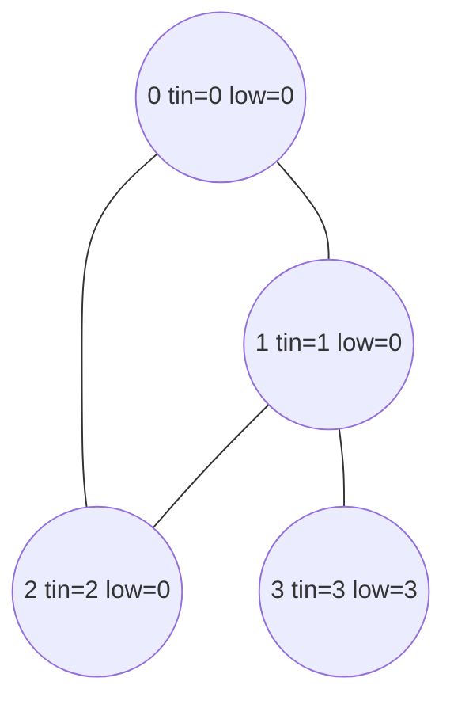

# Bridges and articulation points (`find_bridges`, `find_articulation_point`)

Tarjan's low-link DFS on an undirected graph: edges and vertices whose removal disconnects (part of) the graph.

**Files:** `find_bridges.cpp`, `find_articulation_point.cpp` (triggers = file stems) · **Needs:** none
(statement-level) · **Tests:** `../test_graph_algos.cpp` (`Graph.BridgesAndCutpointsMatchBruteForce`, `Graph.EdgeCases`)

## Problems it solves
- "Which roads are critical?": edges whose removal increases the number of components (LeetCode 1192).
- "Which junctions are critical?": vertices whose removal increases the number of components.
- 2-edge-connected components: delete the bridges and take connected components (or compress with a stack in the same DFS).
- Statement signals: "remove one edge/vertex and the network splits", "must every path use this edge?", tree of components.
- Directed reachability is a different problem: use [`scc/`](../scc/README.md).

## API
In scope: `n` and `vector<int> adj[n]` (undirected: each edge stored in both lists, 0-indexed).
```cpp
// find_bridges.cpp declares:
int timer; vector<pair<int,int>> bridges;       // each bridge as {child, parent} in the DFS tree
vector<int> vis(n), tin(n), low(n);
function<void(int,int)> dfs;  // dfs(root, -1) is already run for every unvisited vertex

// find_articulation_point.cpp declares:
int timer; vector<int> vis(n), tin(n), low(n), cutpoint(n);   // cutpoint[v] == 1  <=>  v is an articulation point
```
Both snippets run the DFS over all components when pasted; read `bridges` / `cutpoint` right after.

## Complexity
| Operation | Time | Memory |
|---|---|---|
| bridges | O(V + E) | O(V) plus recursion depth |
| articulation points | O(V + E) | O(V) plus recursion depth |

One DFS, each edge examined twice.

## How it works
`tin[v]` is the DFS entry time; `low[v]` is the smallest `tin` reachable from the subtree of `v` using tree edges
downwards and at most one back edge. For a tree edge `v -> u`:
- **bridge** if `low[u] > tin[v]`: nothing in `u`'s subtree can climb back to `v` or above, so the edge is the only link.
- **articulation point** `v` (non-root) if `low[u] >= tin[v]`: the subtree of `u` can reach at most `v` itself, so deleting
  `v` cuts it off. The root is an articulation point iff it has at least two DFS children.


The triangle `0-1-2` has `low = 0` everywhere (a back edge reaches the root), so none of its edges is a bridge. The edge
`1-3` has `low[3] = 3 > tin[1] = 1`: a bridge, and vertex 1 (`low[3] >= tin[1]`) is an articulation point.

## Pitfalls and variants
- **Parallel edges**: the DFS skips every edge back to the parent vertex (`u == p`), so a doubled edge is still reported
  as a bridge. The library counts parallel edges as one; for multigraphs store edge ids and skip only that id.
- Bridges are stored as `{child, parent}`, not `{parent, child}`; normalize before comparing or printing.
- Recursion depth equals the DFS depth (up to V); the judge's 256 MB stack is assumed.
- `find_bridges` updates `low` through already visited neighbours with `low[u]`, `find_articulation_point` with `tin[u]`.
  Both are correct for their purpose (bridges only compare against `tin[v]`); keep each as is.
- Isolated vertices and several components are handled by the outer loop; a component's root is never reported by the
  non-root rule.

## Practice
- LeetCode 1192 (Critical Connections in a Network)
- Codeforces 118E (Bertown roads, orient edges), 555E (Case of Computer Network)
