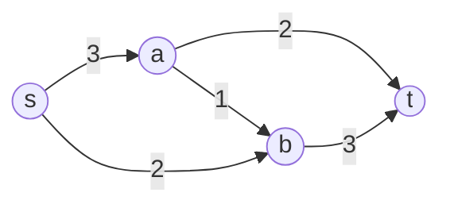

# Maximum flow (`max_flow`, `edmonds_karp`)

Largest amount that can be pushed from a source to a sink through edges with capacities; equal to the minimum cut.

**Files:** `max_flow.cpp` (trigger `max_flow`: the AtCoder Library `atcoder::mf_graph`, Dinic),
`edmonds_karp.cpp` (whole-program snippet with an adjacency matrix) · **Needs:** none ·
**Tests:** `../test_flow_and_io.cpp` (`Flow.MaxFlowAndEdmondsKarpMatchMinCut`)

## Problems it solves
- Maximum flow / minimum cut in a network (CSES Download Speed, Police Chase for the cut itself).
- Bipartite matching (source -> left -> right -> sink, all capacities 1): CSES School Dance; also assignment, "can every
  task be given a distinct worker?".
- Edge-disjoint paths (unit capacities, CSES Distinct Routes); vertex-disjoint paths via vertex splitting.
- Project selection / closure, image segmentation, "minimum edges to delete to separate s from t".
- Weighted matching with costs needs min-cost flow, which is not in the library.

## API
```cpp
// max_flow.cpp (namespace atcoder, then `using namespace atcoder;`)
mf_graph<int> g(n);                       // Cap = int (long long under the boilerplate); n vertices
int id = g.add_edge(from, to, cap);       // directed edge, cap >= 0; returns the edge index 0, 1, 2, ...
int f = g.flow(s, t);                     // max flow s -> t; s != t. Can be called again: continues from the current flow
int f2 = g.flow(s, t, flow_limit);        // stops once flow_limit is reached
vector<bool> cut = g.min_cut(s);          // cut[v] = v is on the source side of a minimum cut (call after flow)
auto e = g.get_edge(id);                  // e.from, e.to, e.cap (original capacity), e.flow (current flow)
vector<mf_graph<int>::edge> all = g.edges();
g.change_edge(id, new_cap, new_flow);     // 0 <= new_flow <= new_cap

// edmonds_karp.cpp: reads the input itself
// "n m" then m lines "x y c" (1-indexed, parallel edges summed); prints the flow from vertex 1 to vertex n
```

## Complexity
| Operation | Time | Memory |
|---|---|---|
| `mf_graph::flow` (Dinic) | O(V² E) in general; O(E · min(V^(2/3), E^(1/2))) with unit capacities | O(V + E) |
| `min_cut` | O(V + E) | O(V) |
| `edmonds_karp.cpp` | O(V · E²) as commented, in matrix form each BFS costs O(V²) so about O(V³ · E) worst case | O(V²) |

Both are far faster than the worst case on contest data; Dinic is the one to use.

## How it works
Residual graph: every edge `u -> v` of capacity `c` has a reverse edge with the flow pushed so far. An augmenting path is
any `s -> t` path of positive residual capacity; pushing its bottleneck keeps the flow valid. When none exists, the set
`S` of vertices reachable from `s` defines a cut whose capacity equals the flow (max-flow min-cut theorem).

**Edmonds-Karp** augments along a BFS shortest path each time. **Dinic** builds a BFS level graph, then sends a blocking
flow with a DFS that only follows edges from level `k` to `k+1` and remembers the next edge to try (`iter`).


Augment `s-a-t` by 2, `s-b-t` by 2, then `s-a-b-t` by 1: total flow 5 = capacity of the cut `{s} | {a, b, t}`.

## Pitfalls and variants
- `max_flow.cpp` is the ACL class; nothing else from the library needs it. `edmonds_karp.cpp` is **not** a library function:
  it reads `n m` and the edges from `cin` and prints the answer, so paste it as the whole `main` body.
- `adj` in `edmonds_karp.cpp` is an `n x n` matrix: use it only for small `n` (about 500 at most), and use Dinic otherwise.
- Capacities and flows can exceed 32 bits: `mf_graph<int>` is `long long` under the boilerplate, or write `mf_graph<long long>`.
- For matching, vertex numbering: put the source and sink after the real vertices (`s = n`, `t = n + 1`).
- `min_cut` returns the side of `s` (all vertices still reachable in the residual graph); the cut edges are those from a
  `true` to a `false` vertex that are saturated.
- Rebuilding edges between queries is cheaper than `change_edge` unless you really need incremental flow.

## Practice
- CSES: Download Speed, Police Chase, School Dance, Distinct Routes
- AtCoder Library Practice Contest D (Maxflow), Codeforces 546E (Soldier and Traveling)
