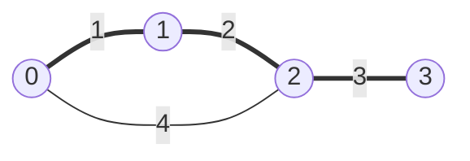

# Minimum spanning tree (`kruskal`, `prims`)

The cheapest set of edges that connects all vertices of an undirected weighted graph.

**Files:** `kruskal.cpp` (alias `mst_kruskal`), `prims.cpp` (alias `mst_prims`) · **Needs:** `kruskal` needs `dsu`
(pasted automatically) · **Tests:** `../test_graph_algos.cpp`

## Problems it solves
- Minimum cost to connect all cities / computers; "is the graph connected, and at what cost?".
- Minimax paths: in the MST, the path between two vertices minimizes the largest edge.
- Maximum spanning tree: sort descending (Kruskal) or negate the weights.
- Offline "connect while weight ≤ x" queries: Kruskal order + DSU.

## API
Both are statement-level lambdas that expect `n` in scope.
```cpp
// kruskal: edges = container of {u, v, wt} (array<int, 3>); sorts edges in place
int cost = kruskal();   // -1 if the graph is not connected

// prims: vector<pair<int, int>> adj[n] of {to, weight}; also fills `mst` with {v, parent} pairs
int cost = prims();     // grows from vertex 0; mst.size() < n - 1 means not connected
```

## Complexity
| | Time | Memory |
|---|---|---|
| Kruskal | O(E log E) sort + O(E α(V)) unions | O(V) besides the edge list |
| Prim (set) | O(E log E) | O(E) set entries |

## How it works
Both rely on the cut property: the lightest edge crossing any cut belongs to some MST. **Kruskal** takes the
edges in increasing order and keeps an edge when its endpoints are still in different DSU sets. **Prim** grows
one tree from vertex 0 and always adds the lightest edge that leaves it (the `set` ordered by weight).


Kruskal keeps 1, 2 and 3. It skips 4, because 0 and 2 are already connected.

## Pitfalls and variants
- `kruskal` returns `-1` for a disconnected graph. `prims` returns the cost of the component of vertex 0 only, so check `mst.size()`.
- Edge weights up to 1e9 with n up to 2e5: the total needs `long long`. It is one at runtime, because `int` is `long long`.
- For dense graphs (V ≤ ~5000, E ≈ V²), an O(V²) Prim with an array beats both.

## Practice
- CSES: Road Reparation
- Codeforces 1513D (GCD and MST)
