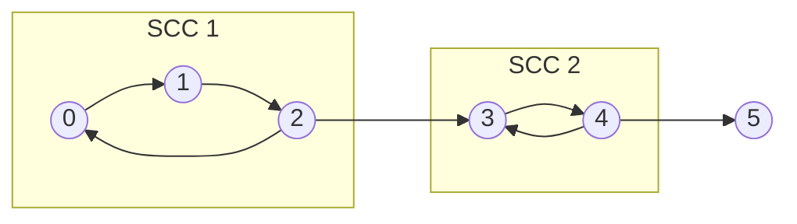

# Strongly connected components (`kosaraju`)

Splits a directed graph into strongly connected components (SCCs) and builds the condensation DAG.

**Files:** `kosaraju.cpp` (trigger `kosaraju`) · **Needs:** none (statement-level, no wrapper function) ·
**Tests:** `../test_graph_algos.cpp` (`Graph.KosarajuMatchesBruteForce`)

## Problems it solves
- "Which vertices can reach each other?": group the vertices into mutually reachable classes (CSES Flight Routes Check, Planets and Kingdoms).
- Turn a cyclic graph into a DAG by contracting each component, then run DP / topological sort on the condensation (Coin Collector).
- Minimum edges to add to make the graph strongly connected: from the condensation's sources and sinks.
- 2-SAT is SCC on the implication graph: see [`two_sat/`](../two_sat/README.md).
- Not for undirected graphs: connected components are a DSU, bridges and cut vertices are
  [`low_link/`](../low_link/README.md).

## API
In scope: `n` and `vector<int> adj[n]` (directed, 0-indexed). The snippet declares the variables below and fills them.
```cpp
int scc;                       // number of components
vector<int> order, root_nodes; // order: vertices by decreasing finish time; root_nodes: one representative per component
vector<int> root(n);           // root[v] = representative of v's component
vector<int> adjT[n], adj_scc[n];
// adj_scc[root[v]] holds root[u] for every cross-component edge v -> u (duplicates are possible, no self-loops)
```
`root_nodes` is in topological order of the condensation: a component appears before every component it can reach.
Representatives are vertex ids, not `0..scc-1`; map them (e.g. by index in `root_nodes`) if you need dense ids.

## Complexity
| Operation | Time | Memory |
|---|---|---|
| everything | O(V + E) | O(V + E) (transpose + condensation lists) |

Two DFS passes over the graph and its transpose, plus one pass to build `adj_scc`.

## How it works
1. DFS on the original graph and record the finishing order; reversed, a component that can reach another one comes
   first. The vertex with the largest finish time lies in a source component of the condensation.
2. DFS on the **transpose** graph in that order. Starting from a vertex of a source component, the transpose DFS cannot
   leave its own component (edges into it from later components were reversed away), so it collects exactly that SCC.
3. Repeat; each tree of the second pass is one component, labelled by its first vertex.


`root_nodes` lists SCC 1 before SCC 2 before `{5}`, and `adj_scc[root[2]]` contains `root[3]`.

## Pitfalls and variants
- Both DFS are recursive (`function<void(int)>`): 2e5-vertex chains need the large stack (the judges and the tests provide it).
- `adj_scc` has one entry per cross-component edge, so it may contain duplicates; `sort` + `unique` if it matters
  (counting paths needs the multiplicity, reachability does not).
- It declares `scc`, `order`, `root`, ... at the paste point, so paste it once per scope and avoid name clashes.
- It uses `vector<int> adjT[n]` arrays of variable length (a GCC extension), consistent with the other graph snippets.
- Tarjan's algorithm needs one pass and no transpose; the AtCoder `scc_graph` inside [`two_sat.cpp`](../two_sat/two_sat.cpp)
  is that variant (its component ids are already in topological order).

## Practice
- CSES: Flight Routes Check, Planets and Kingdoms, Giant Pizza (2-SAT), Coin Collector
- AtCoder Library Practice Contest G (SCC)
- Codeforces 427C (Checkposts)
