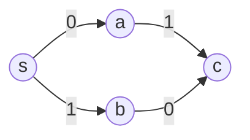

# 0-1 BFS (`01bfs`)

Single-source shortest paths when every edge weight is 0 or 1, using a deque instead of a heap.

**Files:** `01bfs.cpp` (trigger `01bfs`) · **Needs:** none (`@fragment`: reads the edges itself) ·
**Tests:** `../../test_flow_and_io.cpp` (`ZeroOneBfs.MatchesBruteForce`)

## Problems it solves
- Shortest path where moves are either free or cost 1: "minimum number of edges to reverse so that a path exists", grid problems where turning or walking through a wall costs 1.
- Minimum number of switches/changes along a path when each step is "keep going" (0) or "change" (1).
- State-space BFS with two kinds of transitions, one free and one costing 1.
- Weights in {0, 1, 2, ...}: use [`dijkstra`](../dijkstra/README.md) (or a bucket queue); all weights equal: plain BFS.

## API
Whole-fragment: reads the graph from `cin`, so `n`, `m` and the source `s` must be in scope.
```cpp
// input: m lines "u v" (1-indexed): edge u -> v costs 0, and the reverse move v -> u costs 1
vector<pair<int, int>> adj[n];     // {to, weight in {0, 1}}
vector<int> dist(n, INF);          // dist[v] = minimal cost from s, INF if unreachable
deque<int> q;
```
Edit the reading loop to match your own graph (for example, push `{v, 0}` only, or both directions with different weights).

## Complexity
| Operation | Time | Memory |
|---|---|---|
| whole run | O(V + E) | O(V + E) |

A vertex can be pushed again each time its distance improves, but the deque order keeps distances non-decreasing from front
to back, so each vertex is improved only a few times.

## How it works
The deque always holds vertices whose distances differ by at most 1 and are sorted from front to back. Relaxing a 0-edge
pushes the neighbour to the **front** (same distance as the current vertex); a 1-edge pushes it to the **back**
(one more). This keeps the deque sorted by distance, imitating Dijkstra without the log factor.


`dist = {s: 0, a: 0, b: 1, c: 1}`: `a` goes to the front of the deque, `b` to the back.

## Pitfalls and variants
- The snippet is 1-indexed on input (`u--`, `v--`) and the weights are hard-coded by the two `push_back` lines.
- Only strictly improving relaxations are pushed (`now < dist[u]`), so no `visited` array is needed.
- Weights greater than 1 break the argument; use Dijkstra.
- To recover the path, add a `parent` array updated with `dist` and use [`restore_path`](../../restore_path.cpp).

## Practice
- AtCoder ABC 176 D (Wizard in Maze), Codeforces 590C (Three States)
- LeetCode 1368 (Minimum Cost to Make at Least One Valid Path in a Grid)
