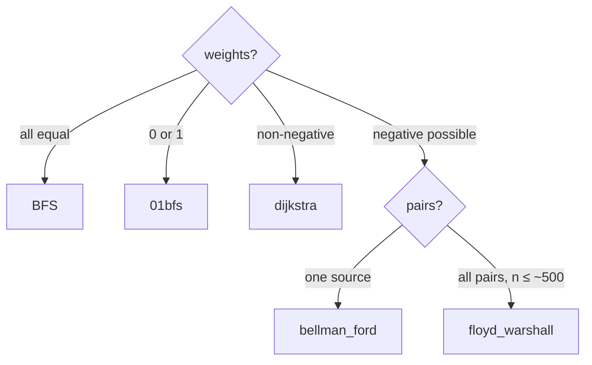

# Shortest Path Algo in Graphs

| Folder | Problem | Weights | Time |
|---|---|---|---|
| [`dijkstra/`](dijkstra/README.md) | single source | non-negative | O(E log V) |
| [`bellman_ford/`](bellman_ford/README.md) | single source, finds negative cycles | any | O(V · E) |
| [`floyd_warshall/`](floyd_warshall/README.md) | all pairs, finds negative cycles | any | O(V³) |

Related, elsewhere in `graph/`: `01bfs.cpp` (weights 0/1, O(V + E)) and `restore_path.cpp` (walk `parent[]` back
from the target).

All three are statement-level snippets: they declare `dist` / `parent` (or use your `dist` matrix)
and a lambda, and expect `n`, `adj` or `edges` to be in scope. `test_shortest_path.cpp` checks them against each
other and against a brute force on random graphs.

