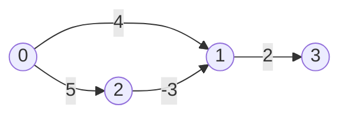

# Bellman-Ford
Single source shortest path with negative weight edges; also detects negative cycles.

**Files:** `bellman_ford.cpp` (alias `shortest_path_bellman_ford`) · **Needs:** none (statement-level snippet)
· **Tests:** `../test_shortest_path.cpp`

## Problems it solves
- Shortest paths when some edges are negative (single source).
- Detecting a negative cycle and printing it (CSES Cycle Finding).
- Systems of difference constraints `x_v − x_u ≤ w`: one edge per constraint, add a source with 0-edges to everyone.
- Use [`dijkstra`](../dijkstra/README.md) when all weights are ≥ 0: it is far faster.

## API
In scope: `n` and `edges` as a container of `{u, v, wt}` (structured bindings: `array<int, 3>` or a tuple).
```cpp
// pastes: int changed; vector<int> dist(n, INF), parent(n, -1); auto bellman = [&](int source) {...};
bellman(0);                  // the snippet then checks `changed` and recovers a negative cycle into `cycle`
```
If you only need to find a negative cycle (anywhere in the graph), initialize `dist` with 0 instead of INF.

## Complexity
- We do n - 1 relaxations for each edges. Proof by taking a linear graph
- If on nth iteration dist changes then negative cycle exits and to find all such points do dfs
- For finding negative cycle go back to nth parent of the changed vertex so that you are in cycle then while loop to get cycle
- TC : O(V * E)

| Operation | Time | Memory |
|---|---|---|
| `bellman(source)` | O(V · E) | O(V) |

The loop stops early once a full pass changes nothing.

## How it works
A shortest path without a negative cycle has at most `n - 1` edges, so `n - 1` rounds of relaxing every edge
(`dist[v] = min(dist[v], dist[u] + wt)`) make all distances final: after round `k`, `dist[v]` is at most the best
path using `k` edges. If round `n` still improves something, a negative cycle is reachable; following `parent` `n` times
from the improved vertex lands inside the cycle.


Round 1 sets `dist[1] = 4`; round 2 improves it to `5 - 3 = 2` through vertex 2. Dijkstra would fix `dist[1] = 4` too early.

## Pitfalls and variants
- `dist[u] != INF` guards the relaxation, so unreachable vertices never "relax" each other downwards.
- A vertex that only *reaches* a negative cycle is not on it: walk `parent` n times first, as the snippet does.
- To mark all vertices whose distance is −∞, run a DFS/BFS from every vertex changed in the n-th pass.
- SPFA (queue-based) is often faster in practice, but has the same worst case.

## Practice
- CSES: High Score (longest path = negated weights, −∞ detection), Cycle Finding
