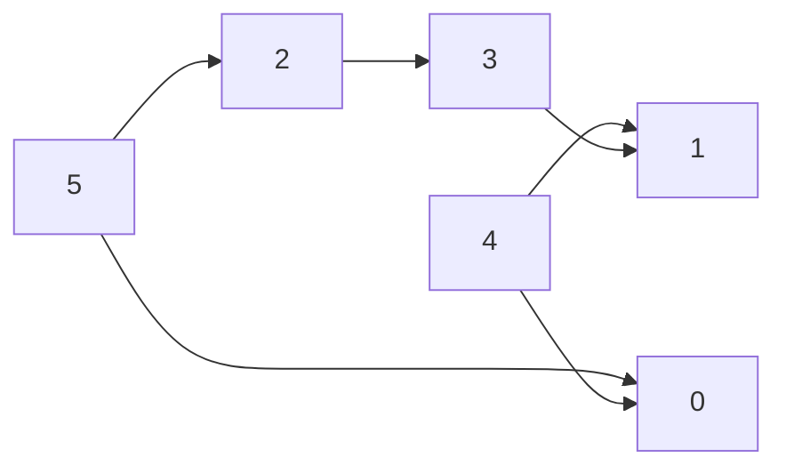

# Topological sort (`topological_sort_bfs`, `topological_sort_dfs`)

An ordering of the vertices of a directed acyclic graph in which every edge `v -> u` has `v` before `u`.

**Files:** `topological_sort_bfs.cpp` (trigger `topological_sort_bfs`, alias `Topological_Sort_Bfs`),
`topological_sort_dfs.cpp` (alias `Topological_Sort_Dfs`) · **Needs:** none (statement-level lambdas) ·
**Tests:** `../test_graph_algos.cpp` (`Graph.TopologicalSortAndCycleChecks`)

## Problems it solves
- "Order the tasks so that every prerequisite comes first" (course schedule, build order, CSES Course Schedule).
- DP over a DAG: process vertices in topological order so that all predecessors are final (longest path, number of paths).
- Cycle detection as a by-product: the BFS version returns fewer than `n` vertices if the graph has a cycle
  (see [`cycle_detection/`](../cycle_detection/README.md)).
- Lexicographically smallest order: replace the `queue` in the BFS version with a `priority_queue` (min-heap).
- Not for undirected graphs, and not when the graph may contain cycles and you need components: use [`scc/`](../scc/README.md).

## API
In scope: `n` and `vector<int> adj[n]` (or any `adj[v]` iterable of `int`), 0-indexed edges `v -> u`.
```cpp
// pastes: function<vector<int>()> Topological_Sort_Bfs = [&]() { ... };
vector<int> topo = Topological_Sort_Bfs();   // Kahn's algorithm; topo.size() < n  <=>  there is a cycle

// pastes: function<vector<int>()> Topological_Sort_Dfs = [&]() { ... };
vector<int> topo = Topological_Sort_Dfs();   // reversed DFS finishing order; ALWAYS n entries, NOT valid if a cycle exists
```

## Complexity
| Operation | Time | Memory |
|---|---|---|
| BFS (Kahn) | O(V + E) | O(V) (in-degrees, queue, result) |
| DFS | O(V + E) | O(V) plus recursion depth up to V |

Every vertex and every edge is touched a constant number of times in both versions.

## How it works
**Kahn (BFS).** Compute in-degrees, push every vertex of in-degree 0, and repeatedly pop a vertex, append it to the
answer, and decrement the in-degree of its out-neighbours, pushing those that reach 0. A vertex enters the queue only
after all its predecessors left it, so the order is topological. Vertices on a cycle never reach in-degree 0, which is
exactly why `topo.size() != n` detects a cycle.

**DFS.** A vertex is appended to `topo` after all its descendants (post-order), so for every edge `v -> u` the vertex
`u` is appended before `v`. Reversing the list puts `v` before `u`.


Kahn on this graph starts from the sources `{5, 4}` and could output `5 4 2 0 3 1`. Any order with every arrow pointing right is valid.

## Pitfalls and variants
- The DFS version does **not** report cycles: on a cyclic graph it returns a meaningless order. Use the BFS version, or
  [`dg_cycle`](../cycle_detection/README.md), when the input may be cyclic.
- The result is not unique; if the statement wants a specific one (smallest lexicographic), use a heap in Kahn.
- The DFS version is recursive (`function<void(int)>`); a path graph of 2e5 vertices relies on the 256 MB stack the judge gives.
- Both are `function<...>` lambdas, which are a little slower than plain functions; fine for 2e5 vertices.
- Pick BFS when you also need cycle detection or lexicographic order, DFS when you already have a DFS-shaped solution.

## Practice
- CSES: Course Schedule, Longest Flight Route, Game Routes
- LeetCode 207 / 210 (Course Schedule I / II)
- Codeforces 510C (Fox and Names)
