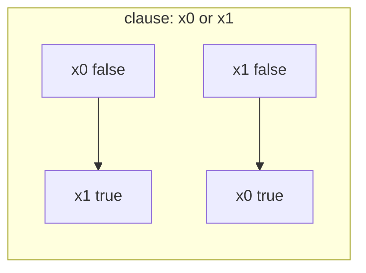

# 2-SAT (`two_sat`)

Satisfiability of a conjunction of clauses `(x_i = f) or (x_j = g)`, with an assignment when one exists. This is the
AtCoder Library `atcoder::two_sat`, bundled with its `scc_graph` (Tarjan SCC).

**Files:** `two_sat.cpp` (trigger `two_sat`) · **Needs:** none (self-contained namespace `atcoder`, ends with
`using namespace atcoder;`) · **Tests:** `../test_flow_and_io.cpp` (`TwoSat.MatchesBruteForce`)

## Problems it solves
- "Choose one of two options for each item so that all pairwise constraints hold" (each constraint involves at most two items).
- Constraints such as "a or b", "a implies b", "a and b cannot both be true", "a equals b" (two clauses), "a xor b".
- Typical statements: n switches / lamps / people with yes-no choices and m constraints (CSES Giant Pizza), scheduling with two time slots.
- Not for three literals per clause (3-SAT is NP-hard), and not when you need to count or optimize assignments.

## API
```cpp
atcoder::two_sat ts(n);              // n boolean variables 0..n-1
ts.add_clause(i, f, j, g);           // adds (x_i == f) or (x_j == g); f, g are bool; i == j is allowed
bool ok = ts.satisfiable();          // runs SCC; call before answer()
vector<bool> x = ts.answer();        // x[i] is the value of variable i; valid only if satisfiable() returned true
```
Also available: `atcoder::internal::scc_graph g(n); g.add_edge(u, v); auto groups = g.scc();` (vertex lists in
topological order) or `g.scc_ids()` (`{count, id[v]}`, ids in topological order of the condensation).
Derived constraints: `a -> b` is `add_clause(a, false, b, true)`; "not both" is `add_clause(a, false, b, false)`;
forcing `x_a = true` is `add_clause(a, true, a, true)`.

## Complexity
| Operation | Time | Memory |
|---|---|---|
| `add_clause` | O(1) | 2 edges |
| `satisfiable` | O(n + m) | O(n + m) |
| `answer` | O(n) copy | O(n) |

The implication graph has `2n` vertices and `2m` edges; one Tarjan SCC pass solves it.

## How it works
Vertex `2i` means "x_i is false" and `2i+1` means "x_i is true". A clause `(A or B)` is equivalent to the two
implications `not A -> B` and `not B -> A`, which `add_clause` inserts. The formula is unsatisfiable exactly when some
variable lies in the same SCC as its negation. Otherwise assign `x_i = true` when the SCC of `2i+1` comes **later** in
topological order than that of `2i` (`id[2i] < id[2i+1]`): the standard rule that picks the literal that implies the other.


Each clause adds the pair of implications shown; a path `x -> not x -> x` in the graph means a contradiction.

## Pitfalls and variants
- `answer()` returns whatever was stored by the last `satisfiable()` call; do not read it after a `false`.
- `i`, `j` are asserted to be in `[0, n)`; the default constructor `two_sat()` builds an empty instance (n = 0).
- The SCC uses a recursive lambda; a long implication chain needs the big stack.
- To model "exactly one of a, b": `add_clause(a, true, b, true)` and `add_clause(a, false, b, false)`.
- Plain SCC with condensation edges is in [`scc/kosaraju.cpp`](../scc/README.md); use that when you need the DAG itself.

## Practice
- CSES: Giant Pizza
- AtCoder Library Practice Contest H (Two SAT)
- Codeforces 776D (The Door Problem), 1903F (Babysitting)
