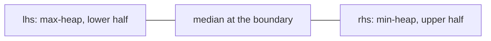

# Heaps

LeetCode / GFG answers plus two hand-written heap classes; they keep the judge's signatures. A binary heap stores a
complete binary tree in an array: the children of 1-indexed node `i` are `2i` and `2i + 1`, a min-heap keeps every
node `<=` its children (max-heap `>=`), so the top is the extreme element in O(1) and push / pop cost O(log n).
Building a heap from n items bottom-up (sift-down from `n / 2` to 1) is O(n), not O(n log n). Most snippets use
`std::priority_queue` (a max-heap by default; `greater<int>` or negated keys make it a min-heap).
No test file here: `python tools/check.py` only compile-checks the snippets.

**Files:** see the groups below · **Needs:** none (the judge supplies `Node`) · **Tests:** none

## Files by pattern

- **Heap implementations:** `min_heap.cpp`, `max_heap.cpp`
- **Array to heap (conversions):** `convert_max_to_min_heap.cpp`, `convert_min_to_max_heap.cpp`
- **Heap checks:** `is_min_heap.cpp`, `is_max_heap.cpp` (array), `is_binary_tree_min_heap.cpp`,
  `is_binary_tree_max_heap.cpp` (linked tree)
- **k-th / k smallest / k largest (bounded heap of size k):** `kth_largest.cpp`, `k_largest.cpp`, `k_smallest.cpp`
- **Merge:** `merge_k_arrays.cpp`, `merge_k_lists.cpp`, `merge_min_heaps.cpp`, `merge_max_heaps.cpp`
- **Two heaps / other heap uses:** `median_in_stream.cpp`, `max_combinations.cpp`, `find_smallest_range.cpp`,
  `replace_with_rank.cpp`

## Heap implementations

### `min_heap.cpp`: min-heap class
**Problem:** a hand-written priority queue with `insert(x)`, `remove()` (pop the minimum), `heap_sort()` and the
heapify constructor (`minHeap(int n)` for an empty heap with capacity, `minHeap(vector<int>&)` from data). The
minimum is `tree[1]`.
**Idea:** 1-indexed array `tree` of size `s`, the smallest power of two greater than `n`; empty slots hold the
sentinel `INF`, and `tree[0] = -INF` stops the insert loop at the root. `insert` writes at `++ind` and sifts up
while smaller than the parent. `remove` copies the last element to the root, clears the last slot and `propagate`s
(sifts down, picking the smaller child; reading the sentinel `INF` of a missing child makes it lose). The vector
constructor places `a[i - 1]` at `tree[i]` for `i = n..1` and sifts each down: heapify in O(n) (the comment links
the video explaining why).
**Complexity:** `insert`, `remove` O(log n); vector constructor O(n); `heap_sort` O(n log n) and it empties the
heap; memory O(s) = O(n) (up to 2n).
**Pitfalls:** capacity is fixed at `s - 1` elements (`n` rounded up to the next power of two, minus one);
inserting more writes out of range. `remove()` on an empty heap corrupts state (copies `tree[0]`). Values equal to
the sentinel (`INT_MAX`) are indistinguishable from "empty" and end `heap_sort` early. There is no `top()` or `size()`
accessor: read `tree[1]` and `ind`.

### `max_heap.cpp`: max-heap class
**Problem:** the mirror image of `min_heap.cpp` (`maxHeap`, maximum at `tree[1]`).
**Idea:** identical layout; sentinel `-INF` for empty slots, `tree[0] = INF`, comparisons reversed.
`heap_sort` returns the elements in descending order.
**Complexity:** same as the min-heap: `insert` / `remove` O(log n), heapify constructor O(n), `heap_sort`
O(n log n), memory O(n).
**Pitfalls:** same as `min_heap.cpp`; a stored value of `-INT_MAX` equals the empty sentinel.

## Conversions

### `convert_max_to_min_heap.cpp`: max-heap array to min-heap
**Problem:** the array `a[0..n-1]` is a max-heap; rearrange it into a min-heap (`void convertMaxToMinHeap(vector<int>&,
int n)`). GFG "Convert Min Heap to Max Heap" family (link not verified).
**Idea:** the old order is useless, so rebuild: for `k = n/2` down to 1 sift node `k` down (swap with the smaller
child while larger than it). Indices are 1-based in the code (`a[i - 1]`).
**Complexity:** time O(n) (sum over levels of height times number of nodes), extra space O(1).
**Pitfalls:** `n` is passed in and may be less than `a.size()`. The sift-down stops early at an equal child, which is
fine for non-strict heaps.

### `convert_min_to_max_heap.cpp`: min-heap array to max-heap
**Problem:** the opposite direction (`void convertMinToMaxHeap(vector<int>&, int n)`).
**Idea:** the same bottom-up heapify with the comparisons flipped (swap with the larger child).
**Complexity:** time O(n), extra space O(1).
**Pitfalls:** as above. The same function body is pasted into `merge_max_heaps.cpp`.

## Heap checks

### `is_min_heap.cpp`: is this array a min-heap
**Problem:** decide whether `a[0..n-1]` satisfies the min-heap property (`bool isMinHeap(int a[], int n)`). GFG "Is
Binary Tree Heap" family (link not verified).
**Idea:** for each node `i` compare with the children `2i` and `2i + 1` if they exist (a missing child is replaced by
`INF` so it never fails). Checking parent against child is enough, the property is transitive.
**Complexity:** time O(n), extra space O(1).
**Pitfalls:** equal values are allowed (non-strict). The tree versions below are strict.

### `is_max_heap.cpp`: is this array a max-heap
**Problem:** the max-heap property for an array (`bool isMaxHeap(int a[], int n)`).
**Idea:** same loop, `a[i - 1] >= max(left, right)`.
**Complexity:** time O(n), extra space O(1).
**Pitfalls:** a missing child is represented by `-1`, so a node with a value below `-1` and no children is wrongly
rejected (`a[i] >= -1` fails); the min-heap check uses `INF` and has no such problem.

### `is_binary_tree_min_heap.cpp`: is this binary tree a min-heap
**Problem:** for a linked binary tree, is it a complete binary tree that satisfies the min-heap order
(`bool isMinHeap(Node*)`). GFG "Is Binary Tree Heap" (link not verified).
**Idea:** level-order BFS, three conditions. Heap order: `v->data` against both children (strict `<`).
Completeness inside a level: once a node lacks a child (`check = false`), no later child may appear in that level
or the levels below. Completeness across levels: a level whose number of children `cnt` differs from the expected
`m` (doubling every level) may happen at most once (`last`), because only the final level may be partial.
**Complexity:** time O(n), extra space O(w) for the queue (w = widest level).
**Pitfalls:** an empty tree crashes (the null root is dequeued and dereferenced). Heap order is strict, so equal
values fail (the array checks allow them). `m *= 2` is a plain `int` and overflows on a tree deeper than about 30
levels, which only a non-complete tree can have.

### `is_binary_tree_max_heap.cpp`: is this binary tree a max-heap
**Problem:** the same for the max-heap order (`bool isMaxHeap(Node*)`).
**Idea:** identical to the min version with `>` instead of `<`.
**Complexity:** time O(n), extra space O(w).
**Pitfalls:** same as the min version. Its name equals the array version's `isMaxHeap`, so paste only one of them.

## k-th, k largest, k smallest

### `kth_largest.cpp`: k-th largest in a stream
**Problem:** for every prefix of the array print the k-th largest element, or `-1` while fewer than `k` elements
have been seen (`vector<int> kthLargest(int k, int a[], int n)`). GFG "k-th largest element in a stream" (link not
verified); LeetCode 703 is the class version.
**Idea:** a min-heap of the `k` largest seen so far; its top is the k-th largest. A new element enters only if it is
bigger than the top (which is popped).
**Complexity:** time O(n log k), extra space O(k).
**Pitfalls:** `k = 0` reads `top()` of an empty heap. Duplicates count separately (the k-th largest of
`[5, 5]` for `k = 2` is `5`).

### `k_largest.cpp`: k largest elements
**Problem:** the `k` largest values in descending order (`vector<int> kLargest(int a[], int n, int k)`). GFG "k largest
elements" (link not verified).
**Idea:** the same bounded min-heap; at the end pop everything (ascending) and reverse.
**Complexity:** time O(n log k), extra space O(k).
**Pitfalls:** `k > n` returns all `n` elements; `k = 0` reads `top()` of an empty heap. `std::nth_element` is O(n)
average when only the set (not the order) is needed.

### `k_smallest.cpp`: k smallest elements
**Problem:** the `k` smallest values in ascending order (`vector<int> kSmallest(int a[], int n, int k)`). GFG "k smallest
elements" (link not verified).
**Idea:** a bounded max-heap of size `k`: its top is the largest of the current `k` smallest, replaced when a
smaller element arrives; the final pops come out descending, so reverse.
**Complexity:** time O(n log k), extra space O(k).
**Pitfalls:** same as `k_largest.cpp`.

## Merge

### `merge_k_arrays.cpp`: merge k sorted arrays
**Problem:** merge `k` sorted arrays into one sorted vector (`vector<int> mergeKArrays(vector<vector<int>>, int k)`).
GFG "Merge K sorted arrays" (link not verified).
**Idea:** the implementation pushes every element of every array into one min-heap and pops them all, i.e. a heap
sort of the concatenation; it does not use the fact that the inputs are sorted.
**Complexity:** time O(N log N), extra space O(N), where N is the total number of elements. The textbook version keeps
one `(value, array, index)` entry per array in the heap and runs in O(N log k) with O(k) extra space.
**Pitfalls:** the parameter `k` is unused and the input is copied (passed by value). Empty arrays are fine.

### `merge_k_lists.cpp`: merge k sorted linked lists
**Problem:** merge `n` sorted singly linked lists into one sorted list (`Node* mergeKLists(Node* a[], int n)`). GFG
"Merge K sorted linked lists"; LeetCode 23 (link not verified).
**Idea:** a min-heap (max-heap of negated keys, `priority_queue<pair<int, Node*>>`) holds the current head of each list.
Pop the smallest, append it to the result, and push its successor.
**Complexity:** time O(N log k) for N total nodes, extra space O(k); the nodes are relinked in place.
**Pitfalls:** every `a[i]` must be non-null (it is dereferenced to build the heap); `n = 0` returns null. Negating
the key overflows for `INT_MIN`. Equal keys compare the node pointers, so the order among equals is arbitrary (not
stable).

### `merge_min_heaps.cpp`: merge two min-heaps
**Problem:** merge two binary min-heaps given as arrays (`vector<int> mergeMinHeaps(vector<int>&, vector<int>&, int n,
int m)`). GFG "Merge two binary Max heaps" family (link not verified).
**Idea:** heapify both inputs with `convertMaxToMinHeap` (pasted into the file), then merge them with two pointers,
repeatedly taking the smaller head.
**Complexity:** time O(n + m), extra space O(n + m) for the result.
**Pitfalls:** the two-pointer merge treats the arrays as sorted, which heap arrays are not, so the result holds the
right multiset but is not guaranteed to satisfy the heap property (see the max example below). Concatenating and
heapifying with the conversion function is guaranteed. The conversion function is a copy of
`convert_max_to_min_heap.cpp` instead of `@needs`.

### `merge_max_heaps.cpp`: merge two max-heaps
**Problem:** the max-heap version (`vector<int> mergeMaxHeaps(vector<int>&, vector<int>&, int n, int m)`).
**Idea:** heapify both with `convertMinToMaxHeap` (pasted copy), then two-pointer merge taking the larger head.
**Complexity:** time O(n + m), extra space O(n + m).
**Pitfalls:** for `[10, 1, 9]` and `[8, 7, 6]` the output is `[10, 8, 7, 6, 1, 9]`, where node 7 (index 2) has the
larger child 9 (index 5): not a heap. It also duplicates `convert_min_to_max_heap.cpp` and defines the same function
name, so it cannot be pasted together with that file.

## Two heaps and other heap uses

### `median_in_stream.cpp`: running median
**Problem:** after each insertion report the median of all numbers so far (`insertHeap(int&)`, `getMedian()`). GFG
"Find median in a stream"; LeetCode 295 (link not verified).
**Idea:** the lower half lives in a max-heap `lhs`, the upper half in a min-heap `rhs`, with `lhs` equal to or one
larger than `rhs`. A new element goes to the correct side and, if the sizes would be off by one the wrong way, the
top of the bigger heap moves across. The median is `lhs.top()` for an odd count, otherwise the average of both tops.

**Complexity:** insert O(log n), median O(1), memory O(n).
**Pitfalls:** `getMedian` on an empty structure reads `lhs.top()` of an empty heap. The median is a `double`
(half-integers). `insertHeap` takes `int&`, so it cannot be called with a literal.

### `max_combinations.cpp`: top-k pair sums
**Problem:** from two arrays of size `n` take one element of each and return the `k` largest sums in descending
order (`vector<int> maxCombinations(int n, int k, vector<int>&, vector<int>&)`). InterviewBit "Maximum Sum
Combinations" / GFG (link not verified).
**Idea:** sort both arrays descending. The largest sum is `(0, 0)`. A max-heap of index pairs pops the best pair and
pushes its two neighbours `(i + 1, j)` and `(i, j + 1)`; a `set` of seen pairs prevents pushing the same pair twice.
**Complexity:** time O(n log n + k log k), extra space O(k) for the heap and the set.
**Pitfalls:** it sorts the caller's arrays in place. If `k > n * n` it stops when the heap is empty and returns fewer
sums. Sums use `int` and can overflow for large inputs.

### `find_smallest_range.cpp`: smallest range covering k lists
**Problem:** `k` sorted lists of `n` elements each (`int a[][N]`); find the smallest range `[lo, hi]` containing at
least one element from every list (`pair<int, int> findSmallestRange(int a[][N], int n, int k)`). GFG "Find smallest
range containing elements from k lists"; LeetCode 632 is the vector version (link not verified). `@fragment` because
`N` comes from the judge.
**Idea:** a min-heap with the current element of each list and a running maximum `maxi`. The range
`[heap top, maxi]` covers every list; record it if it is the smallest so far, then advance the list of the minimum
(updating `maxi`). Stop when some list is exhausted.
**Complexity:** time O(n k log k), extra space O(k) heap entries.
**Pitfalls:** `maxi` starts at `-1`, so lists containing negative numbers break it. Heap entries are allocated with
`new` and never freed. A tie on length keeps the first (leftmost) range found.

### `replace_with_rank.cpp`: replace elements by their rank
**Problem:** replace each element with its rank (smallest = 1); equal values share a rank, with no gaps afterwards
(`vector<int> replaceWithRank(vector<int>&, int n)`). GFG "Replace elements by its rank in the array" (link not
verified).
**Idea:** a min-heap of indices ordered by `(value, index)`. Pop in sorted order; a value equal to the previous
distinct value gets the same rank, otherwise the next rank.
**Complexity:** time O(n log n), extra space O(n).
**Pitfalls:** the comparator is written "backwards" for `priority_queue` (it defines a max-heap on `<`, so the
comment says it works in reverse). Sorting a copy and binary searching or a map from value to rank achieves the same.
