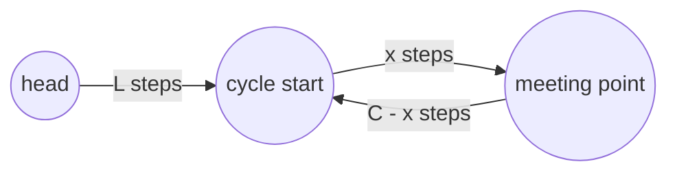
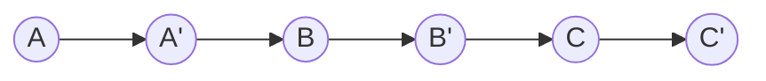

# Linked lists

LeetCode / GFG answers; they keep the judge's signatures. Nodes are the judge's `ListNode` (`val`, `next`) or `Node`
(`data`, `next`, plus `arb` for the random pointer or `bottom` for the multilevel list). Almost every problem here is
pointer rewiring: keep the pointers you are about to overwrite in local variables first, and use two pointers
(slow / fast, or a lagging `prev`) instead of extra memory. No test file: `python tools/check.py` only
compile-checks the snippets.

**Files:** see the groups below · **Needs:** none (the judge supplies the node type) · **Tests:** none

## Files by pattern

- **Reversal:** `reverse_iterative.cpp`, `reverse_recursive.cpp`, `reverse_k_group.cpp`
- **Cycle detection (Floyd, slow and fast pointers):** `cycle.cpp`, `find_start_cycle.cpp`
- **Merge based:** `merge_sort.cpp`, `flatten.cpp`
- **Rewiring tricks:** `copy_list.cpp` (interleave copies), `rotate.cpp` (close into a ring)
- **Design:** `lru_cache.cpp` (doubly linked list + hash map)

## Reversal

Reversing walks the list once and turns every `next` around:

### `reverse_iterative.cpp`: reverse a linked list
**Problem:** reverse a singly linked list and return the new head (`ListNode* reverseList(ListNode*)`). LeetCode 206
(https://leetcode.com/problems/reverse-linked-list/).
**Idea:** keep `temp1` = the already reversed prefix (initially null). For the current node save `next`, point it to
`temp1`, then advance both. When there is no next node, the current node is the new head.
**Complexity:** time O(n), extra space O(1).
**Pitfalls:** an empty list returns null (explicit check); a single node returns itself. Always save `head->next`
before overwriting it.

### `reverse_recursive.cpp`: reverse a linked list, recursively
**Problem:** the same problem, recursive (`ListNode* reverseList(ListNode*)`). LeetCode 206.
**Idea:** the recursion is the loop of the iterative version turned into a tail call `f(prefix, node)`: rewire the
node, then recurse on the saved next node, and return the last node as the head.
**Complexity:** time O(n), extra space O(n) for the call stack (the compiler need not remove the tail call).
**Pitfalls:** a 10^5-node list recurses 10^5 deep; fine with the judges' 256 MB stack, but prefer the iterative
version in contests. The unused local `temp1` is a leftover. Empty list returns null.

### `reverse_k_group.cpp`: reverse nodes in k-group
**Problem:** reverse the list `k` nodes at a time; a final group shorter than `k` stays as it is
(`ListNode* reverseKGroup(ListNode*, int k)`). LeetCode 25
(https://leetcode.com/problems/reverse-nodes-in-k-group/).
**Idea:** this solution swaps the values, not the nodes. Count the length `n` and keep `n / k * k` nodes. In every
group of `k`, push the first `ceil(k / 2)` nodes on a stack (dropping the middle one when `k` is odd); for the
remaining nodes pop the stack and swap values, pairing positions `j` and `k - 1 - j`.
**Complexity:** time O(n), extra space O(k) for the stack.
**Pitfalls:** LeetCode states the values must not be changed, only the links, so this passes the judge but breaks the
rule (an O(1)-space version rewires `next` per group). `k = 1` or `k > n` leaves the list unchanged. An empty list
returns null.

## Cycle detection

Floyd's tortoise and hare: `slow` moves one step, `fast` two. If the list has a cycle they meet inside it, otherwise
`fast` reaches the end.

### `cycle.cpp`: detect a cycle
**Problem:** does the list contain a cycle (`bool hasCycle(ListNode*)`)? LeetCode 141
(https://leetcode.com/problems/linked-list-cycle/).
**Idea:** run `slow` and `fast` while `fast` and `fast->next` exist; if they ever point to the same node there is a
cycle. The gap between them shrinks by 1 each round inside a cycle, so they meet within `C` rounds once both are in it.
**Complexity:** time O(n), extra space O(1).
**Pitfalls:** empty list returns false; a single node pointing to itself returns true (they meet after one step).
The loop must test `fast->next` before `fast->next->next`.

### `find_start_cycle.cpp`: find where the cycle starts
**Problem:** return the node where the cycle begins, or null if there is none (`ListNode* detectCycle(ListNode*)`).
LeetCode 142 (https://leetcode.com/problems/linked-list-cycle-ii/).
**Idea:** after `slow` and `fast` meet, reset `fast` to the head and advance both one step at a time; they meet again
at the cycle start. Proof: let `L` be the distance from the head to the start, `x` the meeting point's offset inside
the cycle and `C` the cycle length. At the meeting `fast` has travelled twice as far: `2(L + x) = L + x + kC`, so
`L + x = kC`, meaning walking `L` steps from the meeting point lands on the start, exactly as walking `L` from the
head does.
**Complexity:** time O(n), extra space O(1).
**Pitfalls:** empty list and acyclic lists return null (the `ok` flag). The second loop only runs when a cycle exists.

## Merge based

### `merge_sort.cpp`: sort a linked list
**Problem:** sort a singly linked list (`ListNode* sortList(ListNode*)`). LeetCode 148
(https://leetcode.com/problems/sort-list/).
**Idea:** top-down merge sort. Find the middle with slow / fast pointers (`slow` ends on the last node of the first
half), cut the list there, sort both halves recursively and merge two sorted lists by relinking nodes. The `<=`
makes the sort stable.
**Complexity:** time O(n log n), extra space O(log n) recursion (no node copies; the merge is in place).
**Pitfalls:** empty list is handled in `sortList`; the recursion assumes a non-null head, and a single node returns
immediately. The recursion uses `std::function`, which is slower than the library's usual `auto &&` self-lambda.
The merge helper is a lambda named `merge`, shadowing `std::merge`.

### `flatten.cpp`: flatten a multilevel linked list
**Problem:** each node has a `next` pointer to the next column head and a `bottom` pointer to a sorted list below it;
flatten everything into one sorted list linked through `bottom` (`Node* flatten(Node*)`). GFG "Flattening a Linked
List" (link not verified).
**Idea:** push every column head on a stack while walking `next`, ending on the last column. Then repeatedly pop the
previous column and merge it with the accumulated list (the standard two-pointer merge of two sorted lists on
`bottom` pointers, with `p1->next` cleared).
**Complexity:** time O(N * k) worst case for N nodes in k columns (the accumulated list is re-walked on every merge;
a divide and conquer or heap merge gives O(N log k)); extra space O(k) for the stack.
**Pitfalls:** empty list returns null. Equal keys keep the left column first (`<=`). The result lists must end with
a null `bottom`, which holds because the last node of each merged list already has it.

## Rewiring tricks

### `copy_list.cpp`: clone a list with random pointers
**Problem:** deep copy a list in which every node also has an arbitrary pointer `arb` to any node or null
(`Node* copyList(Node*)`). GFG "Clone a linked list with next and random pointer"; LeetCode 138 (link not verified).
**Idea:** three passes without a hash map. (1) Insert a copy of every node right after the original. (2) Set each
copy's `arb` to `original->arb->next` (the copy of the target). (3) Split the interleaved list back into the
original and the copy.

**Complexity:** time O(n), extra space O(1) besides the n new nodes.
**Pitfalls:** an empty list crashes in the split phase (`head1->next`). The split must restore the original `next`
pointers. A null `arb` is handled by the `if (random)` check.

### `rotate.cpp`: rotate a list by k nodes
**Problem:** move the first `k` nodes to the end, so the list starts at node `k + 1` (`Node* rotate(Node* head,
int k)`). GFG "Rotate a Linked List" (link not verified); LeetCode 61 rotates from the right instead.
**Idea:** find the tail and the length `n`, reduce `k %= n`, walk to the `k`-th node, cut after it, link the old tail
to the old head, and return the old `(k + 1)`-th node as the new head.
**Complexity:** time O(n), extra space O(1).
**Pitfalls:** `k % n == 0` returns the original head. An empty list crashes (`head->next` is read without a check).
For the right rotation of LeetCode 61 use `n - k % n` instead.

## Design

### `lru_cache.cpp`: LRU cache
**Problem:** a cache of fixed `capacity` with `GET(key)` (returns the value or -1) and `SET(key, value)`; when it is
full a new key evicts the least recently used one. LeetCode 146 (https://leetcode.com/problems/lru-cache/); the GFG
version uses the names `GET` and `SET`.
**Idea:** a doubly linked list ordered by recency between two sentinels (`head` = most recent, `tail` = least recent)
plus an `unordered_map<key, Node*>` to find a node in O(1). Any access unlinks the node and re-inserts it after
`head`. Eviction removes `tail->prev` and erases it from the map; the node stores its `key` so the map entry can
be found.
**Complexity:** `GET`, `SET` O(1) expected; memory O(capacity).
**Pitfalls:** `capacity == 0` evicts the `head` sentinel (`tail->prev`) and corrupts the list. There is no destructor, so
the nodes leak when the cache is destroyed. `SET` on an existing key refreshes its recency (through `GET`). The
nested class `Node` is private to `LRUCache` and unrelated to the judge's `Node`.
