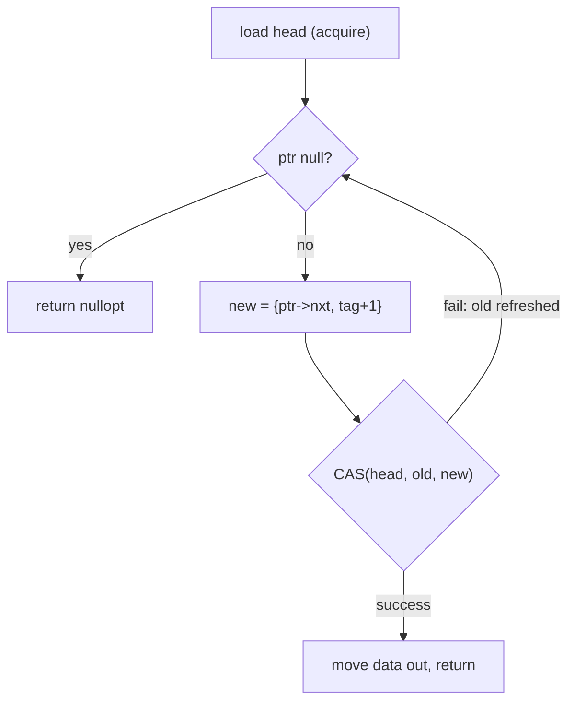

# Low-level / systems

Concurrency and memory snippets in interview style (spin lock, blocking queue, lock-free structures, allocators), not
contest code. Every file is self-contained, ships its own demo `main()`, and is pasted as a whole (no `@needs`).

**Files:** `benchmark_spin_lock.cpp`, `bounded_queue.cpp` (alias `BoundedQueue`), `custom_vector.cpp` (alias `customVector`),
`lock_free_stack.cpp` (alias `LockFreeStack`), `memory_pool.cpp` (alias `MemoryPool`), `spsc_queue.cpp` (alias `SPSCQueue`)
· **Needs:** none · **Tests:** `test_low_level.cpp`

| File | Topic | Key idea |
|---|---|---|
| [`benchmark_spin_lock.cpp`](#benchmark_spin_lockcpp-spin-lock-vs-mutex) | spin lock + benchmark | test-and-test-and-set, acquire/release, `pause` |
| [`bounded_queue.cpp`](#bounded_queuecpp-bounded-blocking-queue) | MPMC blocking queue | one mutex, two condition variables, predicate waits |
| [`custom_vector.cpp`](#custom_vectorcpp-stdvector-from-raw-storage) | `std::vector` clone | raw aligned storage, placement new, `std::launder` |
| [`lock_free_stack.cpp`](#lock_free_stackcpp-treiber-stack-with-tagged-pointers) | Treiber stack | CAS loop, ABA tag, no reclamation |
| [`memory_pool.cpp`](#memory_poolcpp-fixed-size-memory-pool) | fixed-size allocator | intrusive free list in a union |
| [`spsc_queue.cpp`](#spsc_queuecpp-single-producersingle-consumer-ring-buffer) | SPSC ring buffer | release/acquire on indices, no false sharing |

**Testing.** `test_low_level.cpp` renames each file's demo `main` and includes the file inside its own namespace, then
runs `SpscQueue.*`, `BoundedQueue.*`, `LockFreeStack.*`, `MemoryPool.*`, `CustomVector.*`. `benchmark_spin_lock.cpp`
is not in the test (timing output, x86-only intrinsic). MinGW has no TSan/ASan, so these tests show functional
correctness only. For a real data-race or memory check, build the suite in WSL with `-DENABLE_TSAN=ON` /
`-DENABLE_ASAN=ON` (see `handoff.md`, section 7).

### `benchmark_spin_lock.cpp`: spin lock vs mutex

**What it shows.** A `SpinLock` over `std::atomic_flag` and a benchmark that runs 4 threads x 100000 lock/unlock
rounds against `std::mutex`, once with an empty critical section and once with a 1000-iteration loop. The long
comment answers "when does a spin lock beat a mutex" (critical section shorter than a context switch and threads
no more than cores).

**Synchronisation idea.** `lock()` is test-and-test-and-set: spin on a plain `flag.test(relaxed)` (a read that stays in
the local cache line in shared state, so waiting threads do not bounce the line), and only when the flag looks free
try `test_and_set(acquire)`. `unlock()` is `clear(release)`. The acquire/release pair makes everything written in one
critical section visible to the next owner; nothing stronger (seq_cst) is needed. `__builtin_ia32_pause()` is the x86
`PAUSE` hint that stops the speculative pipeline flush when the flag finally changes and lowers power; the ARM
equivalent is `yield`.

**Guarantees.** Mutual exclusion and visibility between critical sections. Not fair (a thread can starve), not
reentrant, and no sleeping: a waiter burns a core.

**Pitfalls.**
- More spinning threads than cores, or blocking (I/O, page fault, preemption) while holding the lock, wastes whole
  time slices; use a mutex there.
- `__builtin_ia32_pause` does not compile on ARM; `atomic_flag::test` needs C++20 and `ATOMIC_FLAG_INIT` is
  deprecated in C++20.
- The benchmark loop does `cnt += j` on a `volatile int` (deprecated compound assignment in C++20) and needs `<string>`
  for `std::string name`; it only works because of other includes.

**Complexity.** Uncontended `lock`/`unlock` O(1) (one atomic RMW). Contended: unbounded spin, no progress guarantee.

### `bounded_queue.cpp`: bounded blocking queue

**What it shows.** `BoundedQueue<T>(cap)`: a multi-producer multi-consumer queue where `push` blocks while full and
`pop` blocks while empty. API: `void push(T)`, `[[nodiscard]] T pop()`.

**Synchronisation idea.**
- One mutex guards the `std::queue`, so no lock-ordering deadlock is possible.
- Two condition variables (`cv_not_full`, `cv_not_empty`): producers only wake consumers and the other way round, so a
  `notify_one` is never wasted on a thread of the same kind.
- `wait(lock, predicate)` re-checks the predicate, which handles spurious wakeups and lost wakeups when another thread
  grabbed the slot first.
- The lock is released before `notify_one`, so the woken thread does not immediately block on the mutex.
- Items are moved in and out.

**Guarantees.** Every pushed item is popped exactly once, FIFO order overall; the mutex gives all the needed
happens-before edges.

**Pitfalls.**
- No `close()`/shutdown: a consumer blocked in `pop` on an empty queue waits forever, so the demo and the tests must
  pop exactly as many items as are pushed.
- `cap == 0` deadlocks the first `push`.
- Not copyable or movable (mutex member). `T` must be move-constructible.

**Complexity.** `push`, `pop` O(1) amortised plus lock cost; memory O(cap).

### `custom_vector.cpp`: `std::vector` from raw storage

**What it shows.** `Vector<T>` with `reserve`, `resize`, `emplace_back`, `push_back`, `pop_back`, `clear`, `swap`,
`operator[]`, `front`, `back`, `begin`/`end`, `size`, `capacity`, `empty`, plus the rule of five.

**Memory idea.** Storage is a raw `std::byte*` obtained from the aligned `operator new`; elements are created with
placement `new` and destroyed explicitly, so capacity can exceed size without constructing anything. The only
`reinterpret_cast` is in `slot(i)`, wrapped in `std::launder`. Growth doubles (`cap ? 2 * cap : 1`), and on growth
elements are move-constructed into the new block and destroyed in the old one. Copy assignment uses copy-and-swap
(strong guarantee for the assignment itself), move operations are `noexcept` swaps.

**Guarantees.** Elements stay contiguous; references and iterators are invalidated by any reallocation.

**Pitfalls.**
- Reallocation moves with `std::move`, not `std::move_if_noexcept`: if `T`'s move constructor throws, the vector is
  left half-moved and the new block leaks.
- `push_back(v[0])` when full is an aliasing bug: `reserve` destroys the old elements before the new one is built
  from the dangling reference (`std::vector` handles this; here the argument must not alias an element).
- `reserve` and `resize` allocate exactly the requested size, so calling `resize(size() + 1)` in a loop is O(n^2).
- `pop_back`, `front`, `back` on an empty vector are undefined behaviour (no checks, like `std::vector`).
- The file has no `#include`s; it relies on `bits/stdc++.h` from the boilerplate. The copy constructor leaks if a copy
  throws midway.

**Complexity.** `operator[]`, `pop_back`: O(1). `push_back`/`emplace_back`: amortised O(1) (doubling), O(n) on
reallocation. `reserve`, `resize`, copy: O(n). Memory O(capacity).

### `lock_free_stack.cpp`: Treiber stack with tagged pointers

**What it shows.** `LockFreeStack<T>` with `void push(T)` and `std::optional<T> pop()`, built on one
`std::atomic<TaggedPtr> head` and a compare-and-swap loop.

**Synchronisation idea.**
- `push`: new node, then loop `node->nxt = old_head.ptr(); CAS(head, old_head, {node, tag + 1})`. Success order
  `release` publishes `data` and `nxt` to whoever acquires `head`; failure order `relaxed` because the failed CAS only
  refreshes `old_head`.
- `pop`: initial `load(acquire)`, then CAS with `acquire` on both success and failure. Failure also needs acquire
  because the next iteration dereferences the refreshed pointer to read `nxt`.
- ABA: a thread reads head = A, is delayed, others pop A, pop B, push A back; a plain CAS would succeed and install a
  stale `nxt`. The pointer is packed with a counter in the upper 16 bits (`tag_shift = 48`, x86-64 user addresses
  use 48 bits) and the tag is bumped on every successful CAS, so the 64-bit value differs. The atomic is lock-free
  only if `std::atomic<TaggedPtr>` is a native 8-byte CAS (`static_assert(sizeof == 8)`).

**Guarantees.** Lock-free (some thread always makes progress), LIFO, ABA-safe up to a 16-bit tag wrap-around (65536
operations while one thread sleeps between its load and its CAS). Individual threads can starve in the retry loop.

**Pitfalls.**
- Popped nodes are never freed (the file says so): the stack leaks one node per push. A real implementation needs hazard
  pointers, epoch-based or quiescent-state reclamation. This leak is also what makes reading `old_head.ptr()->nxt`
  safe here.
- The tag is only 16 bits wide despite the "64-bit version tag" comment. Pointer packing breaks on 5-level paging or
  ARM pointer tagging; a double-width CAS (`cmpxchg16b`) is the portable fix.
- The demo uses `assert`, which vanishes with `NDEBUG`.

**Complexity.** `push`, `pop` O(1) per attempt, unbounded retries under contention; memory O(n) plus the leak.

### `memory_pool.cpp`: fixed-size memory pool

**What it shows.** `MemoryPool<T, PoolSize>` with `T* allocate()` and `void deallocate(T*)`, the allocator behind
order objects in a trading engine demo (`struct Order`).

**Memory idea.** One block of `PoolSize` chunks, each a `union { T obj; Chunk* nxt; }`. Free chunks are linked through
`nxt` (an intrusive free list, no extra memory). `allocate` pops the head, `deallocate` pushes onto the head, so the
list is a LIFO stack: the most recently freed chunk is reused first and stays hot in cache (the file's comment), and
there is no fragmentation because every chunk has the same size.

**Guarantees.** O(1) allocate/deallocate, no calls to the system allocator after construction, `allocate` throws
`std::bad_alloc` when exhausted, `deallocate(nullptr)` is a no-op.

**Pitfalls.**
- `allocate` returns raw memory: no constructor runs and `deallocate` runs no destructor. Use placement `new` /
  explicit `~T()` for non-trivial types.
- No double-free or foreign-pointer detection (either corrupts the list).
- Not thread-safe; not copy-safe either (copying would double `delete[]`).
- `PoolSize == 0` indexes `pool[-1]`. `std::bad_alloc` needs `<new>` (the file only includes `<iostream>` and
  `<stdexcept>`, which suffice in practice).
- `sizeof(Chunk)` is `max(sizeof(T), sizeof(void*))`, so tiny `T` still pay 8 bytes.

**Complexity.** Construction O(PoolSize) (links the free list); `allocate`, `deallocate` O(1); memory
`PoolSize * sizeof(Chunk)`.

### `spsc_queue.cpp`: single-producer single-consumer ring buffer

**What it shows.** `SPSCQueue<T, Size>` (`Size` a power of two, checked by `static_assert`) with
`[[nodiscard]] bool push(T)` (false if full) and `[[nodiscard]] std::optional<T> pop()` (nullopt if empty).

**Synchronisation idea.** Only the producer writes `head`, only the consumer writes `tail`, so no CAS and no lock.
- Producer: `head.load(relaxed)` (its own variable), check `nxt != tail.load(acquire)`, write the slot, then
  `head.store(nxt, release)`. The release store publishes the slot write.
- Consumer: `tail.load(relaxed)`, check `cur != head.load(acquire)`, move the slot out, `tail.store(nxt, release)`
  (hands the slot back to the producer).
- `head` and `tail` are `alignas(64)` so they sit on different cache lines: otherwise each side's store invalidates
  the other's line (false sharing) even though they never write the same variable. The comment notes
  `std::hardware_destructive_interference_size` as the portable constant.
- Indices wrap with `& (Size - 1)` instead of `%`.

**Guarantees.** Wait-free for both sides, FIFO, exactly one producer thread and one consumer thread. One slot is
always kept empty to tell full from empty, so the capacity is `Size - 1`.

**Pitfalls.**
- Two producers or two consumers silently break it (this is not an MPMC queue).
- `T` must be default constructible (it lives in `std::array<T, Size>`) and move-assignable; moved-from slots are not
  destroyed until overwritten.
- `Size` is a template argument, so a large buffer lives inside the object (stack if the queue is a local).
  `Size == 1` passes the `static_assert` but holds nothing.
- The spin loops in the demo burn CPU while waiting; add `yield` or a backoff in real code.

**Complexity.** `push`, `pop` O(1) worst case; memory `Size * sizeof(T)` plus two cache lines.

## Practice
- Interview staples: "implement a thread-safe bounded queue", "what is ABA", "why alignas(64)", "implement a memory
  pool / vector". For lock-free reading: C++ Concurrency in Action (ch. 5, 7).
