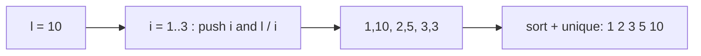

# Floor and ceiling (`floor_ceil`, `generate_all_floors`, `generate_all_ceils`)

Integer floor / ceiling division that is correct for negative numbers, and the O(√n) distinct values of
`floor(n / k)` and `ceil(n / k)` over all `k` (the "blocks").

**Files:** `floor_ceil.cpp` (`floor(a, b)`, `ceil(a, b)`), `generate_all_floors.cpp`, `generate_all_ceils.cpp`
(statement-level: they need a variable `l` and fill `v`) · **Needs:** none · **Tests:**
`../test_math_misc.cpp` (`MathMisc.GcdLcmFloorCeilPow` for the division helpers,
`MathMisc.SmallNumberFunctionsMatchBruteForce` for the block lists)

## Problems it solves
- `a / b` rounds toward zero in C++; with negative `a` or `b` you need a real floor or ceiling (coordinates, slopes, binary
  search on a real-valued answer, "smallest k with k·b ≥ a").
- Sums of the form `Σ_{k=1..n} f(floor(n / k))` with `n` up to 1e12: only about `2√n` distinct values of `floor(n / k)` exist,
  and each is shared by a contiguous run of `k`.
- Enumerating those distinct values (or the distinct values of `ceil(n / k)`) to try each as a candidate.

## API
```cpp
ll q = floor(a, b);            // floor_ceil.cpp: floor of the real quotient a / b, b != 0
ll q = ceil(a, b);             // ceil of a / b

// generate_all_floors.cpp / generate_all_ceils.cpp: in scope `int l;`
// pastes: vector<int> v; ... and leaves v sorted with distinct values
// floors: { floor(l / k) : 1 <= k <= l },   ceils: { ceil(l / k) : 1 <= k <= l }
```
The helpers are named `floor` and `ceil` (two-argument overloads next to `std::floor`/`std::ceil`).

## Complexity
| Operation | Time | Memory |
|---|---|---|
| `floor(a, b)`, `ceil(a, b)` | O(1) | O(1) |
| `generate_all_floors` | O(√l log √l) (the scan is O(√l), the sort adds a log) | O(√l) |
| `generate_all_ceils` | O(√l log √l) | O(√l) |

About `2√l` values are produced, so a loop over them costs O(√l).

## How it works
Division helper: `a / b` truncates toward zero; it is one too large for the floor exactly when the true quotient is negative
(`(a ^ b) < 0`, signs differ) and not exact (`a % b != 0`), hence `a / b − (that)`. The ceiling is `floor + (a % b != 0)`.

Floors: for `k ≤ √l` the values `k` and `floor(l / k)` cover everything. Any `floor(l / k)` with `k > √l` is `< √l`, and every
integer `1..⌊√l⌋` occurs as a floor, so the set is `{1..⌊√l⌋} ∪ {l / 1, l / 2, ..., l / ⌊√l⌋}`; the code pushes both, sorts
and removes duplicates.
Ceilings: start from those candidates, add `a + 1` as an extra candidate for some of them (the `x ≤ y` check), then
the `fix:` step keeps `c` only if `ceil(l / ceil(l / c)) == c` (a value is a ceiling iff it survives that round trip).



## Pitfalls and variants
- `b = 0` divides by zero. The helpers assume no overflow of `a / b`; `LLONG_MIN / -1` overflows.
- The block lists give **values** only. To sum over blocks you also need the range of `k` for each value: iterate
  `for (k = 1; k <= n; k = n / (n / k) + 1)` with `q = n / k` constant on `[k, n / q]`.
- The lists do not contain `0`; they cover `1 ≤ k ≤ l` (for `k > l`, `floor(l / k) = 0`).
- `l` is an `int` (64-bit with the boilerplate); the statement-level snippets declare `v` themselves, paste them inside a function.

## Practice
- [CSES Sum of Divisors](https://cses.fi/problemset/task/1082) (floor blocks)
- (links typed from memory, not verified by opening them)
