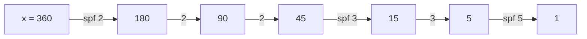

# Sieves

Precompute prime information for every number up to `N` once, then answer primality / factorization queries fast.

**Files:**
| File | Precomputes | Then |
|---|---|---|
| `sieve.cpp` | `bitset isPrime`, optional `primes` list (`initiate(true)`) | O(1) primality |
| `linear_sieve.cpp` (alias `LinearSieve`) | `spf[x]`, the smallest prime factor | `factorize(x)` in O(log x) for x ≤ N |
| `sieve_factorization.cpp` | uses `sieve`'s `primes` | `factorize(x)` for x ≤ N², O(π(√x)) |
| `divsum_sieve.cpp` | uses `linear_sieve` + `binary_exp` | sum of divisors of x, mod `mod` |
| `mobius_sieve.cpp` (alias `mobiusSieve`) | own `spf`, `mob[]` up to 1e6 | Möbius μ(x) in O(1) |

**Needs:** see the table (pasted automatically) · **Tests:** `../test_number_theory.cpp`

## Problems it solves
- Many primality or factorization queries on values ≤ 1e6 to 1e7: count divisors, distinct primes, gcd tricks.
- Multiplicative functions over a range (φ, μ, σ): see also `../phi_1_to_n.cpp`, `../mobius_1_to_n.cpp`.
- A single large number (≤ 1e12): sieve primes up to √x once (`sieve_factorization`), or trial division (`../factorize.cpp`).
- Counting coprime pairs and inclusion-exclusion over divisors: Möbius.

## API
```cpp
// sieve.cpp
initiate();          // or initiate(true) to also fill `primes`
isPrime[x];

// linear_sieve.cpp
initiate();
spf[x];  factorize(x);   // vector<pair<prime, exponent>>; spf[x] == x  <=>  x is prime (x >= 2)

// sieve_factorization.cpp   (set N to sqrt of the largest x)
initiate(true);  factorize(x);

// divsum_sieve.cpp
initiate();  divsum_sieve(x);

// mobius_sieve.cpp
initiate();  mob[x];
```

## Complexity
| | Build | Query | Memory |
|---|---|---|---|
| `sieve` | O(N log log N) | O(1) | N bits (+ primes) |
| `linear_sieve` (spf) | O(N log log N) | factorize O(log x) | N + 1 ints |
| `sieve_factorization` | sieve up to √X | O(√x / log x) | primes up to √X |
| `mobius_sieve` | O(N log N) | O(1) | 3 vectors of 1e6 + 1 |

## How it works
The sieve of Eratosthenes crosses out the multiples of every prime `p`, starting from `p²`. Smaller multiples
were already crossed out by a smaller factor. Keeping the *first* prime that crosses out `j` gives `spf[j]`, and
dividing by `spf[x]` repeatedly factorizes `x`.


`factorize(360)` = {(2, 3), (3, 2), (5, 1)}.

## Pitfalls and variants
- Every file has its own `N` (2e5, or 1e6 for `mobius_sieve`). Raise it to the problem's bound; memory grows linearly.
- Several files define `initiate()` and `N`. Paste only one sieve per solution, or rename. The `@needs` chain
  takes care of the dependencies: `divsum_sieve` reuses `linear_sieve`'s `factorize`.
- `linear_sieve.cpp` keeps the user's name. It is an spf sieve (Eratosthenes order), not the O(N) linear sieve.
- Segmented sieve (primes in [L, R] with R up to 1e12) is not in the library yet.

## Practice
- CSES: Counting Divisors, Common Divisors
- Codeforces 1295D (φ), SPOJ PRIME1 (segmented)
