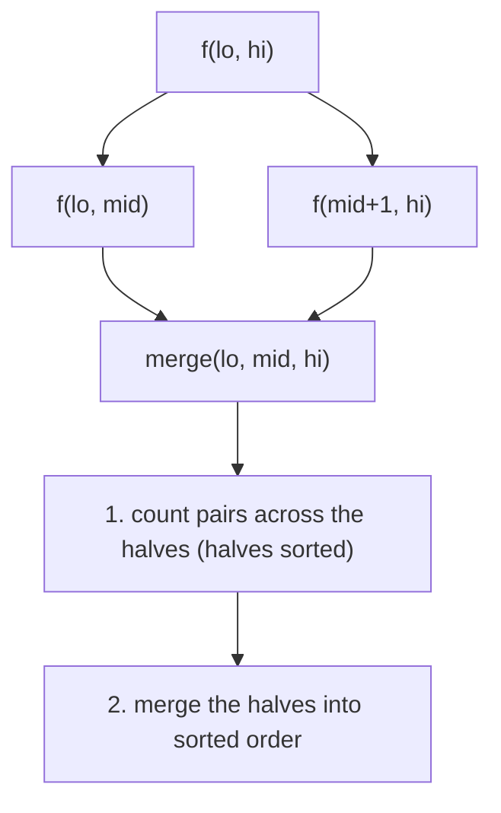

# Merge-sort counting

Counting pairs / inversions during merge sort (LeetCode). All six files share one skeleton: split `[lo, hi]` at
`mid`, solve both halves recursively, then in `merge(lo, mid, hi)` first **count** the pairs `(i, j)` with `i` in the
left half and `j` in the right half that satisfy the condition, and only then merge the two sorted halves. Every pair
`i < j` is separated at exactly one level of the recursion, so it is counted exactly once. Both halves are already
sorted when they are counted, so a monotone pointer (or a binary search) replaces the O(n^2) scan.

Generic cost: O(n log n) time (O(log n) levels, O(n) per level), O(n) extra space for the temporary merge buffer,
recursion depth O(log n). Use it when the condition relates an earlier element with a later element and depends on
their relative order (inversions, "smaller to the right", pairs with an offset). A Fenwick tree over compressed values
solves the same problems online; merge sort needs no coordinate compression. No test file: `python tools/check.py`
only compile-checks the snippets.

**Files:** see the groups below · **Needs:** none · **Tests:** none

## Files by pattern

- **Count pairs across the halves with one pointer (two sorted halves):** `reverse_pairs.cpp`, `number_of_pairs.cpp`
- **Count pairs with a binary search per element:** `count_range_sum.cpp`
- **Per-element counts (carry the index through the sort):** `count_smaller.cpp`, `create_sorted_array.cpp`,
  `good_triplets.cpp`

Three files (`create_sorted_array.cpp`, `good_triplets.cpp`, `number_of_pairs.cpp`) use a variable-length array
`int arr[hi - lo + 1]` as the merge buffer. That is a GCC extension (not standard C++) and uses stack space
proportional to the range; fine on the judges, but `std::vector` is the portable choice.

## Count pairs with a pointer

### `reverse_pairs.cpp`: reverse pairs
**Problem:** count pairs `i < j` with `nums[i] > 2 * nums[j]` (`int reversePairs(vector<int>&)`). LeetCode 493
(https://leetcode.com/problems/reverse-pairs/).
**Idea:** before merging, for each `j` in the right half advance `i` over the left half while `nums[i] <= 2 * nums[j]`.
Since the right half is sorted ascending, `2 * nums[j]` only grows, so `i` never moves back; the left elements from
`i` to `mid` all qualify (`mid - i + 1`). The product is `2ll * nums[j]` to avoid overflow.
**Complexity:** time O(n log n), extra space O(n).
**Pitfalls:** the count must be done before merging (after merging the halves are mixed). The result counts up to
n^2 / 2, which fits `int` for the LeetCode limit (5 * 10^4) but not for larger `n`.

### `number_of_pairs.cpp`: number of pairs satisfying inequality
**Problem:** count pairs `i < j` with `nums1[i] - nums1[j] <= nums2[i] - nums2[j] + diff`
(`long long numberOfPairs(vector<int>&, vector<int>&, int diff)`). LeetCode 2426
(https://leetcode.com/problems/number-of-pairs-satisfying-inequality/).
**Idea:** rearrange to `d[i] <= d[j] + diff` with `d = nums1 - nums2`, which is the reverse-pairs shape. For each `j` in
the right half the pointer `i` advances while `d[i] <= d[j] + diff`; the left elements before it all count.
**Complexity:** time O(n log n), extra space O(n).
**Pitfalls:** the count is `long long`. `diff` can be negative; the pointer logic still holds because `d[j] + diff`
grows with sorted `d[j]`.

## Count pairs with a binary search

### `count_range_sum.cpp`: count of range sum
**Problem:** count subarrays whose sum lies in `[lower, upper]` (`int countRangeSum(vector<int>&, int lower, int
upper)`). LeetCode 327 (https://leetcode.com/problems/count-of-range-sum/).
**Idea:** with prefix sums `P`, the sum of `nums[i..j]` is `P[j] - P[i-1]`, so count pairs of prefixes with
`lower <= P[j] - P[i] <= upper`. Subarrays starting at index 0 are counted directly while building `P`. In the merge,
for each `j` in the right half two binary searches in the sorted left half give the range of `P[i]` in
`[P[j] - upper, P[j] - lower]`.
**Complexity:** time O(n log^2 n) (a binary search per element per level; two pointers would give O(n log n)), extra
space O(n).
**Pitfalls:** prefix sums are `long long` (the sum overflows `int`). The `max<int>(0, R - L)` guard is for an empty
range. `n = 0` returns 0.

## Per-element counts

### `count_smaller.cpp`: count of smaller numbers after self
**Problem:** for each element the number of smaller elements to its right (`vector<int> countSmaller(vector<int>&)`).
LeetCode 315 (https://leetcode.com/problems/count-of-smaller-numbers-after-self/).
**Idea:** sort `(value, original index)` pairs in descending order. When the merge takes a left element `arr[i]`
because it is larger than `arr[j]`, every remaining right element is smaller too, so add `hi - j + 1` to
`ans[arr[i].second]`. Taking the right element on ties keeps equal values from counting.
**Complexity:** time O(n log n), extra space O(n).
**Pitfalls:** it is strictly smaller (equal values do not count). The index must travel with the value, because
the sort permutes the array.

### `create_sorted_array.cpp`: create sorted array through instructions
**Problem:** elements are inserted into a growing array one by one; inserting `x` costs `min(number of already inserted
elements strictly less than x, number strictly greater than x)`; return the total cost modulo `1e9 + 7`
(`int createSortedArray(vector<int>&)`). LeetCode 1649
(https://leetcode.com/problems/create-sorted-array-through-instructions/).
**Idea:** "already inserted" means an earlier index, so the left half of each merge holds the earlier elements. Sort an
index array `ind` by value. For each right-half element `j` count left elements with a smaller value (pointer `L`) and
with a larger value (pointer `R` skips values `<=`): store them in `mini[ind[j]]` and `maxi[ind[j]]`, accumulated over
all levels. The final answer sums `min(mini, maxi)` per element.
**Complexity:** time O(n log n), extra space O(n).
**Pitfalls:** equal values count for neither side (strict `<` for one pointer, `<=` for the other). The local `const int
mod` shadows the boilerplate's `mod`. The merge buffer is a variable-length array.

### `good_triplets.cpp`: count good triplets in an array
**Problem:** `nums1` and `nums2` are permutations of `0..n-1`; count triples of values that appear in the same order in
both arrays (`long long goodTriplets(vector<int>&, vector<int>&)`). LeetCode 2179
(https://leetcode.com/problems/count-good-triplets-in-an-array/).
**Idea:** replace each value of `nums1` by its position in `nums2`, so the problem becomes counting increasing triples
`a < b < c` in one sequence. For the middle element, `dp1` = number of smaller elements to its left and `dp2` = number
of larger elements to its right; the answer is `sum(dp1[v] * dp2[v])`. Both are counted during the merge, with a
pointer per direction, and stored by value (valid because it is a permutation).
**Complexity:** time O(n log n), extra space O(n).
**Pitfalls:** it overwrites `nums1` (the caller's array is sorted afterwards). Both arrays must be permutations (values
used as indices). The merge buffer is a variable-length array.
