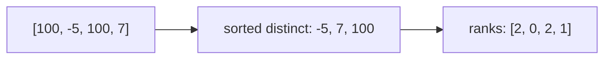

# Coordinate compression

Replace values by their rank among the distinct values, so large or negative values become indices `0..m-1` with the same order.

**Files:** `coordinate_compression.cpp` (statement-level, builds a lookup map), `compress_array.cpp` (function, compresses an array) · **Needs:** `coordinate_compression.cpp` uses `gp_hash_table` and `custom_hash` but declares no `@needs`: paste [`gp_hash_table`](../gp_hash_table.cpp) and [`custom_hash`](../custom_hash.cpp) first; `compress_array.cpp` needs nothing · **Tests:** `../test_misc_snippets.cpp` (`Misc.ArrayHelpersMatchBruteForce`)

## Problems it solves
- Values up to 1e9 (or negative) that must index a Fenwick tree, segment tree, DSU or array: "count inversions", "points in
  rectangles offline", "number of distinct values in a range".
- Statement signals: only the relative order of the values matters, n up to 2e5 but values up to 1e9 / 1e18.
- Not needed when values are already small (use them directly), or when an `unordered_map` of counts is enough and order does not matter.

## API
`compress_array.cpp` is a plain function:
```cpp
vector<int> compress_array(vector<int> &arr);   // result[i] = rank of arr[i] among the distinct values, 0-indexed; arr is not modified
```
`coordinate_compression.cpp` is statement-level and expects a `vector<int> coord` in scope holding the values (it sorts and dedups `coord` in place):
```cpp
// before pasting: vector<int> coord = ...;
// pastes: sort + unique on coord, int m = size(coord),
//         gp_hash_table<int, int, custom_hash> mp;   mp[coord[i]] = i;
mp[value];            // rank of value (a value that was never in coord is inserted with rank 0: do not query unknown values)
coord[rank];          // the original value back
```
Use `compress_array` when you only need the compressed array; use the other when you also look up ranks by value later or map back.

## Complexity
| Operation | Time | Memory |
|---|---|---|
| `compress_array` | O(n log n) (sort + one `lower_bound` per element) | O(n) |
| `coordinate_compression` build | O(n log n) for the sort, O(m) expected for the hash map | O(m) |
| rank lookup `mp[x]` | O(1) expected | |
| rank by `lower_bound` on `coord` | O(log m) | no hash map needed |

## How it works
Sort the values, drop duplicates, and the position in the sorted distinct list is the rank. `compress_array` finds each
rank by `lower_bound` in that list; `coordinate_compression` stores them in a hash map instead, so repeated lookups are O(1).
Ranks keep the order: `rank(a) < rank(b)` exactly when `a < b`, and equal values share a rank.



## Pitfalls and variants
- Compress queries together with the data when you need the order between them (offline problems): put all values into one vector first.
- `mp[x]` on a missing key inserts a default entry; use `mp.find` if the key may be absent.
- If you only need ranks of a few values, `lower_bound(all(coord), x) - coord.begin()` is simpler than a hash map and needs no pb_ds includes.
- To keep equal elements apart (rank by position, like a stable sort), compress pairs `{value, index}` instead.
- `compress_array` takes `vector<int>`: under the boilerplate that is `vector<long long>`.

## Practice
- CSES: [Distinct Values Queries](https://cses.fi/problemset/task/1734), [Salary Queries](https://cses.fi/problemset/task/1144) (compress offline, Fenwick)
- LeetCode: [1331. Rank Transform of an Array](https://leetcode.com/problems/rank-transform-of-an-array/)
