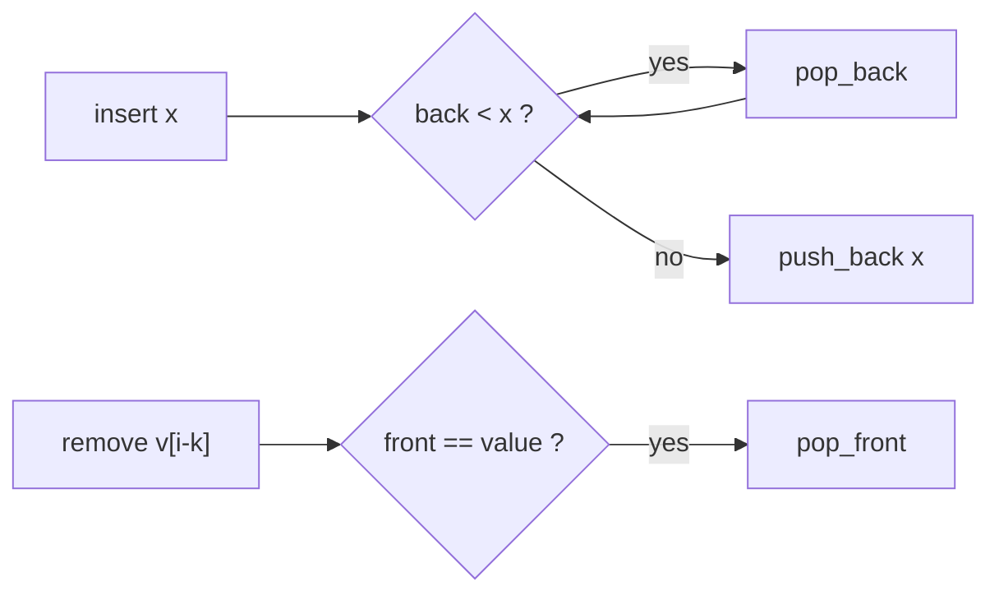

# Monotone deque (sliding window maximum / minimum)

A deque that keeps window values in monotone order, so the maximum (or minimum) of the current window is always at the front.

**Files:** `monotone_deque_max.cpp` (`getmax`), `monotone_deque_min.cpp` (`getmin`); both define a struct named `monotone_deque` · **Needs:** none · **Tests:** `../test_misc_snippets.cpp` (`Misc.ArrayHelpersMatchBruteForce`)

## Problems it solves
- "Maximum / minimum of every window of size k", "longest subarray with max - min <= limit" (one max deque and one min deque),
  DP transitions `dp[i] = best of dp[i-k..i-1] + cost` (bounded-range optimisation).
- Statement signals: fixed or two-pointer window sliding left to right, n up to 1e6, an O(n log n) multiset would be too slow.
- Not for arbitrary range queries (use [`sparse_table`](../../data_structure/sparse_table/README.md) or a segment tree), and not
  when you also need the k-th largest (use an ordered set).

## API
Paste **one** of the two files: both declare `struct monotone_deque`, so a max and a min deque in the same program need namespaces or renaming.
```cpp
monotone_deque<ll> d;     // template on the value type
d.insert(x);              // push x at the back, dropping every smaller (max file) / larger (min file) value first
d.remove(x);              // call with the value LEAVING the window; pops the front only if it equals x
d.getmax();               // monotone_deque_max.cpp: window maximum, INT_MIN when empty
d.getmin();               // monotone_deque_min.cpp: window minimum, INT_MAX when empty
```
Window of size k over `v`:
```cpp
for (int i = 0; i < n; i++) {
    d.insert(v[i]);
    if (i >= k) d.remove(v[i - k]);
    if (i >= k - 1) ans.push_back(d.getmax());
}
```
`insert` and `remove` take an `int` parameter (which is `long long` under the boilerplate's macro).

## Complexity
| Operation | Time | Memory |
|---|---|---|
| `insert` | O(1) amortised | O(k) deque |
| `remove` | O(1) | |
| `getmax` / `getmin` | O(1) | |

Every element is pushed once and popped at most once, so n operations cost O(n) in total.

## How it works
The deque holds a non-increasing sequence (max version): when `x` arrives, anything smaller at the back can never be the
maximum again (`x` is newer and at least as large), so it is popped. The front is therefore the maximum of the window.
Equal values are kept (the pop test is strict), which is what makes `remove(x)` correct with duplicates: it pops the front
only when the front equals the departing value, and a duplicate behind it takes over. The min file mirrors this with `>`.



## Pitfalls and variants
- `remove` must be called with exactly the value that leaves, once per departing element; calling it with another value does nothing.
- The empty-window sentinels are `INT_MIN` / `INT_MAX`, not the limits of `T`, so values beyond the `int` range need your own check.
- `insert(int x)` and `remove(int x)` are not templated on `T`: without `#define int long long`, a `monotone_deque<long long>` truncates its arguments.
- The data lives in the public member `q`; it stores values, not indices. If you need the argmax, keep a deque of indices instead (not in the library).
- Related: [`nge`/`nse`](../README.md) and [`monotonic_stack`](../../data_structure/monotonic_stack/README.md) use the same pop-while-worse idea for next-greater queries.

## Practice
- LeetCode: [239. Sliding Window Maximum](https://leetcode.com/problems/sliding-window-maximum/), [1438. Longest Continuous Subarray With Absolute Diff Less Than or Equal to Limit](https://leetcode.com/problems/longest-continuous-subarray-with-absolute-diff-less-than-or-equal-to-limit/)
- CSES: [Sliding Window Minimum](https://cses.fi/problemset/task/3221) (not verified: id from memory)
