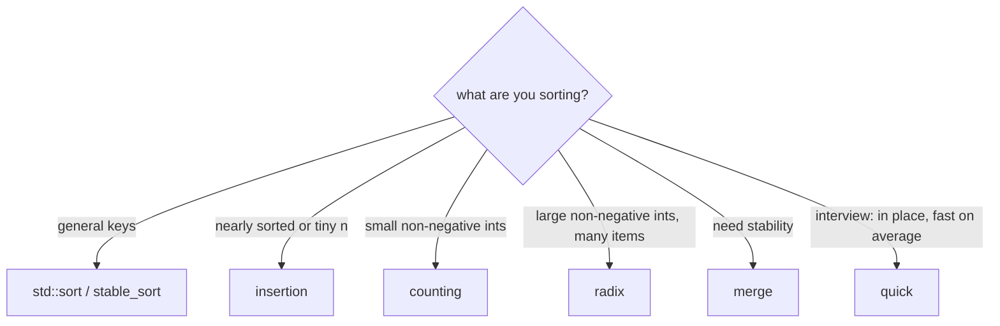

# Sorting algorithms

Textbook sorts written as statement-level lambdas over a vector `a` that is in scope. In a contest you almost always use
`sort(all(a))` (introsort, O(n log n) worst case); these exist for the interview-style "implement X" questions and for the
two non-comparison sorts, which beat `std::sort` on small integer keys.

**Files:** `bubble_sort.cpp`, `selection_sort.cpp`, `insertion_sort.cpp`, `merge_sort.cpp` (trigger `sorting_merge_sort`), `quick_sort.cpp`, `counting_sort.cpp`, `radix_sort.cpp` (old names `bubbleSort`, `selectionSort`, ... still work) · **Needs:** none · **Tests:** none

## Problems it solves
- "Implement merge sort / quicksort", "sort without `std::sort`", stability questions.
- Sorting small non-negative integers faster than comparison sorts: counting sort when the maximum is small, radix sort when
  values are large but have few digits.
- Not for contests with general keys: use `std::sort` or `std::stable_sort`.

## API
All sort the vector `a` in place; the lambdas capture it by reference. `merge_sort.cpp` also needs `n` in scope and ends by calling `mergeSort(0, n - 1)`.
```cpp
auto bubbleSort = [&]() -> void;          // sorts all of a
auto selectionSort = [&]() -> void;
auto insertionSort = [&]() -> void;
// merge_sort.cpp: lambda merge(lo, mid, hi) and function<void(int,int)> mergeSort(lo, hi); finishes with mergeSort(0, n - 1);
// quick_sort.cpp: lambda partition(lo, hi) and function<void(int,int)> quickSort(lo, hi); call quickSort(0, n - 1) yourself
auto countingSort = [&]() -> void;        // counting_sort.cpp also declares  vector<int> a = {4, 1, 2, 1};  (demo array: replace or delete)
auto radixSort = [&]() -> void;
```

## Complexity
| Algorithm | Best | Average | Worst | Extra space | Stable | In place |
|---|---|---|---|---|---|---|
| bubble | O(n²) | O(n²) | O(n²) | O(1) | yes | yes |
| selection | O(n²) | O(n²) | O(n²) | O(1) | no | yes |
| insertion | O(n) | O(n²) | O(n²) | O(1) | yes | yes |
| merge | O(n log n) | O(n log n) | O(n log n) | O(n) | yes | no |
| quick (first-element pivot) | O(n log n) | O(n log n) | O(n²) | O(log n) stack, O(n) worst | no | yes |
| counting | O(n + k) | O(n + k) | O(n + k) | O(k) | not applicable (rewrites plain values) | no |
| radix (LSD, base 10) | O(d·n) | O(d·n) | O(d·n) | O(n) | yes (each digit pass is stable) | no |

`k` is the maximum value (counting sort) and `d` the number of decimal digits of the maximum (radix sort).
Bubble sort here has **no early exit**, so a sorted array still costs O(n²); add a `swapped` flag for the O(n) best case.

## How it works
- **Bubble:** repeated adjacent swaps; after pass `i` the `i` largest elements are in place (the inner loop shrinks to `n - i`). The strict `>` keeps equal elements in order.
- **Selection:** find the minimum of the suffix and swap it to position `i`. At most n - 1 swaps, but the long-distance swap breaks stability.
- **Insertion:** shift larger elements right and drop `a[i]` into the gap. Cost is n plus the number of inversions, so it is fast on nearly sorted arrays and for tiny n.
- **Merge:** split in the middle, sort both halves recursively, merge with `a[i] <= a[j]` (left first on ties, hence stable). The temporary buffer is a stack array `int b[len]` (a VLA) per merge.
- **Quick:** the pivot is `a[lo]`. `partition` scans `i` from the left while `a[i] <= pivot` and `j` from the right while `a[j] > pivot`, swaps the pair, finally swaps the pivot into `a[j]` and returns that index; both sides are sorted recursively.
- **Counting:** count each value, then write the values back in order. Valid for `a[i] >= 0` only; memory is O(max).
- **Radix:** LSD: for base = 1, 10, 100, ... apply a stable counting sort on the digit `(x / base) % 10`, scanning the input right to left to keep stability. Non-negative values only.



## Pitfalls and variants
- **Quick sort pivot:** `a[lo]` makes a sorted, reverse-sorted or all-equal array hit O(n²) time and O(n) recursion depth (with all values equal `partition` returns `hi` every time). Randomise the pivot first (swap `a[lo]` with `a[uid(lo, hi)]`) before relying on it.
- **Merge sort:** `int b[len]` is a VLA (not standard C++, GCC accepts it) on the stack; a top-level merge of 1e6 `long long` is 8 MB, fine with the 256 MB judge stacks. `mergeSort` is a `std::function`, so every call costs more than a plain recursive function.
- **Counting / radix:** a negative value indexes out of bounds (`cnt[x]`); shift by the minimum first. Counting sort allocates `max + 1` counters, so a value of 1e9 is a memory blow-up.
- `counting_sort.cpp` declares its own `vector<int> a = {4, 1, 2, 1};` and `merge_sort.cpp` / `quick_sort.cpp` define lambdas called `merge` and `partition`, which clash with `std::merge` / `std::partition` at global scope: paste inside `main`.
- Sorted copies of `a` are not made: all of these overwrite `a`.

## Practice
- LeetCode: [912. Sort an Array](https://leetcode.com/problems/sort-an-array/) (merge, quick with random pivot, counting or radix), [75. Sort Colors](https://leetcode.com/problems/sort-colors/) (counting / partition)
