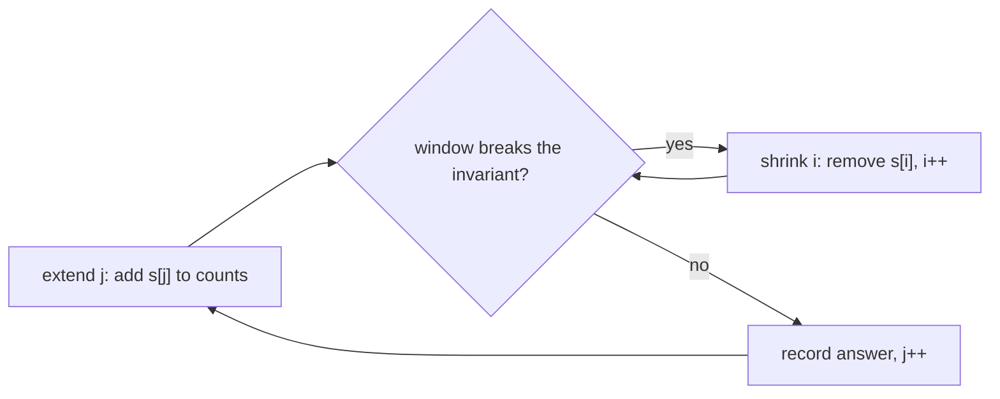

# Sliding window

Two-pointer window problems (LeetCode / Coding Ninjas): a window `[i, j]` over an array or string grows on the right
and shrinks on the left while an invariant (number of distinct values, character counts) is kept. Because `i` and `j`
only move forward, every problem is O(n) (times the cost of testing the invariant). Use it when the question is about
a contiguous range and the property is monotone: adding elements can only break it or only help, never both. The
fixed-size window maximum is in [`stack_queues/max_sliding_window.cpp`](../stack_queues/README.md). No test file:
`python tools/check.py` only compile-checks the snippets.

**Files:** see the groups below · **Needs:** none · **Tests:** none

## Files by pattern

- **At most / exactly K distinct values:** `longes_k_distinct_chars.cpp`, `subarrays_with_k_distinct.cpp`
- **Cover a pattern with the shortest window:** `min_window.cpp`

### `longes_k_distinct_chars.cpp`: longest substring with at most K distinct characters
**Problem:** the length of the longest substring of lowercase letters containing at most `k` distinct characters
(`int longesKDistinctChars(int k, string &s)`, the file name keeps the original typo). Coding Ninjas "Longest
Substring with At Most K Distinct Characters"
(https://www.codingninjas.com/studio/problems/longest-substring-with-at-most-k-distinct-characters_2221410).
**Idea:** `cnt[26]` and `distinct` describe the window `[i, j)`. While `distinct < k` take `s[j]`. When the window
already has `k` distinct letters, still take `s[j]` if it is one of them; otherwise shrink from the left until
`distinct` drops below `k`, then take it. The answer is the largest window seen.
**Complexity:** time O(n) (`i` and `j` each advance at most n times), extra space O(26).
**Pitfalls:** `k = 0` never terminates properly (the shrink loop runs `i` past the string); handle it before the
call. Only `'a'..'z'` are supported (index `s[j] - 'a'`). An empty string returns 0.

### `min_window.cpp`: minimum window substring
**Problem:** the shortest substring of `s` that contains every character of `t` with multiplicity, or `""`
(`string minWindow(string s, string t)`). LeetCode 76 (https://leetcode.com/problems/minimum-window-substring/).
**Idea:** `req[]` holds the needed counts of `t` (58 slots, `'A'..'z'`), `cnt[]` the counts in the window. Extend `j`;
while the window covers `t`, record it if shorter and shrink `i`. `check()` compares all 58 counters.
**Complexity:** time O(58 * n) = O(n) (each step calls the 58-wide `check`), extra space O(58). Tracking a "missing
characters" counter instead would make the check O(1).
**Pitfalls:** `m > n` returns `""` immediately. `t` must be non-empty: with `m = 0` the window is always "valid" and `i`
runs past `j`. Characters outside `'A'..'z'` (digits, spaces) index out of range. The result is the first shortest
window found.

### `subarrays_with_k_distinct.cpp`: subarrays with exactly K distinct integers
**Problem:** count the subarrays that contain exactly `k` different integers
(`int subarraysWithKDistinct(vector<int>&, int k)`). LeetCode 992
(https://leetcode.com/problems/subarrays-with-k-different-integers/).
**Idea:** "exactly k" is not monotone, "at most k" is. So `exactly(k) = atMost(k) - atMost(k - 1)`. `calc(k)` counts the
subarrays with at most `k` distinct values: for every right end `j`, shrink `i` until `distinct <= k`; then all
`j - i + 1` subarrays ending at `j` qualify.
**Complexity:** time O(n) (two linear passes), extra space O(n) for the counts.
**Pitfalls:** it first subtracts 1 from every element (values must lie in `1..n`) and so modifies the caller's vector.
`calc(0)` is valid and returns 0. Counts reach about n^2 / 2, so the result needs 64 bits for large `n` (fine under the
boilerplate's `#define int long long`).
