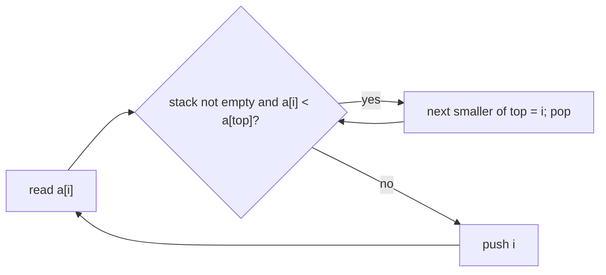
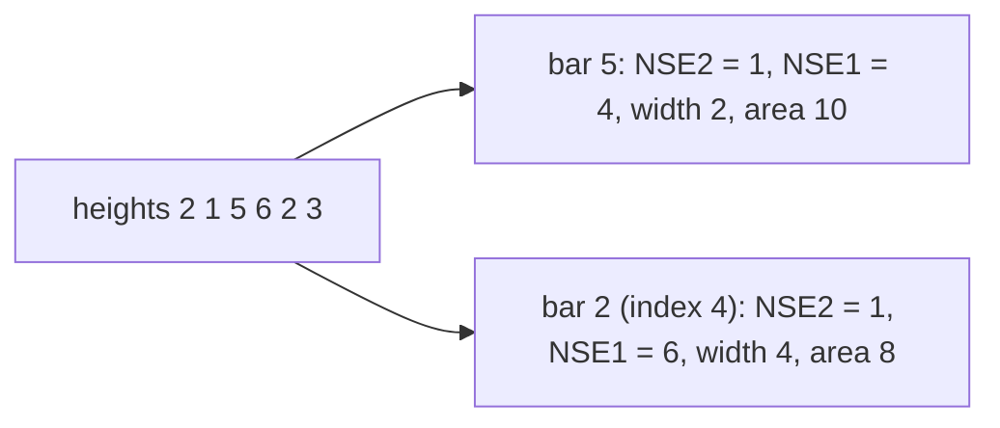

# Stacks and queues

LeetCode / GFG answers; they keep the judge's signatures (including GFG-style `n` parameters and `-1` for "empty").
Three ideas cover most of the folder: a **monotonic stack** (answers "next / previous smaller or greater" for every
element in O(n)), a **monotonic deque** (window maximum), and **building one structure out of another** (stack from
queues, queue from stacks, array and linked implementations). No test file: `python tools/check.py` only
compile-checks the snippets, so the reasoning below is from reading the code.

**Files:** see the groups below · **Needs:** none · **Tests:** none

## Files by pattern

- **Next / previous smaller (monotonic stack):** `next_and_second_next_smaller.cpp`, `sum_subarray_mins.cpp`,
  `subarray_ranges.cpp`, `remove_kdigits.cpp`
- **Bars and histograms:** `largest_rectangle_area.cpp`, `maximal_rectangle.cpp`, `trap_rain_water1.cpp`,
  `trap_rain_water2.cpp`
- **Stack as a tool:** `is_balanced.cpp`, `asteroid_collision.cpp`, `celebrity.cpp`, `min_stack1.cpp`, `min_stack2.cpp`
- **Window maximum (monotonic deque):** `max_sliding_window.cpp`
- **Implementations:** `stack_using_arrays.cpp`, `stack_using_linked_list.cpp`, `stack_using_queue.cpp`,
  `queue_using_arrays.cpp`, `queue_using_linked_list.cpp`, `queue_using_stack.cpp`

## The monotonic stack in one picture

Scan left to right keeping indices whose values are increasing. When `a[i]` is smaller than the top, `i` is the
*next smaller element* of the top, so pop it and record `i`; whatever is left below the new top is its *previous
smaller* element. Each index is pushed and popped once, so the whole scan is O(n).

## Next / previous smaller

### `next_and_second_next_smaller.cpp`: next and second next smaller element
**Problem:** for every index find the first smaller element to its right (`nxt`) and the second smaller element to
its right (`snxt`); `n` when there is none (a statement-level lambda `get()`, needs `n` and `a` in scope and returns
`pair<vector<int>, vector<int>>`). This is the "second next greater" LeetCode 2454 idea with the comparison flipped.
**Idea:** one stack of `(index, state)`. State 1 means "still waiting for its first smaller element", state 0 means
"first one found, waiting for the second". On `a[i]` pop every top that is larger: state 1 gets `nxt = i` and is set
aside, state 0 gets `snxt = i`. Then push `i` with state 1 and put the set-aside entries back (in their original
order, now with state 0) on top. The stack stays sorted by value because the set-aside entries are larger than `a[i]`.
**Complexity:** time O(n) (each index is pushed at most twice and popped at most twice), extra space O(n).
**Pitfalls:** strict comparison, so an equal element is not "smaller". Works on the caller's `n` and `a`, so it cannot
be pasted into a function that does not have them.

### `sum_subarray_mins.cpp`: sum of subarray minimums
**Problem:** sum of `min(subarray)` over all subarrays, modulo `1e9 + 7` (`int sumSubarrayMins(int n, vector<int>&)`).
LeetCode 907 (https://leetcode.com/problems/sum-of-subarray-minimums/).
**Idea:** contribution technique. For each `a[i]` find `NSE1[i]` (first strictly smaller to the right) and `NSE2[i]`
(first smaller-or-equal to the left). `a[i]` is the minimum of `(NSE1 - i) * (i - NSE2)` subarrays; sum
`a[i] * that`. The asymmetry (`<` on one side, `<=` on the other) gives each subarray exactly one "owner" among equal
minima.
**Complexity:** time O(n), extra space O(n) for the two arrays and the stack.
**Pitfalls:** the `<` / `<=` pair is essential with duplicates (using `<` on both sides counts a subarray twice). The
product is computed in `long long` before `% mod`. The code assumes non-negative values (negative values give a
negative remainder).

### `subarray_ranges.cpp`: sum of subarray ranges
**Problem:** sum of `max - min` over all subarrays (`long long subarrayRanges(int n, vector<int>&)`). LeetCode 2104
(https://leetcode.com/problems/sum-of-subarray-ranges/).
**Idea:** the sum of maxima minus the sum of minima, each by the contribution technique of the previous file.
It runs four stack passes (next smaller `<`, previous smaller `<=`, next greater `>`, previous greater `>=`) and adds
`a[i] * (greater span)` and subtracts `a[i] * (smaller span)`.
**Complexity:** time O(n), extra space O(n).
**Pitfalls:** spans are cast to `long long` before multiplying (answers reach about n^3 * max value). Tie rules must
be paired (strict on one side, non-strict on the other) for both the min and the max pass.

### `remove_kdigits.cpp`: remove k digits
**Problem:** remove `k` digits from a number string to make the smallest possible number (`string removeKdigits(string,
int k)`). LeetCode 402 (https://leetcode.com/problems/remove-k-digits/).
**Idea:** greedy with an increasing stack. While `k > 0` and the previous digit is larger than the current one, drop
the previous digit (a larger digit before a smaller one makes the number bigger). If digits remain to be removed
after the scan, drop from the end. Then strip leading zeros.
**Complexity:** time O(n), extra space O(n).
**Pitfalls:** if everything is removed or only zeros remain, return `"0"`. Leading zeros are stripped after removal.
`k >= n` yields `"0"`.

## Bars and histograms

### `largest_rectangle_area.cpp`: largest rectangle in a histogram
**Problem:** the area of the largest rectangle in a histogram of bar heights (`int largestRectangleArea(vector<int>&)`).
LeetCode 84 (https://leetcode.com/problems/largest-rectangle-in-histogram/).
**Idea:** the best rectangle of height `h[i]` extends over every neighbour at least as tall. Find `NSE1[i]` (next
strictly smaller to the right, default `n`) and `NSE2[i]` (previous strictly smaller on the left, default `-1`) with
two monotonic stack passes; the width is `NSE1 - NSE2 - 1`.

**Complexity:** time O(n), extra space O(n).
**Pitfalls:** the area `height * width` needs 64 bits for large inputs (it is fine under the boilerplate's
`#define int long long`). Equal heights are fine because both searches are strict. An empty histogram returns 0.

### `maximal_rectangle.cpp`: maximal rectangle of 1s in a binary matrix
**Problem:** the area of the largest rectangle containing only `'1'` in a matrix of chars (`int
maximalRectangle(vector<vector<char>>&)`). LeetCode 85 (https://leetcode.com/problems/maximal-rectangle/).
**Idea:** build the histogram row by row (`heights[j]++` on `'1'`, reset to 0 on `'0'`) and run the largest-rectangle
routine on each row.
**Complexity:** time O(rows * cols), extra space O(cols) (plus an unused `n x m` `dp` matrix, which makes the real
memory O(rows * cols)).
**Pitfalls:** an empty matrix reads `matrix[0]` (undefined behaviour). The file contains its own copy of
`largestRectangleArea` (same name as `largest_rectangle_area.cpp`) instead of `// @needs`.

### `trap_rain_water1.cpp`: trapping rain water, prefix and suffix maxima
**Problem:** how much water stays between bars of the given heights (`int trap(vector<int>&)`). LeetCode 42
(https://leetcode.com/problems/trapping-rain-water/).
**Idea:** the water above bar `i` is `min(tallest bar on the left, tallest on the right) - height[i]`, clamped at 0.
Precompute both maxima as arrays.
**Complexity:** time O(n), extra space O(n).
**Pitfalls:** the first and last bars hold no water (the loop skips them); for `n < 3` the answer is 0.

### `trap_rain_water2.cpp`: trapping rain water, two pointers
**Problem:** the same problem (`int trap(vector<int>&)`). LeetCode 42.
**Idea:** two pointers `l`, `r` and the running maxima `maxL`, `maxR`. Move the pointer at the smaller bar: its water
level is bounded by its own side's maximum because the other side is at least as tall.
**Complexity:** time O(n), extra space O(1).
**Pitfalls:** maxima start at 0, so heights must be non-negative. The `<=` tie-break is harmless.

## Stack as a tool

### `is_balanced.cpp`: balanced brackets
**Problem:** are the parentheses `()`, `{}`, `[]` in the string balanced and properly nested (`bool isBalanced(string)`)?
GFG "Parenthesis Checker"; LeetCode 20 (link not verified).
**Idea:** push every non-closing character; on a closing bracket the top must be its matching opener.
**Complexity:** time O(n), extra space O(n).
**Pitfalls:** any character that is not a closing bracket is pushed, so letters or digits make the answer false;
filter the input first if it can contain them. An empty string is balanced.

### `asteroid_collision.cpp`: asteroid collision
**Problem:** asteroids move on a line, positive to the right, negative to the left, equal speed; when two collide the
smaller one explodes (both when equal sizes); return the survivors (`vector<int> asteroidCollision(int n, vector<int>&)`).
LeetCode 735 (https://leetcode.com/problems/asteroid-collision/).
**Idea:** a stack of survivors. A negative asteroid collides only with positive ones on top: pop while the top is
smaller, stop (and destroy the newcomer, or both if equal) when the top is at least as large. Otherwise push.
**Complexity:** time O(n), extra space O(n).
**Pitfalls:** equal sizes destroy each other. Negatives that arrive on an empty stack or on a negative top just push
(they fly away left, never colliding).

### `celebrity.cpp`: the celebrity problem
**Problem:** in a party of `n` people, a celebrity is known by everyone and knows nobody; `M[i][j] = 1` means `i`
knows `j`. Find the celebrity or `-1` (`int celebrity(vector<vector<int>>&, int n)`). GFG "The Celebrity Problem" (link
not verified).
**Idea:** elimination. Pop two people `x`, `y`: if `x` knows `y`, `x` cannot be a celebrity, keep `y`; else if `y`
knows `x`, keep `x`; if neither knows the other, both are out. One candidate remains; verify its row is all zeros and
its column is all ones except the diagonal.
**Complexity:** time O(n) matrix reads for the elimination plus O(n) verification, extra space O(n) for the stack (two
pointers would make it O(1)).
**Pitfalls:** the verification is mandatory (the candidate only means "nobody else can be one"). Empty or fully
eliminated stack returns `-1`. The diagonal `M[i][i]` is expected to be 0.

### `min_stack1.cpp`: min stack with pairs
**Problem:** a stack with `push`, `pop`, `top` and `getMin`, all O(1) (`class MinStack`). LeetCode 155
(https://leetcode.com/problems/min-stack/).
**Idea:** each entry stores `{value, minimum of the stack up to it}`; the answer for `getMin` is the top's second field.
**Complexity:** every operation O(1), memory O(n) (two ints per element).
**Pitfalls:** `top` / `getMin` / `pop` on an empty stack are undefined (the judge never calls them).

### `min_stack2.cpp`: min stack with O(1) extra memory
**Problem:** the same interface, without a second value per element.
**Idea:** keep the current minimum `mini` in one variable and store an encoded value when a new minimum arrives:
`2 * val - mini` (which is smaller than `val`, hence smaller than the new `mini`). A stored value below `mini` is a
marker: the real top is `mini`, and popping it restores the previous minimum with `mini = 2 * mini - stored`.
**Complexity:** every operation O(1), extra memory O(1) beyond the one `long long` per element.
**Pitfalls:** the stack holds `long long` because the encoded value can leave the `int` range when `int` is 32-bit.
`pop` on an empty stack is ignored; `mini` is stale when the stack is empty (reset by the next `push`).

### `max_sliding_window.cpp`: sliding window maximum
**Problem:** the maximum of every window of `k` consecutive elements (`vector<int> maxSlidingWindow(vector<int>&, int
k)`). LeetCode 239 (https://leetcode.com/problems/sliding-window-maximum/).
**Idea:** a deque of values kept in decreasing order. Inserting `x` pops all smaller values from the back (they can never
be a maximum again), so the front is the window maximum. When the window slides, remove the leaving value only if it
equals the front.
**Complexity:** time O(n) (each element enters and leaves the deque once), extra space O(k).
**Pitfalls:** equal values are kept (pop only on strictly smaller), which makes removing by value correct with
duplicates. `k > n` returns an empty vector. The class `monotone_deque` is a second copy of the one in
[`miscellaneous/monotone_deque`](../miscellaneous/monotone_deque/README.md), which has the same name; paste only one.

## Implementations

### `stack_using_arrays.cpp`: stack with an array
**Problem:** implement `push` and `pop` of a stack on a fixed array (`class MyStack`). GFG "Implement Stack using
Array" (link not verified).
**Idea:** an array of 1000 ints and an index `top` (`-1` when empty); `pop` returns `-1` on an empty stack.
**Complexity:** `push`, `pop` O(1); memory fixed at 1000 ints.
**Pitfalls:** no overflow check: the 1001st push writes out of range.

### `stack_using_linked_list.cpp`: stack with a linked list
**Problem:** the same stack on singly linked nodes (`class MyStack`). GFG "Implement Stack using Linked List" (link not
verified).
**Idea:** push inserts at the head, pop removes the head and frees it; `-1` if empty.
**Complexity:** `push`, `pop` O(1); memory O(n).
**Pitfalls:** there is no destructor, so remaining nodes leak. `MyStack` publicly inherits `StackNode` only because
the GFG template does.

### `stack_using_queue.cpp`: stack with two queues
**Problem:** implement a stack using queues (`class QueueStack`, `push`, `pop`). GFG "Stack using two queues" (link
not verified); LeetCode 225.
**Idea:** `push` appends to `q1`. `pop` moves all but the last element of `q1` into `q2`, takes the last one, then
swaps the queues so `q2` becomes the main queue again.
**Complexity:** `push` O(1), `pop` O(n); memory O(n).
**Pitfalls:** `pop` on an empty stack returns `-1`. For a fast `top` or an O(1) pop, rotate a single queue on push
instead.

### `queue_using_arrays.cpp`: queue with an array
**Problem:** a queue on a fixed array (`class MyQueue`, `push`, `pop`). GFG "Implement Queue using Array" (link not
verified).
**Idea:** two indices, `front` and `rear`; push writes at `rear++`, pop reads at `front++`, `-1` when equal.
**Complexity:** O(1) per operation; memory 100005 ints.
**Pitfalls:** indices only move forward, so after 100005 pushes in total (not at a time) it overflows; a circular
buffer would fix that.

### `queue_using_linked_list.cpp`: queue with a linked list
**Problem:** a queue on linked nodes (`struct MyQueue`, `push`, `pop`). GFG "Implement Queue using Linked List" (link
not verified).
**Idea:** `front` and `rear` pointers; push appends at `rear`, pop advances `front`; `-1` when empty.
**Complexity:** O(1) per operation; memory O(n).
**Pitfalls:** popped nodes are never freed (leak), and `rear` keeps pointing at the last node after the queue
empties; it is harmless because the next push relinks from `front`.

### `queue_using_stack.cpp`: queue with two stacks
**Problem:** a queue from stacks (`class Queue`, `enqueue`, `dequeue`). GFG "Queue using two Stacks" (link not
verified); LeetCode 232.
**Idea:** `enqueue` pushes on `input`. `dequeue` moves all but the bottom element to `output`, takes the bottom
(the oldest element), then moves the rest back.
**Complexity:** `enqueue` O(1), `dequeue` O(n); memory O(n). The amortised O(1) version moves everything to `output`
only when it is empty and keeps it there.
**Pitfalls:** `dequeue` on an empty queue returns `-1`.
