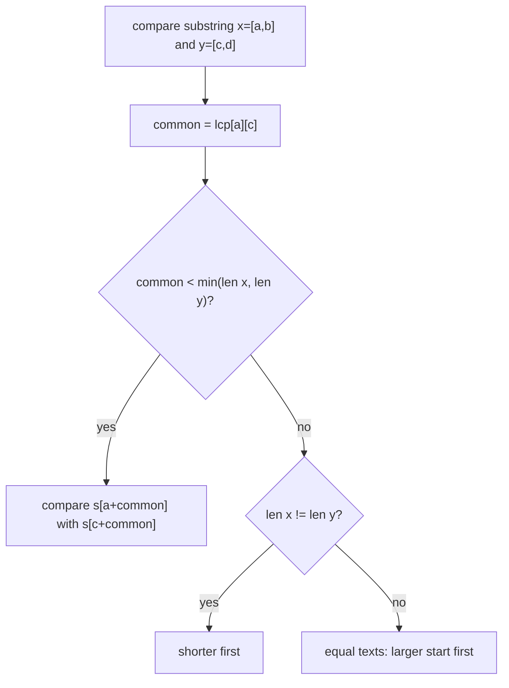

# LCP table and lexicographic substring order (`lcp`, `lexo_substring`)

The quadratic table `lcp[i][j]` = length of the longest common prefix of the suffixes starting at `i` and `j`, and a
sorting of all substrings that is built on top of it.

**Files:** `lcp.cpp` (trigger `lcp`, alias `LCP`: function `LCP`), `lexo_substring.cpp` (alias `Lexo_substring`: struct
`Lexo_substring`) · **Needs:** none (`lexo_substring` repeats the table-building loop of `lcp` instead of using `@needs lcp`) ·
**Tests:** `../test_strings.cpp` (`Strings.LcpLexoSubstringAndSuffixArray`)

## Problems it solves
- n up to about 2000-3000: "LCP of suffixes `i` and `j`" in O(1), longest common substring of two strings (concatenate with a
  separator), longest repeated substring, DP such as "longest common substring ending at `i` and `j`".
- Listing all substrings in lexicographic order for small n, or "k-th substring" with duplicates counted.
- Not for large n: memory is `(n + 1)^2` elements, and under `#define int long long` that is 8 bytes each (n = 3000 is
  about 72 MB). Use [`suffix_array/`](../suffix_array/README.md) (plus a linear LCP array) instead.

## API
```cpp
vector<vector<int>> lcp = LCP(n, s);         // s: string&, n = s.size(); (n + 1) x (n + 1), lcp[i][j] for 0 <= i, j < n

Lexo_substring L(n, s);                      // builds L.lcp and sorts every substring
L.substrings;                                // vector<pair<int,int>> of inclusive [first, second] ranges, sorted
```
Order of `substrings`: lexicographic by text; if one text is a prefix of another the shorter comes first; equal texts are
ordered by **later start index first**.

## Complexity
| Operation | Time | Memory |
|---|---|---|
| `LCP(n, s)` | O(n^2) | O(n^2) |
| `Lexo_substring` build | O(n^2 log n) | O(n^2) (table plus n(n+1)/2 pairs) |
| query `lcp[i][j]` | O(1) | |

Each comparison of two substrings is O(1) through the table; there are about n^2/2 substrings, so sorting costs
O(n^2 log n^2) = O(n^2 log n). The original comment in the code says `(n ^ 2)logn`.

## How it works
`lcp[i][j] = s[i] == s[j] ? 1 + lcp[i+1][j+1] : 0`, filled from the back (the extra row and column of zeros are the base case).
To compare substrings `(a, b)` and `(c, d)`: look at `common = lcp[a][c]`. If `common` is shorter than both lengths, the
characters at offset `common` decide. Otherwise one substring is a prefix of the other, so the shorter wins.



## Pitfalls and variants
- `n` is passed separately and must equal `s.size()`.
- The table is `(n + 1) x (n + 1)`; row and column `n` stay zero and are only the base case.
- The sort comparator is stored in a `std::function` (via class template deduction) and takes non-const references; it
  works but is slower than a plain lambda.
- Equal substrings (same text, different positions) both appear in `substrings`; the tie-break makes the order deterministic.
- `Lexo_substring` has no `@needs lcp` and copies the table loop: edit both when changing it.

## Practice
- [CSES Distinct Substrings](https://cses.fi/problemset/task/2105) (needs the suffix-array approach at n = 1e5, not this table)
- [LeetCode 718: Maximum Length of Repeated Subarray](https://leetcode.com/problems/maximum-length-of-repeated-subarray/) (same recurrence)
- (links typed from memory, not verified by opening them)
