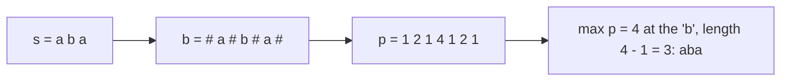

# Manacher and palindrome check

Manacher's algorithm computes the palindromic radius around every centre of a string in O(n). `is_palindrome` is the plain
two-pointer check for one string.

**Files:** `manacher.cpp` (trigger `manacher`, alias `Manacher`: class `Manacher`),
`is_palindrome.cpp` (alias `is_Palindrome`: function `is_Palindrome`) · **Needs:** none ·
**Tests:** `../test_strings.cpp` (`Strings.ManacherMatchesBruteForce`, `Strings.PalindromeHelpers`)

## Problems it solves
- Longest palindromic substring in O(n) (LeetCode 5), count all palindromic substrings (sum over centres), is `s[l..r]`
  a palindrome as an O(1) query after O(n) preprocessing.
- Palindrome partition style DP that needs "is `[l, r]` a palindrome" for all pairs: use `isPalindrome(l, r)` instead of an n² table.
- A single "is this string a palindrome" test: `is_Palindrome`.
- With updates to the string, use hashing with a Fenwick tree; with the shortest palindrome by prepending, see
  [`prefix_function/`](../prefix_function/README.md).

## API
```cpp
Manacher m(s);                 // s: string&; keeps a reference to s, so s must outlive m
m.Longest(center, odd);        // length of the longest palindrome centred at original index `center`
                               //   odd = 1: odd length, centred ON s[center]
                               //   odd = 0: even length, centred BETWEEN s[center] and s[center + 1]
m.getLongest();                // a longest palindromic substring (string)
m.isPalindrome(l, r);          // inclusive [l, r]: is s[l..r] a palindrome
m.p;                           // raw radii over the transformed string "#a#b#c#" (p[i] - 1 = palindrome length at i)

bool ok = is_Palindrome(s);    // two pointers, string&, true for the empty string
```

## Complexity
| Operation | Time | Memory |
|---|---|---|
| build `Manacher` | O(n) | O(n) (transformed string of length 2n + 1 and radii) |
| `Longest`, `isPalindrome` | O(1) | |
| `getLongest` | O(n) | O(length of the answer) |
| `is_Palindrome` | O(n) | O(1) |

The window `[l, r)` of the rightmost palindrome only moves right, and the `while` loop only extends past `r`, so total extension work is O(n).

## How it works
Insert `#` between characters so that every palindrome has odd length in the transformed string `b`. `p[i]` is the radius
of the palindrome centred at `b[i]` (counting the centre, so the original palindrome length is `p[i] - 1`). Keep the
palindrome `[l, r)` that reaches furthest right. For a new centre `i < r`, its mirror `l + r - i` already has a known
radius, so start from `min(r - i, p[mirror])` and only expand when the mirror palindrome touches the boundary.



`Longest(center, odd)` maps an original centre to the index `2*center + 1` (the character) or `2*center + 2` (the gap).

## Pitfalls and variants
- `Manacher` stores `string &a`: do not build it from a temporary, and do not modify `s` afterwards.
- `Longest(c, 0)` is the even palindrome between `c` and `c + 1` (0 when `c` is the last index).
- The class uses the `all` macro of the boilerplate (`getLongest`).
- `is_Palindrome` and the method names keep the original spelling (`getLongest`, `isPalindrome`).
- To count palindromic substrings: for every centre `i` of `b`, add `p[i] / 2` (rounded down) of the raw array `m.p`.

## Practice
- [CSES Longest Palindrome](https://cses.fi/problemset/task/1111)
- [LeetCode 5: Longest Palindromic Substring](https://leetcode.com/problems/longest-palindromic-substring/)
- [LeetCode 647: Palindromic Substrings](https://leetcode.com/problems/palindromic-substrings/)
- (links typed from memory, not verified by opening them)
