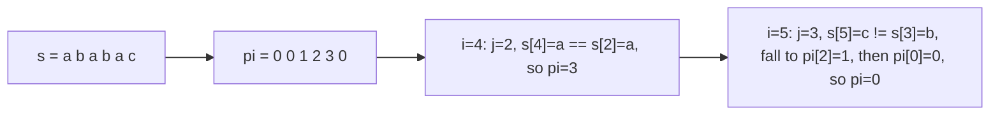

# Prefix function, KMP and shortest palindrome

The prefix function `pi[i]` is the length of the longest proper prefix of `s[0..i]` that is also a suffix of it. It gives
all borders, periods and pattern occurrences of a string in linear time.

**Files:** `prefix_function.cpp` (trigger `prefix_function`, alias `string_prefix_function`),
`kmp.cpp` (alias `string_kmp`), `shortest_palindrome.cpp` (alias `string_shortestPalindrome`) ·
**Needs:** `kmp` and `shortest_palindrome` need `prefix_function` (pasted automatically) · **Tests:** `../test_strings.cpp` (`Strings.PrefixFunctionKmpAndRabinKarp`, `Strings.PalindromeHelpers`)

## Problems it solves
- "Find every occurrence of pattern `t` in text `s`" with `|s|, |t|` up to 1e6 (CSES String Matching).
- Borders and periods: the smallest period of `s` is `n - pi[n-1]`; `s` is a repetition of a block iff that value divides `n`.
- "Longest prefix that is also a suffix" (LeetCode 1392), counting occurrences of every prefix, string compression.
- Shortest palindrome obtained by adding characters in front of `s` (LeetCode 214).
- Not for many different patterns at once (Aho-Corasick) and not for "does this substring equal that substring" queries
  on arbitrary ranges: use [`hashing/`](../hashing/README.md).

## API
```cpp
vector<int> pi = prefix_function(s);          // s: string&, pi.size() == s.size(), pi[0] == 0
vector<int> occ = kmp(s, t);                  // 0-indexed start positions of t in s, ascending, overlaps included
string r = shortestPalindrome(s);             // judge signature (by value): shortest palindrome of the form  x + s
```
`kmp(s, t)` assumes `t` is non-empty (an empty pattern is not handled). Both strings are taken by non-const reference.

## Complexity
| Operation | Time | Memory |
|---|---|---|
| `prefix_function` | O(n) | O(n) |
| `kmp(s, t)` | O(\|s\| + \|t\|) | O(\|t\|) plus the answer |
| `shortestPalindrome` | O(n) | O(n) |

The inner `while` only moves `j` down along fail links; `j` goes up at most once per character, so the total number of
decrements is bounded by the total number of increments (amortised O(n)).

## How it works
`pi[i]` is found from `pi[i-1]`. Let `j = pi[i-1]`: `s[0..j-1]` is a border of `s[0..i-1]`. If `s[i] == s[j]` that border
extends and `pi[i] = j + 1`. Otherwise try the next shorter border of `s[0..j-1]`, which is `pi[j-1]` (a border of a border
is a border), and repeat until `j == 0`. The chain `j -> pi[j-1] -> ...` is the set of fail links.



KMP runs the same loop over the text: `j` is the length of the longest prefix of `t` that ends at the current text
position. When `j == m` an occurrence ends at `i - 1`, it is recorded at `i - j`, and `j` falls back to `pi[m-1]` so
overlapping matches are found. On a mismatch `j` follows the fail link instead of moving `i` back.

`shortestPalindrome` builds `s + '?' + reverse(s)`. The last prefix-function value is the length of the longest prefix
of `s` that is a palindrome (the `?` stops a border from growing past `s`). The rest of `s` is reversed and put in front.

## Pitfalls and variants
- `shortestPalindrome` uses `'?'` as the separator, so it is wrong if `s` itself contains `'?'` (LeetCode only has lowercase letters).
- The matching string is taken first: `kmp(text, pattern)`.
- `pi[i]` is a length, so the border of `s[0..i]` ends at index `pi[i] - 1`.
- `prefix_function` and `kmp` take `string &`, so literals and temporaries do not bind; copy into a variable first.
- For one pattern against many texts or substring comparisons by range, hashing is easier; for exact worst-case guarantees prefer this folder.

## Practice
- [CSES String Matching](https://cses.fi/problemset/task/1753)
- [CSES Finding Borders](https://cses.fi/problemset/task/1732)
- [CSES Finding Periods](https://cses.fi/problemset/task/1733)
- [LeetCode 28: Find the Index of the First Occurrence in a String](https://leetcode.com/problems/find-the-index-of-the-first-occurrence-in-a-string/)
- [LeetCode 214: Shortest Palindrome](https://leetcode.com/problems/shortest-palindrome/)
- [LeetCode 1392: Longest Happy Prefix](https://leetcode.com/problems/longest-happy-prefix/)
- (links typed from memory, not verified by opening them)
